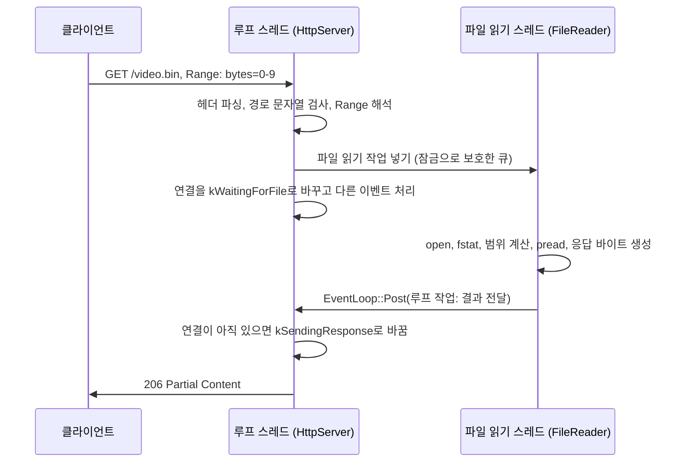
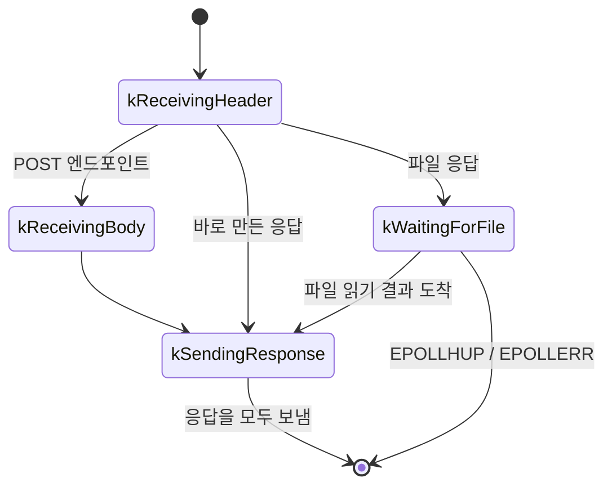

# Design

## Context

변경 이유는 proposal.md "Why"를 따른다. 요구 동작은 이 change의 `specs/http-server`를 따른다.

현재 상태:

- 서버는 단일 스레드 `core::EventLoop`(epoll) 위에서 돈다. 루프의 메서드는 `Run()`을 호출한 스레드에서만 호출할 수 있고, 다른 스레드가 루프에 무언가를 알리는 방법은 없다.
- `EventLoop::Create()`는 루프를 값으로 돌려주므로, 루프 객체는 등록을 시작하기 전에 한 번 이동한다. 등록 정보(`Registration`)는 힙에 있어 이동해도 주소가 바뀌지 않는다.
- `HttpServer`는 연결마다 `kReceivingHeader` → (`kReceivingBody`) → `kSendingResponse` 순서로 진행하고, 응답 하나를 보내면 연결을 닫는다. 연결은 소켓 fd를 키로 `connections_`에 둔다.
- GET 요청은 헤더를 파싱한 자리에서 응답 바이트를 만든다. 등록된 GET 엔드포인트면 핸들러를, 아니면 `BuildStaticFileResponse`를 호출한다.
- `BuildStaticFileResponse`는 루프 스레드에서 `ResolveStaticFilePath`(경로 검사와 `std::filesystem::status`)와 `ReadFileContent`(파일 전체 `read`)를 호출한다.
- 녹화 스레드(`recording::RecordingWriter`)는 잠금으로 보호한 `std::deque`와 `std::condition_variable`로 작업을 받는다. 녹화 스레드는 루프에 결과를 알리지 않는다.

## Goals / Non-Goals

**Goals:**

- HTTP 요청을 처리하는 동안 루프 스레드는 파일 시스템 호출(`open`, `stat`, `fstat`, `read`, `pread`)을 하지 않는다.
- 다른 스레드가 루프 스레드에서 실행할 작업을 넘기는 기능을 HTTP와 무관한 `core`의 기능으로 만든다. 다음 change의 녹화 스레드가 같은 기능을 쓴다.
- `Range` 헤더 해석과 범위 계산을 소켓·스레드 없이 단위 테스트할 수 있는 함수로 둔다.

**Non-Goals:**

- 루프 스레드와 파일 읽기 스레드 말고 범용 스레드 풀이나 작업 실행기를 만들지 않는다. 녹화 스레드와 파일 읽기 스레드는 작업 순서, 큐 정책, 실패 처리가 서로 다르므로 각자의 큐를 가진다.
- POST 핸들러와 GET 엔드포인트 핸들러의 실행은 이전처럼 루프 스레드에서 동기로 한다.

## Decisions

### 1. 구성 요소와 데이터 흐름

이 문서에서 쓰는 용어는 다음과 같다.

- **루프 스레드:** `EventLoop::Run()`을 호출해 epoll 이벤트와 타이머를 처리하는 스레드. 지금 서버의 메인 스레드다.
- **파일 읽기 스레드:** `HttpServer`가 만들고 소유하는 스레드 하나. 파일 읽기 작업을 들어온 순서대로 하나씩 실행한다.
- **파일 읽기 작업:** 파일 응답 하나를 만드는 데 필요한 정보. 파일 경로, `Content-Type`, `Range` 헤더 해석 결과, 그리고 결과를 돌려보낼 연결의 식별 정보(5절)를 담는다.
- **파일 읽기 결과:** 파일 읽기 스레드가 파일 읽기 작업 하나를 실행해 만든 결과. 응답 상태 코드와 소켓에 그대로 보낼 응답 바이트를 담는다.
- **파일 응답:** 정적 파일 요청과, 핸들러가 "이 파일을 보내라"를 돌려준 GET 엔드포인트 요청에 대한 응답. 둘 다 파일 읽기 스레드를 거친다.
- **루프 작업:** 다른 스레드가 `EventLoop::Post`로 넘겨 루프 스레드에서 실행되는 함수 객체.



새 코드와 바뀌는 코드는 다음과 같다.

| 파일 | 역할 | 실행 스레드 |
| --- | --- | --- |
| `core/event_loop.h/.cpp` | `Post`: 다른 스레드에서 루프 작업 넘기기 | `Post`는 아무 스레드, 루프 작업 실행은 루프 |
| `http/byte_range.h/.cpp` | `Range` 헤더 해석, 파일 크기에 맞춘 범위 계산 | 해석은 루프, 계산은 파일 읽기 |
| `http/file_reader.h/.cpp` | 파일 읽기 스레드와 작업 큐, 파일 읽기 작업 실행 함수 | 넣기는 루프, 실행은 파일 읽기 |
| `http/static_files.h/.cpp` | 요청 대상 → 웹 루트 안 경로(문자열 검사만) | 루프 |
| `http/http_request.h/.cpp` | `Range`, `If-Range` 헤더 값 보관 | 루프 |
| `http/http_response.h/.cpp` | `206`, `416` 상태 코드 | 공통 |
| `http/http_server.h/.cpp` | 연결 상태 `kWaitingForFile`, 파일 응답 경로, GET 핸들러의 파일 응답 | 루프 |

### 2. `EventLoop::Post`: eventfd와 잠금으로 보호한 작업 큐

```cpp
// 다른 스레드에서 호출해도 된다. task는 루프 스레드에서 실행된다.
void EventLoop::Post(std::move_only_function<void()> task);
```

- `Create()`가 eventfd(`EFD_NONBLOCK | EFD_CLOEXEC`)를 만들고 epoll에 등록한다. eventfd, 잠금(`std::mutex`), 루프 작업 목록(`std::vector`)은 힙에 둔 구조체(`PostedTaskQueue`) 하나에 담고 `EventLoop`가 `std::unique_ptr`로 소유한다.
  - 이유: `Create()`가 루프를 값으로 돌려주므로 `EventLoop` 객체는 이동한다. `std::mutex`는 이동할 수 없고, eventfd 핸들러가 캡처하는 주소도 바뀌면 안 된다. 힙에 두면 이동해도 주소가 그대로다.
- `Post`는 잠금을 잡고 루프 작업을 목록 끝에 넣은 뒤, 목록이 비어 있다가 처음 채워졌을 때만 eventfd에 1을 쓴다.
  - 이유: 루프가 목록을 비우기 전에 들어온 루프 작업은 같은 깨우기로 함께 처리되므로 eventfd 쓰기를 줄인다.
- eventfd가 읽기 가능해지면 루프 스레드의 핸들러가 eventfd를 읽어 0으로 되돌리고, 잠금을 잡은 채 목록을 지역 변수와 맞바꾼 뒤, 잠금을 풀고 루프 작업을 넣은 순서대로 실행한다.
  - 이유: 루프 작업을 실행하는 동안 잠금을 잡고 있지 않아야, 루프 작업 안에서 다시 `Post`를 불러도 교착되지 않는다.
  - 결과: 루프 작업 안에서 넣은 새 루프 작업은 이번 차례가 아니라 eventfd가 다시 읽기 가능해진 다음 반복에서 실행된다.
- 루프 작업은 epoll 이벤트 묶음 처리 안에서 실행된다. 다른 fd 핸들러와의 실행 순서는 epoll이 돌려준 순서를 따르며 보장하지 않는다.
- 수명 규칙: `Post`를 부르는 스레드는 `EventLoop`가 소멸하기 전에 끝나야 한다. `Run()`이 반환된 뒤 들어온 루프 작업과 아직 실행되지 않은 루프 작업은 `EventLoop`가 소멸할 때 실행하지 않고 파괴한다.

다른 방식으로 파이프(`pipe2`)를 검토했다. eventfd는 fd 하나로 충분하고 쓰기가 8바이트 카운터 더하기라서 eventfd를 쓴다. `Post`가 실패를 반환하지 않는 이유는 eventfd 쓰기가 실패하는 경우가 카운터 넘침(2^64−2)뿐이고, 처음 채워질 때만 쓰므로 일어나지 않기 때문이다. 쓰기가 `EAGAIN` 말고 다른 이유로 실패하면 표준 오류에 남기고 `std::abort()`한다.

### 3. 파일 읽기 스레드: `FileReader`

- `HttpServer`가 `FileReader`를 하나 만들어 소유한다. `FileReader`는 생성자에서 스레드 하나를 시작한다.
- 루프 스레드는 `FileReader::Push(파일 읽기 작업)`로 작업을 넣는다. 큐는 잠금으로 보호한 `std::deque`이고, 파일 읽기 스레드는 `std::condition_variable`로 기다린다. 작업 수에 상한은 두지 않는다(Risks 참고).
- 파일 읽기 스레드는 작업 하나를 꺼내 6절의 실행 함수로 파일 읽기 결과를 만들고, `EventLoop::Post`로 결과를 넘기는 루프 작업을 보낸다.
- 소멸자는 정지를 요청하고, 큐에 남은 작업은 실행하지 않고 버린 뒤, 실행 중인 작업이 끝나기를 기다려 스레드를 join한다.
  - 이유: 서버가 끝날 때 응답을 기다리는 클라이언트는 연결이 닫히므로, 남은 파일 읽기 작업을 실행해도 보낼 곳이 없다.
- 테스트를 위해 생성자는 파일 읽기 작업 실행 함수를 인자로 받을 수 있다. 기본값은 6절의 실제 실행 함수다. `HttpServer::Start`도 이 함수를 선택 인자로 받아 `FileReader`에 넘긴다.
  - 이유: "파일 읽기가 늦어지는 동안의 엔드포인트 요청" 시나리오를 시험하려면 파일 읽기를 테스트가 정한 시점까지 멈춰 둘 방법이 필요하다. 디스크를 실제로 느리게 만드는 방법은 테스트 환경에서 재현할 수 없다.

파일 읽기 스레드를 녹화 스레드와 따로 두는 이유:

- 녹화 스레드는 `--record-sync`초마다 `fdatasync`를 부르고, 이 호출은 수백 ms 걸릴 수 있다. 같은 스레드가 파일 읽기를 맡으면 그동안 파일 응답이 늦어진다.
- 파일 읽기 작업이 녹화 큐에 끼어들면 녹화 쓰기가 늦어져, 큐의 64MiB 상한에 걸려 GOP를 버리는 일이 늘어난다.

### 4. GET 핸들러의 파일 응답

GET 핸들러 반환형을 다음처럼 바꾼다.

```cpp
// 핸들러가 본문 대신 보낼 파일
struct HttpFileResponse {
    std::filesystem::path path;   // 보낼 파일. 핸들러가 경로 안전성을 확인한 값이어야 한다.
    std::string content_type;
};

using HttpGetResult = std::variant<HttpEndpointResponse, HttpFileResponse>;
using HttpGetHandler = std::move_only_function<HttpGetResult(const HttpRequest& request)>;
```

- `HttpEndpointResponse`를 반환하면 이전처럼 그 자리에서 응답한다. 기존 핸들러는 `HttpEndpointResponse`를 반환하므로 `std::variant`로 암시 변환되어 코드를 바꾸지 않아도 된다.
- `HttpFileResponse`를 반환하면 서버가 정적 파일과 같은 파일 응답 경로(5절)로 처리한다. `Range`도 같은 규칙으로 처리한다.
- 정적 파일 요청은 서버가 내부에서 `HttpFileResponse{웹 루트 안 경로, 확장자로 정한 Content-Type}`을 만들어 같은 경로로 넘긴다.

다른 방식으로 핸들러에 "나중에 응답할 객체"(응답 콜백)를 넘기는 범용 지연 응답을 검토했다. 지금 오래 걸리는 일은 파일 읽기뿐이고, 범용 지연 응답을 두면 핸들러마다 자기 스레드와 연결 수명 확인을 직접 다뤄야 한다. 파일 응답만 서버가 맡으면 스레드와 연결 수명 처리가 서버 한곳에 모인다. 다른 종류의 지연 응답이 필요해지면 그때 범용 방식을 다시 검토한다.

### 5. 연결 상태와 결과 전달

연결 상태에 `kWaitingForFile`을 더한다.



- `kWaitingForFile`에서는 감시 이벤트를 0으로 바꾼다. epoll은 감시 이벤트와 관계없이 `EPOLLHUP`과 `EPOLLERR`를 전달하므로, 클라이언트가 RST를 보내 연결을 끊으면 루프 스레드가 연결을 바로 닫는다. 이미 넣은 파일 읽기 작업은 취소하지 않고, 결과가 도착했을 때 버린다.
- 클라이언트가 `close()`나 `shutdown(SHUT_WR)`로 FIN만 보내면 서버 소켓에는 `EPOLLIN`과 `EPOLLRDHUP`만 생기므로, 감시 이벤트가 0인 동안 루프 스레드는 연결을 닫지 않는다. 결과가 도착하면 루프 스레드가 응답을 보내고, 송신이 실패하거나 응답을 다 보내면 연결을 닫는다. FIN만으로는 클라이언트가 응답을 더 받지 않는 `close()`인지, 응답을 기다리는 반쯤 닫힘인지 서버가 구별할 수 없으므로 FIN을 받아도 응답을 보낸다.
- 연결 식별: 연결마다 1부터 늘어나는 연결 번호(`std::uint64_t`)를 주고, 파일 읽기 작업에 소켓 fd와 연결 번호를 함께 담는다. 결과가 도착하면 `connections_`에서 fd를 찾고 연결 번호가 같고 상태가 `kWaitingForFile`인지 확인한다. 다르면 결과를 버린다.
  - 이유: 연결이 닫힌 뒤 같은 fd 번호가 새 연결에 다시 쓰일 수 있다. fd만으로 찾으면 다른 클라이언트에게 응답을 보낸다.
- 서버 수명 확인: `HttpServer`는 루프 스레드에서만 쓰는 수명 표시(`std::shared_ptr<char>`)를 가진다. 결과를 넘기는 루프 작업은 이 수명 표시의 `std::weak_ptr`과 서버 주소를 캡처하고, 실행할 때 `weak_ptr`이 만료되었으면 아무것도 하지 않는다.
  - 이유: `HttpServer`가 소멸한 뒤에도 루프의 작업 목록에 결과 전달 루프 작업이 남아 있을 수 있다. `HttpServer` 소멸과 루프 작업 실행은 둘 다 루프 스레드에서 일어나므로, 루프 작업이 `weak_ptr`을 확인하는 시점과 서버가 소멸하는 시점은 겹치지 않는다. 파일 읽기 스레드는 `weak_ptr`을 복사만 하며, 복사는 여러 스레드에서 해도 안전하다.
- 요청 로그(`메서드 대상 상태코드`)는 결과가 도착해 응답을 보내기 시작할 때 루프 스레드에서 남긴다. 결과를 버린 요청은 로그를 남기지 않는다.

`HttpServer` 소멸 순서:

1. `FileReader`를 파괴한다. 남은 작업을 버리고 실행 중인 작업이 끝나기를 기다린다.
2. 수명 표시를 파괴한다. 이후 실행되는 결과 전달 루프 작업은 아무것도 하지 않는다.
3. 이전처럼 모든 소켓의 루프 등록을 해제하고 닫는다.

`FileReader`가 `HttpServer`의 다른 멤버보다 먼저 소멸해야 하므로 멤버 선언 순서로 보장한다(마지막에 선언).

### 6. 파일 읽기 작업 실행

파일 읽기 스레드에서 실행하는 함수는 파일 읽기 작업 하나로 파일 읽기 결과 하나를 만든다. 소켓과 루프에 접근하지 않으므로 이 함수만 따로 단위 테스트한다.

1. `open(path, O_RDONLY | O_NONBLOCK | O_CLOEXEC)`
   - `ENOENT`, `ENOTDIR`이면 `404`. 경로 검사 뒤 파일이 지워진 경우다.
   - 그 밖의 오류(`EACCES` 등)는 원인을 표준 오류에 남기고 `500`.
   - `O_NONBLOCK`을 쓰는 이유: 웹 루트 안에 FIFO가 있으면 `O_RDONLY`만으로 열 때 쓰는 쪽이 생길 때까지 `open`이 끝나지 않아 파일 읽기 스레드가 멈춘다. 일반 파일에는 `O_NONBLOCK`이 영향을 주지 않는다.
2. `fstat`으로 일반 파일인지 확인한다. 디렉터리나 FIFO 등이면 `404`.
3. 7절의 범위 계산으로 응답할 범위를 정한다. 범위가 없으면 파일 전체다. 만족할 수 없는 범위면 `416`.
4. `pread`를 응답할 바이트 수만큼 반복해 읽는다. 읽기 오류는 원인을 남기고 `500`. 파일이 `fstat` 뒤 줄어들어 예상보다 일찍 끝(0바이트 읽기)에 닿아도 `500`으로 처리한다.
5. `BuildResponse`로 상태 줄, 헤더, 본문을 이어 붙인 응답 바이트를 만든다. `200`과 `206`에는 `Accept-Ranges: bytes`를, `206`과 `416`에는 `Content-Range`를 넣는다.

- 응답 바이트를 파일 읽기 스레드에서 만드는 이유: 본문을 응답 바이트로 한 번 더 복사하는 일을 루프 스레드에서 하지 않기 위해서다. 루프 스레드는 받은 응답 바이트를 보내기만 한다.
- 경로 확인: 정적 파일은 루프 스레드에서 문자열 검사만 한다(`/`로 시작하는지, `..` 구성 요소가 없는지, `/` → `/index.html`). 파일이 있는지와 일반 파일인지는 1·2단계에서 확인한다. 그래서 `ResolveStaticFilePath`는 `std::filesystem::status`를 부르지 않도록 바뀌고, 반환하는 오류는 `kBadRequest`와 `kForbidden`만 남는다.
- 파일을 지우는 다른 스레드와는 잠금을 쓰지 않는다. Linux에서는 이미 연 fd로 `unlink` 뒤에도 끝까지 읽을 수 있으므로, 1단계 뒤에 파일이 지워져도 응답은 온전하다.

### 7. `Range` 해석과 범위 계산

두 단계로 나눈다. 해석은 파일 크기 없이 할 수 있고, 계산은 `fstat` 뒤에만 할 수 있기 때문이다.

- **해석(루프 스레드, 헤더 파싱 직후):** `Range` 헤더 문자열을 `ByteRangeSpec`(시작·끝 위치 또는 마지막 n바이트) 하나로 바꾼다. 다음 경우에는 범위가 없는 것으로 보고 파일 전체를 보낸다(명세 "범위 요청 무시").
  - 단위가 `bytes`가 아님, 범위가 둘 이상(쉼표), 숫자가 아니거나 `uint64` 범위를 넘음, 끝 위치가 시작 위치보다 작음
  - 요청에 `If-Range`가 있음. 서버는 `ETag`와 `Last-Modified`를 보내지 않으므로 `If-Range` 값이 현재 파일과 같은지 판단할 수 없다. RFC 9110은 이때 파일 전체를 보내도록 허용한다.
  - `Range` 헤더가 여러 번 옴. `ParseRequestHeader`가 이 경우 `Range` 값을 비우고 표시만 남긴다.
- **계산(파일 읽기 스레드, `fstat` 뒤):** `ByteRangeSpec`과 파일 크기로 (시작 위치, 바이트 수)를 정한다.
  - `a-b`: 시작 a, 끝 min(b, 크기−1). a ≥ 크기면 만족할 수 없음
  - `a-`: 시작 a, 끝 크기−1. a ≥ 크기면 만족할 수 없음
  - `-n`: 시작 max(0, 크기−n), 끝 크기−1. n = 0이거나 크기가 0이면 만족할 수 없음

`bytes=0-` 같은 범위가 파일 전체를 가리켜도 `206`으로 응답한다. RFC 9110이 이를 허용하고, 재생기는 `206`과 `Content-Range`를 보고 파일 크기를 알 수 있다.

## Risks / Trade-offs

- [파일 읽기 스레드가 하나라서, 캐시에 없는 큰 파일을 읽는 동안 다른 파일 응답이 기다림] → 지금 제공하는 파일은 웹 페이지 몇 개이고, 다음 change의 녹화 조각 요청은 GOP 하나(약 1초, 수백 KB~수 MB)씩이다. 기다림이 문제가 되면 스레드 수를 늘린다. 작업끼리 독립적이므로 큐 구조는 그대로 쓸 수 있다.
- [범위 없이 큰 파일을 요청하면 파일 전체를 메모리로 읽음] → 녹화 파일 하나(60초, 2Mbps 기준 약 15MB) 정도는 받아들인다. 큰 파일을 범위 없이 받는 클라이언트가 생기면 응답을 나눠 읽어 보내는 방식(스트리밍)을 더한다.
- [파일 읽기 작업 수에 상한이 없음] → 연결 하나에 작업은 하나뿐이므로 작업 수는 열린 연결 수를 넘지 않는다. 연결 수 상한은 이 change의 범위 밖이다.
- [`kWaitingForFile`에서 클라이언트가 `close()`나 `shutdown(SHUT_WR)`로 FIN만 보내면 서버가 결과가 도착할 때까지 연결을 닫지 않음] → `EPOLLHUP`은 연결의 양방향이 모두 닫히거나 RST를 받아야 생기며, FIN 하나로는 생기지 않는다. 클라이언트가 이미 소켓을 닫았다면 서버가 보낸 응답에 클라이언트 커널이 RST로 답하고, 루프 스레드는 그 뒤의 송신이 실패할 때 연결을 닫는다. 그때까지 파일 읽기 결과를 만드는 비용과 RST 전에 보낸 응답 바이트는 낭비된다.
- [`Post`를 부르는 스레드가 `EventLoop`보다 오래 살면 해제된 메모리에 접근함] → 2절의 수명 규칙을 `EventLoop` 주석에 적는다. `FileReader`는 `HttpServer` 안에서 소멸하므로 규칙을 지킨다.

## 향후 개선

- 파일 읽기 스레드 수 늘리기
- 큰 응답의 스트리밍(파일을 조각씩 읽어 소켓 송신 속도에 맞춰 보내기)
- `sendfile`로 페이지 캐시에서 소켓으로 바로 보내기(캐시에 있는지 확인한 뒤에만)
- keep-alive
- `ETag`, `Last-Modified`, 조건부 요청, `HEAD`
