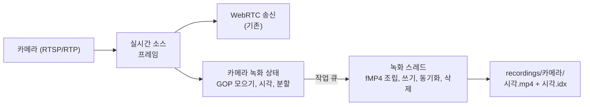

# Background

## 읽는 순서

1. 이 문서의 "전체 흐름"과 "H.264 프레임과 GOP"를 먼저 읽는다.
2. `proposal.md`에서 범위를 확인한다. 특히 범위 밖 항목(재생, 녹화 중지, 해상도 변경)을 본다.
3. 이 문서의 "MP4와 fMP4", "시각"을 읽은 뒤 `specs/camera-recording`의 "녹화 파일 형식", "파일 분할과 이름", "프레임 시각"을 읽는다.
4. 이 문서의 "디스크에 안전하게 쓰기"와 "체크섬"을 읽은 뒤 나머지 요구사항(색인, 동기화, 보관, 비상 삭제, 복구)을 읽는다.
5. 이 문서의 "스레드와 작업 큐"를 읽은 뒤 `design.md`, `tasks.md`를 읽는다.

이 change에서 서버는 이미 받고 있는 카메라 프레임을 디스크에도 남긴다. 프레임은 GOP 단위로 모아 fMP4 조각으로 만들고, 1분 단위 파일에 이어 붙인다. 디스크 작업은 영상 전달을 막지 않도록 다른 스레드가 맡는다. 서버가 갑자기 꺼져도 다시 켤 때 체크섬으로 믿을 수 있는 데까지만 남긴다. 디스크를 무한히 쓰지 않도록 오래된 파일을 지운다.

## 개념

### 전체 흐름



### H.264 프레임과 GOP

**키프레임(IDR 프레임)**
- 정의: 앞 프레임 없이 혼자 디코딩할 수 있는 프레임이다. 이 프로젝트에서는 SPS, PPS, IDR 슬라이스를 모두 가진 프레임을 키프레임이라고 부른다.
- 왜 필요한가: 다른 프레임(P 프레임)은 바로 앞 프레임과의 차이만 담는다. 재생을 시작하거나 탐색하려면 키프레임에서 시작해야 한다.
- 동작: vms-cam 기본값은 30fps에 키프레임 간격 30프레임이라서, 1초마다 키프레임이 하나 온다.
- 쓰이는 곳: `camera-recording` "녹화 시작과 중단", "파일 분할과 이름"

**GOP(Group of Pictures)**
- 정의: 키프레임 하나와 그 뒤 다음 키프레임 직전까지의 프레임 묶음이다.
- 왜 필요한가: GOP 하나는 혼자 디코딩할 수 있는 가장 작은 단위다. 이 단위로 저장하면 어느 GOP에서든 재생을 시작할 수 있다.
- 동작: 1초 간격 키프레임, 30fps면 GOP 하나는 프레임 30개(약 1초, 2Mbps면 약 250KB)다.

  ```text
  프레임:  K P P P ... P | K P P P ... P | K ...
           <--- GOP 1 --->  <--- GOP 2 --->
  ```

- 쓰이는 곳: fMP4 조각 하나가 GOP 하나다(`camera-recording` "녹화 파일 형식", `design.md` 결정 4·5).

**SPS·PPS**
- 정의: 해상도, 프로파일, 엔트로피 부호화 방식 같은 디코더 설정을 담은 NAL 단위다. SPS는 Sequence Parameter Set, PPS는 Picture Parameter Set의 줄임말이다.
- 왜 필요한가: 디코더는 이 설정 없이 슬라이스를 해석할 수 없다.
- 동작: SPS 첫 바이트 뒤 3바이트는 `profile_idc`, 제약 플래그, `level_idc`다. 예를 들어 `42 C0 1F`는 Constrained Baseline, 레벨 3.1이다.
- 쓰이는 곳: fMP4 초기화 구간의 `avcC`(`design.md` 결정 5)

**Annex-B와 길이 접두(AVCC) 형식**
- 정의: NAL 단위를 이어 붙이는 두 가지 방식이다.
  - Annex-B: 각 NAL 앞에 시작 코드 `00 00 01`을 붙인다. 접근 단위의 첫 NAL과 SPS·PPS 앞에는 `00`을 하나 더 붙여 `00 00 00 01`로 쓰는 것이 보통이므로, 읽는 쪽은 두 길이를 모두 처리해야 한다.
  - AVCC: 각 NAL 앞에 그 NAL의 바이트 길이를 붙인다.
- 왜 필요한가: MP4는 길이 접두 형식을 쓴다. 기존 `.h264` 파일은 Annex-B다.
- 동작: 길이가 5바이트인 NAL `65 88 84 00 33`은 이렇게 저장된다.

  ```text
  Annex-B: 00 00 00 01 65 88 84 00 33
  AVCC   : 00 00 00 05 65 88 84 00 33   (4바이트 빅 엔디언 길이)
  ```

- 쓰이는 곳: 조각의 `mdat`(`design.md` 결정 5)

### MP4와 fMP4

**ISO BMFF 상자(box)**
- 정의: MP4 파일을 이루는 단위다. `[크기 4바이트][종류 4글자][내용]` 구조이며, 상자 안에 상자가 들어갈 수 있다.
- 왜 필요한가: 파일을 처음부터 순서대로 읽지 않아도 크기만 보고 원하는 상자로 건너뛸 수 있다.
- 동작: 크기가 24바이트인 `ftyp` 상자는 이렇게 생겼다.

  ```text
  00 00 00 18  66 74 79 70  69 73 6F 36  00 00 00 00  69 73 6F 6D  61 76 63 31
  [크기 24]    [f t y p]    [major iso6] [버전 0]     [isom]       [avc1]
  ```

- 쓰이는 곳: `design.md` 결정 5의 상자 목록

**일반 MP4와 fragmented MP4(fMP4)**
- 정의
  - 일반 MP4: 모든 프레임의 위치와 시각 표(`moov` 안의 `stbl`)를 파일 하나에 한꺼번에 둔다.
  - fMP4: 앞에 코덱 정보만 두고, 프레임은 작은 조각마다 자기 표를 붙여 이어 쓴다.
- 왜 필요한가: 일반 MP4는 녹화가 끝나야 표를 완성할 수 있다. 녹화 중에 꺼지면 표가 없어 파일 전체를 못 쓴다. fMP4는 조각을 쓸 때마다 그 조각까지가 완전한 파일이다.
- 동작

  ```text
  일반 MP4: [ftyp][mdat: 모든 프레임 .................][moov: 전체 표]  <- 끝나야 쓸 수 있음
  fMP4    : [ftyp][moov: 코덱만][moof][mdat][moof][mdat][moof][mdat]... <- 계속 덧붙임
             <--- 초기화 구간 ---><-- 조각 --><-- 조각 -->
  ```

- 쓰이는 곳: `camera-recording` "녹화 파일 형식", `design.md` 결정 5

**초기화 구간(`ftyp` + `moov`)**
- 정의: 파일 맨 앞의 코덱 설정 부분이다.
- 동작: `moov` 안에는 이런 정보가 들어간다.
  - 트랙 하나, 시간 단위(`mdhd` timescale), 해상도(`tkhd`)
  - SPS·PPS를 담은 `avcC`
  - 조각을 쓴다는 표시(`mvex`/`trex`)
  - 프레임 표(`stts`, `stsz` 등)는 비어 있다.
- 쓰이는 곳: `design.md` 결정 5

**샘플과 샘플 엔트리(`avc1`·`avc3`)**
- 정의
  - 샘플: MP4가 시각 하나에 대응시키는 미디어 데이터 단위다. 영상 트랙에서는 프레임 하나가 샘플 하나다.
  - 샘플 엔트리: 초기화 구간의 `stsd`(sample description) 상자 안에 있는 항목이다. 트랙의 샘플을 디코딩하는 방법, 즉 코덱 종류, 해상도, 디코더 설정을 적는다. 항목의 4글자 이름이 코덱 종류를 나타낸다.
- 왜 필요한가: 디코더는 샘플을 읽기 전에 어떤 코덱인지, 디코더를 어떤 설정으로 초기화할지 알아야 한다.
- 동작: H.264의 샘플 엔트리는 SPS·PPS를 두는 곳에 따라 두 가지다.

  | 샘플 엔트리 | SPS·PPS를 두는 곳 |
  | --- | --- |
  | `avc1` | 초기화 구간의 `avcC`에만 둔다. 조각의 샘플 데이터에는 넣지 않는다 |
  | `avc3` | `avcC`에 더해, 조각의 샘플 데이터 안에도 넣을 수 있다 |

  `avc1`이면 디코더는 `avcC`에서 SPS·PPS를 한 번 읽고, 조각의 샘플에는 슬라이스 NAL만 들어 있다. 그래서 파일 중간에 SPS·PPS를 바꿀 수 없다.
- 쓰이는 곳: `design.md` 결정 5

**조각(`moof` + `mdat`)**
- 정의
  - `moof`(movie fragment): 이 조각의 프레임 목록이다. 시작 시각, 프레임마다 길이·크기·키프레임 여부가 들어 있다.
  - `mdat`(media data): 프레임 바이트다.
- 동작: `moof`에는 이런 상자가 들어 있다.
  - `mfhd`: 조각 번호
  - `tfdt`(track fragment decode time): 조각 첫 프레임의 시각
  - `trun`(track run): 프레임마다 (길이, 크기, 플래그)와, `moof` 시작에서 `mdat` 데이터까지의 거리(`data-offset`)

  ```text
  moof
    mfhd   번호 7
    traf
      tfhd   트랙 1
      tfdt   540000         (= 6초, 90000Hz 기준)
      trun   30프레임, data-offset=248
             [3000, 61234, sync] [3000, 4120, -] [3000, 3988, -] ...
  mdat   [00 00 EF 32 65 ...][00 00 10 18 41 ...] ...
  ```

- 쓰이는 곳: `camera-recording` "녹화 파일 형식", "녹화 색인"(조각이 `moof`로 시작함을 확인)

**시간 단위(timescale) 90000**
- 정의: 시각 값 1이 몇 분의 1초인지를 정하는 수다. 90000이면 값 1이 1/90000초다.
- 왜 필요한가: RTP의 H.264 타임스탬프가 90kHz다. 같은 단위를 쓰면 RTP 차이를 그대로 프레임 길이로 쓸 수 있다.
- 동작: 30fps 프레임 길이는 90000 / 30 = 3000이다.
- 쓰이는 곳: `camera-recording` "녹화 파일 형식", "프레임 시각"

**B 프레임과 디코딩 순서·표시 순서**
- 정의
  - B 프레임: 앞 프레임과 뒤 프레임을 함께 참조해 만드는 프레임이다. 이 경우 뒤 프레임을 먼저 디코딩해야 하므로, 프레임을 저장하고 디코더에 넣는 순서(디코딩 순서)와 화면에 보여 주는 순서(표시 순서)가 달라진다.
  - 디코딩 시각: 샘플을 디코더에 넣는 시각이다. MP4는 샘플마다 이 시각을 기본으로 기록한다.
  - 표시 시각(composition time): 샘플을 화면에 보여 주는 시각이다. 디코딩 시각과 다르면 MP4는 그 차이(composition offset)를 따로 기록한다. 일반 MP4는 `ctts` 상자에, fMP4는 `trun`의 샘플별 composition offset 필드에 둔다.
- 동작

  ```text
  표시 순서:   I0 B1 B2 P3
  디코딩 순서: I0 P3 B1 B2   (P3를 먼저 디코딩해야 B1·B2를 만들 수 있다)
  ```

  B 프레임이 없으면 두 순서가 같으므로 디코딩 시각과 표시 시각이 같고, composition offset을 기록하지 않는다. vms-cam은 B 프레임을 쓰지 않는 Constrained Baseline 프로파일(`bframes=0`)로 인코딩한다.
- 쓰이는 곳: `design.md` 결정 5. 디코딩 시각과 표시 시각이 같은 이 값을 `design.md`에서는 "재생 시각"이라고 부른다(아래 "시각" 절의 "재생 시각").

### 시각

**서버 시계(UTC)와 유닉스 시각**
- 정의: 유닉스 시각은 1970-01-01 00:00:00 UTC부터 지난 초 수다. 서버 시계는 OS가 관리하는 현재 시각이다.
- 왜 필요한가: 여러 카메라의 녹화를 같은 시간 축에 놓으려면 하나의 공통 시계가 필요하다.
- 동작: UTC를 쓰면 시간대나 서머타임 변경과 관계없이 시각이 한 방향으로 늘어난다. `20261104T100105Z`는 2026-11-04 10:01:05 UTC이고, `Z`는 UTC를 뜻한다.
- 쓰이는 곳: `camera-recording` "파일 분할과 이름", "프레임 시각"

**재생 시각**
- 정의: 녹화 파일 안에서 프레임이 놓이는 시점이다. 그 파일의 첫 프레임을 0으로 놓고 얼마나 지났는지를 1/90000초 단위로 센 값이다. 실제로 일어난 시각(UTC)이 아니라 파일마다 0부터 다시 시작하는 상대 시각이다.
- 왜 필요한가: MP4는 프레임마다 실제 시각이 아니라 트랙의 시간 단위로 센 시각을 기록한다(조각의 `tfdt`와 `trun`의 프레임 길이). 재생기는 이 값으로 프레임을 보여 줄 순서와 간격을 정한다.
- 동작

  ```text
  재생 시각 = uint32(프레임 RTP 타임스탬프 − 파일 첫 키프레임의 RTP 타임스탬프)
  실제 시각 = 파일 시작 시각(UTC) + 재생 시각 / 90000초
  ```

  30fps면 파일 첫 프레임의 재생 시각은 0, 다음 프레임은 3000, 그다음은 6000이다. 파일 시작 시각이 10:01:05.000 UTC이면 재생 시각이 270000인 프레임의 실제 시각은 10:01:08.000 UTC다. B 프레임이 없으므로 디코딩 시각과 표시 시각이 모두 이 값이다("B 프레임과 디코딩 순서·표시 순서").
- 쓰이는 곳: `design.md` 결정 2의 `WriteFragment`, 결정 4 "시각", 결정 5의 `tfdt`, 결정 6의 색인 레코드

**클럭 드리프트**
- 정의: 서로 다른 기계의 시계가 같은 시간 동안 조금씩 다른 양을 세는 현상이다.
- 왜 필요한가: 카메라의 90kHz 카운터만으로 시각을 이어 가면, 카메라 시계 오차가 계속 쌓인다.
- 동작: 카메라 시계가 50ppm 빠르면 1분에 3ms, 하루에 4.3초 앞서 나간다. 파일을 열 때마다 서버 시계로 기준을 다시 잡으면 어긋남은 파일 하나(1분) 동안 쌓이는 수 ms를 넘지 않는다.

  ```text
  프레임 시각 = 파일 시작 시각(서버 시계) + (프레임 RTP - 파일 첫 RTP) / 90000
  ```

- 쓰이는 곳: `camera-recording` "프레임 시각", `design.md` 결정 4

**단위 구간**
- 정의: 유닉스 시각을 단위 시간으로 나눈 몫이 같은 시간 묶음이다.
- 동작: 단위 60초면 10:01:00.000~10:01:59.999 UTC가 한 구간이다. 모든 카메라가 같은 경계를 쓰므로 "가장 오래된 구간"을 카메라와 관계없이 하나로 말할 수 있다.
- 쓰이는 곳: `camera-recording` "파일 분할과 이름", "비상 삭제"

### 디스크에 안전하게 쓰기

**페이지 캐시와 `write`**
- 정의: 커널이 파일 내용을 메모리에 모아 두었다가 나중에 디스크에 쓰는 장치다.
- 왜 필요한가: `write`가 성공해도 데이터는 아직 메모리에만 있을 수 있다.
- 동작: 같은 파일을 읽는 쪽은 메모리에서 읽으므로 바로 새 내용을 본다. 프로세스만 죽으면 커널이 나중에 디스크에 써 준다. 정전이나 커널 패닉이면 메모리 내용이 사라진다.
- 쓰이는 곳: `design.md` 결정 6의 쓰기 순서

**`fsync`·`fdatasync`**
- 정의: 그 파일의 메모리 내용이 디스크에 기록될 때까지 기다리는 시스템 호출이다. `fdatasync`는 수정 시각 같은 부가 정보 기록은 건너뛴다.
- 왜 필요한가: 정전 뒤에도 어디까지가 남아 있는지 보장하려면 필요하다.
- 동작: 부른 스레드가 디스크 응답을 기다리며 멈춘다(수 ms~수백 ms). 커널은 메모리 내용을 아무 순서로나 디스크에 쓰므로, 순서를 보장하려면 앞 파일을 동기화한 뒤 뒤 파일을 써야 한다.
- 쓰이는 곳: `camera-recording` "디스크 동기화", `design.md` 결정 3·6·7

**비정상 종료의 종류**

| 상황 | 예 | 남는 상태 |
| --- | --- | --- |
| 정상 종료 | SIGTERM, Ctrl+C | 모두 기록됨 |
| 프로세스만 죽음 | SIGKILL, 세그폴트, OOM 종료 | `write`를 마친 데이터는 남음. 쓰던 도중이면 조각 일부만 남을 수 있음 |
| 시스템이 꺼짐 | 정전, 커널 패닉 | 마지막 동기화 이후 데이터는 없거나 일부만 있거나 0으로 채워질 수 있음. 색인과 영상의 순서도 어긋날 수 있음 |

- 쓰이는 곳: `camera-recording` "시작할 때 복구"

**`ftruncate`**
- 정의: 파일을 지정한 길이로 자르는 시스템 호출이다.
- 쓰이는 곳: 복구에서 마지막 유효 조각 뒤를 잘라 낼 때(`design.md` 결정 9)

**`statvfs`와 `ENOSPC`**
- 정의
  - `statvfs`: 파일 시스템의 전체·여유 공간을 조회하는 호출이다. `f_bavail × f_frsize`가 일반 사용자가 쓸 수 있는 바이트다.
  - `ENOSPC`: 공간이 없어 쓰기가 실패했을 때의 오류 번호다.
- 쓰이는 곳: `camera-recording` "비상 삭제", `design.md` 결정 8

### 체크섬

**CRC32**
- 정의: 바이트 열에서 32비트 값을 계산해, 내용이 조금이라도 바뀌면 값이 달라지게 하는 오류 검출 부호다.
- 왜 필요한가: 정전 뒤 파일에는 구조가 멀쩡해 보여도 내용이 옛 값이나 0인 구간이 있을 수 있다. 쓸 때 계산한 CRC32와 다시 읽은 값의 CRC32를 비교하면 이를 알아챌 수 있다.
- 동작: 다항식 0xEDB88320(반사형), 초기값 0xFFFFFFFF, 마지막에 비트 반전을 쓴다. zlib, PNG, 이더넷과 같은 방식이다. 검산 값은 `"123456789"` → `0xCBF43926`이다.
- 쓰이는 곳: `camera-recording` "녹화 색인", "시작할 때 복구", `design.md` 결정 6

**색인 레코드**
- 정의: 조각 하나에 대해 "언제(시작 시각, 길이), 어디에(파일 안 위치, 크기), 무엇이(CRC32)"를 적은 고정 크기 기록이다.
- 왜 필요한가
  - 다음 change의 재생은 시각으로 조각을 찾아 그 바이트 범위만 읽는다.
  - 복구는 레코드와 실제 바이트를 비교해 믿을 수 있는 범위를 정한다.
- 동작: 레코드 자체에도 CRC가 있어서, 반쯤 쓰인 레코드는 CRC 불일치로 걸러진다.
- 쓰이는 곳: `camera-recording` "녹화 색인", `design.md` 결정 6

### 보관 정책

**순환 녹화(overwrite)**
- 정의: 저장 한도에 닿으면 가장 오래된 녹화를 지우고 새 녹화를 계속 쓰는 방식이다. NVR의 기본 동작이다.
- 동작: 이 change는 두 단계로 지운다.
  - 평상시: 카메라마다 녹화 분량 5분을 넘으면 그 카메라의 가장 오래된 파일을 지운다.
  - 디스크 부족 시: 모든 카메라에서 가장 오래된 단위 구간을 함께 지운다.

  ```text
             10:00  10:01  10:02  ...
  front      [f00]  [f01]  [f02]
  back       [b00]  [b01]  (꺼짐)
              ^ 디스크 부족이면 이 세로줄을 함께 지움
  ```

- 쓰이는 곳: `camera-recording` "보관 분량", "비상 삭제"

### 스레드와 작업 큐

**이벤트 루프와 블로킹 호출**
- 정의: 이벤트 루프는 스레드 하나로 여러 소켓과 타이머를 돌아가며 처리한다. 블로킹 호출은 끝날 때까지 그 스레드를 멈추는 호출이다.
- 왜 필요한가: 일반 파일의 `write`, `fdatasync`, `unlink`는 비차단으로 바꿀 수 없다. 루프에서 부르면 그동안 RTSP 수신과 WebRTC 송신이 멈춘다.
- 쓰이는 곳: `camera-recording` "녹화 작업 지연", `design.md` 결정 2

**작업 큐와 생산자·소비자**
- 정의: 한 스레드(생산자)가 작업을 넣고, 다른 스레드(소비자)가 꺼내 처리하는 공유 목록이다. 잠금(`mutex`)으로 보호하고, 소비자는 조건 변수(`condition_variable`)로 작업이 올 때까지 잠든다.
- 동작: 소비자가 느리면 큐가 쌓인다. 상한을 두고 넘치면 새 작업을 거절하는 것을 배압(backpressure)이라고 한다. 이 change는 바이트 합 64MiB를 상한으로 둔다.
- 쓰이는 곳: `design.md` 결정 3

### 다음 change와의 관계

**HLS 바이트 범위와 시각 태그**
- 정의: HLS 재생 목록은 조각 파일 대신 "이 파일의 이 바이트 범위"를 가리킬 수 있다(`EXT-X-BYTERANGE`). 각 조각의 실제 시각도 붙일 수 있다(`EXT-X-PROGRAM-DATE-TIME`).
- 왜 필요한가: 이 change의 색인 레코드(위치·크기)와 파일 시작 시각이 그대로 이 태그의 값이 된다. 그래서 녹화 파일을 다시 쓰지 않고 재생할 수 있다.
- 쓰이는 곳: proposal "Why", `design.md` Goals

## 참고 문서

| 용어 | 문서 | 절 |
| --- | --- | --- |
| ISO BMFF 상자, `ftyp`, `moov`, `moof`, `mdat`, `tfdt`, `trun`, `mvex`/`trex` | ISO/IEC 14496-12 (ISO base media file format) | 4.2, 8.2–8.8 |
| `avc1`, `avcC`(AVCDecoderConfigurationRecord), 길이 접두 NAL | ISO/IEC 14496-15 | 5.3, 5.4 |
| SPS·PPS, IDR, NAL 단위 유형 | ITU-T H.264 | 7.3.2.1, 7.4.1.2 |
| Annex-B 시작 코드 | ITU-T H.264 | Annex B |
| RTP H.264 타임스탬프 90kHz | IETF RFC 6184 | 5.1 |
| HLS `EXT-X-BYTERANGE`, `EXT-X-PROGRAM-DATE-TIME` | IETF RFC 8216 | 4.3.2.2, 4.3.2.6 |
| `fsync`, `fdatasync` | Linux man-pages fsync(2) | |
| `statvfs` | Linux man-pages statvfs(3) | |
| `ftruncate` | Linux man-pages truncate(2) | |
| `ENOSPC` | Linux man-pages write(2), errno(3) | ERRORS |
| CRC-32 | ISO/IEC 3309, PNG 명세 부록 D | |
| `std::thread`, `std::mutex`, `std::condition_variable` | ISO/IEC 14882:2023 (C++23) | 33.4, 33.6, 33.7 |
