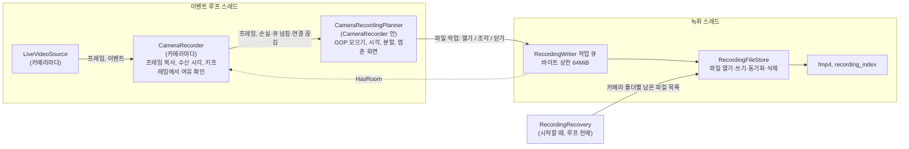
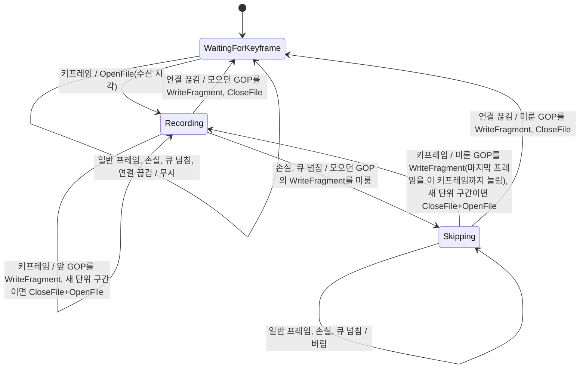
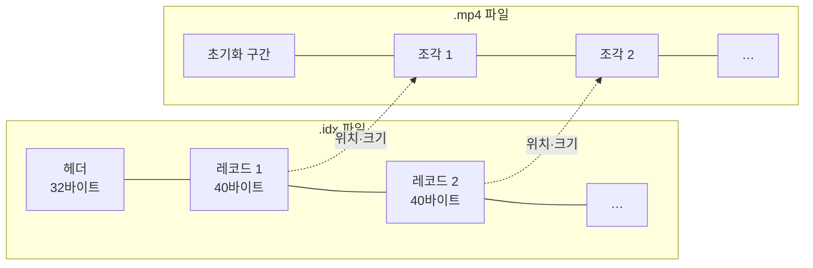

# Design

## Context

변경 이유는 proposal.md "Why"를 따른다. 요구 동작은 이 change의 `specs/`(`camera-recording`, `rtsp-camera-source`)를 따른다.

현재 상태:

- 서버는 단일 스레드 `core::EventLoop`(epoll) 위에서 돈다. 스레드나 스레드 간 통신 코드는 아직 없다.
- 카메라 프레임은 `media::LiveVideoSource`가 구독자에게 동기로 넘긴다.
  - `LiveVideoFrame`은 프레임(`H264Frame`, NAL 뷰 목록), 카메라 RTP 타임스탬프, 키프레임 여부를 담는다.
  - NAL 뷰는 `PublishFrame` 호출 동안만 유효하다.
  - 상태 변화 이벤트는 `kConnected`, `kDisconnected`, `kLoss` 세 가지다.
- 종료 시그널을 받으면 `main.cpp`가 각 `RtspCameraClient::Stop()`을 부른다. `Stop()`은 재생 중이던 카메라에 `kDisconnected`를 발행한다. 그 뒤 루프가 멈추고 `main`의 지역 객체가 선언 역순으로 소멸한다.
- 카메라 이름은 `main.cpp`의 `ParseCameraOption`에서 검사한다(빈 이름, UTF-8, 중복).
- `media/h264_sps`의 `ParseH264SpsResolution`이 SPS에서 해상도를 읽는다. fMP4의 `avcC`에 필요한 프로파일·레벨은 SPS 앞 3바이트에 있다.
- vms-cam 기본값은 키프레임 1초 간격, 2Mbps이며, 키프레임마다 SPS·PPS를 보낸다.

## Goals / Non-Goals

**Goals:**

- 이벤트 루프 스레드에서 하는 녹화 일은 프레임 복사와 몇 가지 판단(GOP 모으기, 시각, 분할, 버림)으로 제한한다. 디스크에 닿는 일(쓰기, 동기화, 삭제, 여유 공간 조회)은 모두 녹화 스레드에서 한다.
- fMP4 작성, 색인 레코드 인코딩, 복구 판정, 녹화 계획(GOP 모으기, 시각, 분할)을 디스크·스레드 없이 단위 테스트할 수 있게 둔다.
- 녹화 파일과 색인을 다음 change의 HLS가 그대로 쓸 수 있게 한다. HLS는 조각의 바이트 범위를 `EXT-X-BYTERANGE`로 가리키고, 파일 시작 시각을 `EXT-X-PROGRAM-DATE-TIME`으로 가리킨다.

**Non-Goals:**

- 녹화 스레드가 이벤트 루프에 결과를 알리는 경로. 이 change에서는 루프가 녹화 결과를 쓰지 않는다. 다음 change에서 재생 목록을 만들 때 추가한다.
- 여러 디스크, 카메라별 스레드, `io_uring` 같은 쓰기 성능 최적화

## Decisions

### 1. 구성 요소와 데이터 흐름



새 코드는 `src/recording/`에 둔다.

| 파일 | 역할 | 스레드 |
| --- | --- | --- |
| `fmp4.h/.cpp` | 초기화 구간(`ftyp`+`moov`)과 조각(`moof`+`mdat`)의 바이트 생성 | 녹화 |
| `recording_index.h/.cpp` | `.idx` 헤더·레코드 인코딩·디코딩, CRC32 | 녹화, 복구 |
| `recording_options.h` | 녹화 설정 구조체(디렉터리, 단위 시간, 보관, 동기화 주기, 최소 여유 공간, 큐 상한) | 공통 |
| `recording_task.h` | 파일 작업(열기, 조각, 닫기)과 작업을 받는 대상의 인터페이스(`Push`, `HasRoom`) | 공통 |
| `camera_recorder.h/.cpp` | 카메라 하나의 구독, 프레임 복사와 수신 시각 기록, 키프레임에서 큐 여유 확인, 계획기 호출 | 루프 |
| `camera_recording_planner.h/.cpp` | 카메라 하나의 GOP 모으기, 시각 계산, 분할, 버리는 구간 처리, 파일 작업 생성 | 루프 |
| `recording_file_store.h/.cpp` | 파일 작업 실행: 파일 I/O, 동기화, 보관·비상 삭제 | 녹화 |
| `recording_writer.h/.cpp` | 작업 큐와 쓰기 대기 크기, 녹화 스레드, 동기화 주기, 종료 시 큐 비우기 | 넣기는 루프, 나머지는 녹화 |
| `recording_recovery.h/.cpp` | 시작할 때 폴더 검사, 잘라 내기, 남은 파일 목록 생성 | 시작 시 메인 스레드 |
| `recording_file_name.h/.cpp` | 시작 시각 ↔ `YYYYMMDDTHHMMSSZ[-n].mp4` 변환, 단위 구간 계산 | 공통 |

### 2. 스레드 경계: 이벤트 루프는 파일 작업을 만들고, 녹화 스레드는 파일 작업을 수행한다

이 절부터 쓰는 용어는 다음과 같다.

- **GOP:** 키프레임부터 다음 키프레임 직전까지의 프레임. 이벤트 루프가 프레임의 NAL 데이터를 복사해 메모리에 모은다.
- **조각:** GOP 하나로 만든 fMP4의 `moof`+`mdat` 바이트열. 녹화 스레드가 만든다.
- **파일 작업:** 이벤트 루프가 녹화 스레드에 넘기는 `OpenFile`, `WriteFragment`, `CloseFile` 값. `WriteFragment` 하나가 GOP 하나를 담는다.
- **버리는 구간:** 패킷 손실(`kLoss`)이나 큐 넘침(3절)이 생긴 시점부터 다음 키프레임 직전까지 받은 프레임을 파일에 쓰지 않는 구간. 그 시점에 모으던 GOP, 즉 키프레임부터 손실·큐 넘침 직전 프레임까지는 버리지 않고 파일에 쓴다. 다만 이 GOP의 마지막 프레임 길이는 다음 키프레임이 와야 정할 수 있으므로, 이 GOP의 `WriteFragment`를 큐에 넣는 시점을 다음 키프레임이 올 때까지 미룬다. 다음 키프레임이 오면 마지막 프레임 길이를 그 키프레임까지로 늘려 큐에 넣는다. 그래서 버리는 구간은 재생할 때 마지막 화면이 멈춘 채로 보이고, 파일 안 재생 시각에 빈 곳이 생기지 않는다. 상태 전환은 4절에서 다룬다.
- **재생 시각:** 녹화 파일 안에서 프레임이 놓이는 시점. 파일 첫 프레임을 0으로 놓고 지난 시간을 1/90000초 단위로 센 값이며, 실제 시각(UTC)은 파일 시작 시각에 이 값을 더해 얻는다. 계산 방법은 4절 "시각", 예시는 background "재생 시각"에 있다.
- **연결 끊김(`kDisconnected`):** 재생 중이던 카메라의 연결을 `RtspCameraClient`가 닫을 때 발행하는 이벤트. RTSP 제어 연결의 오류나 종료, RTP 수신 시간 초과, 서버 종료 때의 `Stop()`에서 발행한다. 카메라 전원이 꺼졌는지는 구별하지 않는다.
- **키프레임 대기(`WaitingForKeyframe`):** 계획기에 열린 파일이 없고, 다음 키프레임에서 새 파일을 여는 상태. 시작 직후와 연결 끊김 뒤에 이 상태가 된다.
- **녹화 공백:** 어떤 녹화 파일에도 들어 있지 않은 시간. 키프레임 대기 상태로 있는 시간(연결 끊김부터 재연결 뒤 첫 키프레임까지 포함), 서버가 꺼져 있던 시간, 서버 시계가 앞으로 건너뛴 만큼의 시간이 녹화 공백이 된다. 버리는 구간은 멈춘 화면으로 파일 안에 들어 있으므로 녹화 공백이 아니다.

두 스레드의 일은 다음과 같이 나눈다.

| 스레드 | 구성 요소 | 하는 일 |
| --- | --- | --- |
| 이벤트 루프 | `CameraRecorder` | 카메라 소스 구독, 프레임 NAL 데이터 복사, 수신 시각 기록, 키프레임에서 큐 여유 확인(3절) |
| 이벤트 루프 | `CameraRecordingPlanner` | `CameraRecorder`가 넘긴 프레임과 이벤트로 GOP 모으기, 파일을 열고 닫을 시점 결정, 프레임별 재생 시각과 길이 계산, 버리는 구간 처리, 파일 작업 생성 |
| 녹화 스레드 | `RecordingWriter`, `RecordingFileStore` | 큐에서 파일 작업을 꺼내 수행(`RecordingFileStore::Execute`): fMP4 초기화 구간·조각과 색인 레코드의 바이트열 생성, CRC32 계산, 파일 쓰기. 주기적인 동기화와 오래된 파일 삭제 |

`CameraRecordingPlanner`는 `CameraRecorder`가 하나씩 가진다. 계획기는 현재 시각을 직접 읽지 않고 프레임에 담긴 수신 시각만 쓰며, 만든 파일 작업은 큐에 직접 넣지 않고 생성자에서 받은 함수로 넘긴다. 그래서 입력 프레임과 이벤트만으로 단독 테스트할 수 있다.

**이벤트 루프가 파일 작업을 만드는 이유:** 파일을 바꿀지는 키프레임을 받은 순간의 서버 시각으로 정한다(4절 "분할"). 녹화 스레드가 작업을 꺼낼 때 시계를 읽으면, 작업이 큐에서 기다린 시간만큼 늦은 시각이 된다. 수신 시각을 아는 이벤트 루프에서 파일 작업을 만들면 이 문제가 없다.

**녹화 스레드가 파일 작업을 수행하는 이유:** 파일 작업 수행에는 일반 파일의 `write`, `fdatasync`처럼 끝날 때까지 스레드를 멈추는 호출이 들어간다. 이벤트 루프에서 부르면 그동안 RTSP 수신과 WebRTC 송신이 멈춘다. fMP4 상자 조립과 CRC32 계산도 조각 크기(2Mbps에서 GOP 하나 약 250KB)에 비례하므로 같이 녹화 스레드에서 한다. 이벤트 루프는 NAL 데이터 복사만 한다. 이 복사는 어느 방식이든 필요하다. `LiveVideoSource`가 넘기는 NAL 뷰는 `PublishFrame` 호출 동안만 유효하므로, 나중에 쓰려면 복사해 두어야 한다.

파일 작업은 세 종류이며, 모두 카메라 이름을 가진다.

| 파일 작업 | 담는 것 |
| --- | --- |
| `OpenFile` | 파일 시작 시각(UTC 유닉스 시각, 밀리초 단위), 첫 키프레임의 SPS·PPS NAL 데이터(초기화 구간의 `avcC`에 들어간다, 5절) |
| `WriteFragment` | GOP 하나의 프레임 목록. 프레임마다 NAL 데이터(AUD·SPS·PPS 제외), 재생 시각, 프레임 길이(1/90000초 단위) |
| `CloseFile` | 카메라 이름 외에 없음 |

카메라마다 열린 파일의 상태(파일 디스크립터, 다음 조각 번호, 다음 쓰기 위치)는 녹화 스레드의 `RecordingFileStore`만 가진다. 두 스레드가 함께 접근하는 데이터는 작업 큐와 그 큐의 쓰기 대기 크기(3절)뿐이다.

다른 방식으로, 이벤트 루프는 프레임과 이벤트만 큐에 넣고 GOP 모으기, 파일 분할, 버리는 구간 처리를 모두 녹화 스레드가 하는 방식도 검토했다. 카메라별 녹화 상태가 녹화 스레드 한 곳에 모이는 장점이 있다. 하지만 서버 시각이 늦게 읽히지 않도록 프레임마다 수신 시각을 담아 보내야 하고, 손실·끊김·큐 넘침 이벤트도 큐 항목으로 보내야 하며, 큐 항목 수가 GOP 단위(카메라당 초당 1개)에서 프레임 단위(카메라당 초당 30개)로 늘어난다. 이벤트 루프 쪽 계산은 프레임마다 정수 비교와 덧셈 정도라 루프를 오래 붙잡지 않으므로, 큐 항목을 GOP 단위로 유지하는 이 방식을 골랐다.

### 3. 작업 큐와 크기 상한

#### 큐 구조

`RecordingWriter`는 `std::deque<RecordingTask>` 하나를 작업 큐로 쓴다. 모든 카메라의 파일 작업이 넣은 순서대로 이 큐 하나를 거치므로, 카메라마다 `OpenFile` → `WriteFragment` → `CloseFile` 순서가 유지된다. `std::mutex` 하나로 큐와 쓰기 대기 크기를 함께 보호하고, `std::condition_variable`로 잠든 녹화 스레드를 깨운다.

#### 쓰기 대기 크기

- **정의:** 큐에 들어 있거나 녹화 스레드가 처리 중인 `WriteFragment` 작업들의 NAL 데이터 크기 합(바이트)이다. fMP4 상자 머리와 색인 레코드 크기는 넣지 않는다. 코드에서는 `RecordingWriter::queued_bytes_`다.
- **더하고 빼는 시점:** `Push`가 작업을 넣을 때 더하고, 녹화 스레드가 그 작업의 파일 쓰기를 마친 뒤 뺀다. 큐에서 꺼낼 때 빼지 않는 이유는, `write`나 `fdatasync`가 오래 걸리는 동안 처리 중인 작업의 NAL 데이터도 메모리에 남아 있기 때문이다.
- **상한:** 64MiB(`RecordingOptions::queue_byte_limit`)다. 2Mbps 카메라 10대가 약 25초 동안 보내는 양이다.
- **`HasRoom()`:** 쓰기 대기 크기가 상한보다 작으면 `true`를 반환한다.

#### 상한에 닿았을 때 버리는 프레임

`CameraRecorder`는 키프레임을 받을 때만 `HasRoom()`을 호출한다.

- `false`이면 그 키프레임을 복사하지 않고, 계획기에 큐 넘침(`kQueueOverflow`) 이벤트를 넘긴다. 계획기는 버리는 구간에 들어가 그 키프레임부터 다음 키프레임 직전까지의 프레임을 버린다. 다음 키프레임에서 `CameraRecorder`가 다시 `HasRoom()`을 확인한다.
- `true`이면 그 키프레임부터 다음 키프레임 직전까지의 프레임을 GOP로 모으고, 다음 키프레임이 오면 그 GOP를 `WriteFragment`로 큐에 넣는다. 모으는 동안 쓰기 대기 크기가 상한에 닿아도 이 GOP는 넣는다.

키프레임에서만 확인하는 이유는, 큐 넘침으로 버리는 프레임이 항상 키프레임부터 다음 키프레임 직전까지가 되어 GOP 중간이 잘리지 않게 하기 위해서다.

`Push`가 작업을 거부하지 않는 이유는 다음과 같다. 다 모은 GOP를 넣을 때 거부하면 그 GOP 전체(약 1초)를 잃는다. 게다가 그 직전 GOP는 이미 큐에 들어가 있어 마지막 프레임 길이를 늘릴 수 없으므로, 잃은 구간이 멈춘 화면이 아니라 재생 시각의 빈 곳이 된다.

그 결과 `HasRoom()` 확인과 그 GOP의 `Push` 사이에 GOP 하나만큼(약 1초)의 시간이 있고, 그동안 다른 카메라도 GOP를 넣는다. 그래서 쓰기 대기 크기는 상한을 최대 "카메라 수 × GOP 하나의 NAL 데이터 크기"만큼 넘을 수 있다. 2Mbps 카메라 10대면 약 2.5MB다.

#### 녹화 스레드의 대기와 동기화 주기

- 큐가 비어 있으면 녹화 스레드는 `condition_variable::wait_until`로 다음 동기화 시각까지 잠든다. 작업이 들어오거나 그 시각이 되면 깨어난다.
- 작업을 하나 처리하기 전마다 다음 동기화 시각이 지났는지 확인하고, 지났으면 열린 파일을 모두 동기화한다(순서는 6절 "쓰기 순서"). 작업이 계속 들어와 대기가 시간 초과로 끝나지 않는 경우에도 `--record-sync` 주기를 지키기 위해서다.

#### 종료

- `RecordingWriter`의 소멸자가 정지 요청 플래그를 세우고 녹화 스레드를 `join`한다.
- 녹화 스레드는 정지 요청을 받아도 큐가 빌 때까지 작업을 계속 처리한다. 큐가 비면 아직 열린 파일이 있는지 보고, 있으면 동기화하고 닫은 뒤 끝난다.
- 정상 종료에서는 소멸자가 불리기 전에 각 카메라의 `CloseFile`이 이미 큐에 들어 있다. `main`이 루프를 멈추기 전에 카메라 클라이언트의 `Stop()`을 부르고, `Stop()`이 `kDisconnected`를 발행하기 때문이다(선언·소멸 순서는 10절).

다른 방식으로 카메라마다 큐를 따로 두고 녹화 스레드가 돌아가며 꺼내는 방식도 있다. 한 카메라의 데이터가 많아도 다른 카메라의 GOP가 상한 때문에 버려지지 않는 장점이 있다. 하지만 디스크가 하나라 전체 쓰기 속도는 같고, 어느 큐에서 꺼낼지 정하는 규칙이 더해져 구조가 복잡해진다. "향후 개선"으로 남긴다.

### 4. `CameraRecordingPlanner`: GOP, 시각, 분할

카메라마다 `CameraRecorder` 안에 하나 있으며 이벤트 루프 스레드에서 돈다. 프레임과 상태 변화를 받아 파일 작업을 만든다. 상태는 다음과 같다.



- **GOP 모으기:** 키프레임부터 다음 키프레임 직전까지의 프레임을 복사해 모은다. 프레임 하나는 NAL 바이트 목록과 카메라 RTP 타임스탬프다. AUD·SPS·PPS NAL은 조각에 넣지 않는다. SPS·PPS는 `OpenFile`의 `avcC`로 간다. 키프레임이 오면 앞 GOP가 완성된다. 그 키프레임의 RTP 타임스탬프로 앞 GOP 마지막 프레임의 길이가 정해진다.
- **시각:** 파일을 열 때 그 키프레임의 수신 시각(`CameraRecorder`가 `system_clock::now()`로 찍은 UTC)과 RTP 타임스탬프를 기준으로 잡는다. 프레임의 재생 시각은 `uint32(rtp - base_rtp)`이다. `uint32` 차이라서 RTP가 순환해도 맞다. 단, 한 파일이 13시간(2^32/90000초)을 넘지 않는다는 전제다. `--record-segment`가 최대 3600초이므로 성립한다. 파일 시작 시각이 같은 카메라의 직전 파일 끝 시각보다 이르면 끝 시각으로 올린다.
- **분할:** 키프레임이 오면 그 수신 시각의 단위 구간 번호 `floor(receive_unix / segment)`가 열린 파일의 구간 번호와 다르면 파일을 바꾼다. 녹화 공백 뒤 같은 구간 번호의 파일을 다시 여는 경우(같은 단위 구간 안의 재연결이나 서버 재시작)는 녹화 스레드가 이름 뒤에 번호를 붙여 해결한다.
- **버리는 구간(`Skipping`):** 손실이나 큐 넘침 이벤트가 오면, 모으던 GOP(키프레임부터 이벤트 직전 프레임까지)의 `WriteFragment`를 큐에 넣는 시점을 다음 키프레임까지 미루고, 그 사이에 받은 프레임은 버린다. 미룬 GOP는 키프레임부터 빠진 프레임 없이 이어지므로 정상 디코딩된다. 큐 넘침은 `CameraRecorder`가 여유 없는 키프레임 대신 알린다. 키프레임이 오면 미룬 GOP의 마지막 프레임 길이를 그 키프레임까지로 정해 큐에 넣는다. 그래서 버린 구간은 마지막 화면이 멈춘 채로 재생되고, 파일 안 재생 시각에 빈 곳이 없으며, 파일은 닫지 않는다. 멈춘 화면의 길이에는 상한을 두지 않는다. 버리기 시작할 때 원인과 함께, 다시 기록할 때 로그를 남긴다.
- **연결 끊김에서만 파일을 닫는다:** 연결 끊김 뒤에는 다음 키프레임이 언제 올지 모르고, 녹화 공백은 다음 change에서 검은 화면으로 보이기로 했다. 그래서 파일을 닫고 키프레임 대기 상태로 돌아가, 그 시간을 녹화 공백으로 남긴다. 손실과 큐 넘침에서는 파일을 닫지 않고 버리는 구간으로 처리한다.
- **마지막 프레임 길이:** 연결 끊김으로 파일을 닫을 때 마지막 GOP의 마지막 프레임은 다음 프레임이 없어 길이를 알 수 없다. 이때는 그 GOP 안 직전 프레임 간격을 쓰고, 프레임이 하나뿐이면 3000(30fps)을 쓴다. `Skipping` 상태에서 연결 끊김이 와도 같다. 미룬 GOP의 마지막 프레임은 늘리지 않고 이 규칙으로 길이를 정해 큐에 넣은 뒤 파일을 닫는다.
- **시계 주입:** 계획기는 시계를 읽지 않고 입력의 수신 시각만 쓴다. 그래서 테스트에서 시각을 담은 입력만으로 분할과 시각을 재현한다. `CameraRecorder`는 테스트에서 시계를 바꾸도록 현재 시각 함수를 생성자 인자로 받는다.
- **결과 전달:** 계획기는 만든 파일 작업을 생성자에서 받은 함수로 넘긴다. `CameraRecorder`는 이 함수에서 작업을 `RecordingWriter`의 큐에 넣는다.

### 5. fMP4 구성 (`fmp4`)

ISO/IEC 14496-12와 14496-15의 최소 구성을 직접 쓴다. 외부 라이브러리를 쓰지 않는다.

```text
초기화 구간
  ftyp  major=iso6, compatible=iso6 isom avc1 mp41
  moov
    mvhd  timescale=1000, duration=0
    trak
      tkhd  track_id=1, width/height = SPS 해상도(16.16 고정소수)
      mdia
        mdhd  timescale=90000
        hdlr  vide
        minf  vmhd, dinf/dref(url self), stbl(stsd/avc1/avcC, 빈 stts·stsc·stsz·stco)
    mvex
      trex  track_id=1

조각 (GOP 하나)
  moof
    mfhd  sequence_number = 파일 안 조각 번호(1부터)
    traf
      tfhd  track_id=1, default-base-is-moof
      tfdt  version 1, base_media_decode_time = 조각 첫 프레임의 재생 시각
      trun  data-offset, 프레임마다 duration·size·flags (첫 프레임만 sync)
  mdat  프레임마다 NAL을 4바이트 길이 + NAL 바이트로 이어 붙임
```

- H.264 트랙의 샘플 엔트리(`stsd` 안에서 코덱 종류와 디코더 설정을 적는 항목)는 `avc1`로 한다. `avc1`은 SPS·PPS를 초기화 구간의 `avcC`에만 두고 조각의 샘플 데이터에는 넣지 않는 방식이다(background "샘플과 샘플 엔트리"). 그래서 카메라가 키프레임마다 보내는 SPS·PPS는 조각에서 빼고, `OpenFile`에 담긴 SPS·PPS를 `avcC`에 한 번 넣는다. 연결 중 SPS·PPS 변경은 범위 밖이므로, 연결 중에 SPS가 바뀌어도 그 파일은 처음 `avcC`를 그대로 쓴다.
- 이 change는 B 프레임이 없는 스트림을 전제한다(vms-cam은 `bframes=0`). B 프레임이 없으면 프레임을 디코더에 넣는 시각과 화면에 보여 주는 시각이 같으므로, 둘의 차이를 기록하는 `ctts` 상자와 `trun`의 composition offset 필드를 쓰지 않는다(background "B 프레임과 디코딩 순서·표시 순서"). 이 문서의 "재생 시각"은 이 하나의 시각이다.
- 재생 시각은 파일마다 0부터 시작하므로, 프레임의 실제 시각을 알려면 파일 시작 시각이 필요하다. 파일 이름과 색인 헤더가 파일 시작 시각을 가진다.

다른 방식으로 MPEG-TS나 원시 Annex-B + 색인도 검토했다. 이 둘은 fMP4가 HLS 조각과 브라우저 MSE에 그대로 맞는 점에서 밀린다. 탐색 기록은 proposal과 이전 논의에 있다.

### 6. 색인 파일 (`.idx`)

녹화 파일마다 같은 이름의 `.idx` 파일을 둔다. 예를 들어 `20261104T100105Z.mp4`의 색인은 `20261104T100105Z.idx`다.

- **카메라당 색인 하나 대신 파일마다 둔 이유:** 오래된 파일을 지울 때 `.mp4`와 `.idx` 두 개만 지우면 된다. 카메라 색인을 다시 쓰거나 앞부분을 잘라 낼 필요가 없다. 복구도 파일 단위로 독립이다.

**파일 구조:** 헤더 하나 뒤에 레코드가 조각 순서대로 이어진다. 레코드 하나가 `.mp4`의 조각 하나를 가리킨다. 레코드 N(1부터)은 `.idx`의 `32 + 40 × (N − 1)`바이트에서 시작한다. 모든 정수는 리틀 엔디언이다.



**헤더(32바이트)**

| 위치 | 크기 | 형식 | 내용 |
| --- | --- | --- | --- |
| 0 | 4 | 문자 | 매직 `VMSI` |
| 4 | 4 | uint32 | 버전 `1` |
| 8 | 8 | int64 | 파일 시작 시각(UTC 유닉스 시각, 밀리초) |
| 16 | 4 | uint32 | 시간 단위 `90000` |
| 20 | 8 | — | 예약(0) |
| 28 | 4 | uint32 | 헤더 CRC32. 0~27바이트에 대해 계산 |

**레코드(40바이트)**

| 위치 | 크기 | 형식 | 내용 |
| --- | --- | --- | --- |
| 0 | 8 | uint64 | 조각 첫 프레임의 재생 시각(1/90000초 단위) |
| 8 | 4 | uint32 | 조각 길이(1/90000초 단위) |
| 12 | 8 | uint64 | `.mp4` 안에서 조각이 시작하는 위치(바이트) |
| 20 | 4 | uint32 | 조각 크기(바이트) |
| 24 | 4 | uint32 | 조각 CRC32. `.mp4`의 조각 바이트 전체에 대해 계산 |
| 28 | 4 | uint32 | 플래그(지금은 0) |
| 32 | 4 | — | 예약(0) |
| 36 | 4 | uint32 | 레코드 CRC32. 0~35바이트에 대해 계산 |

- **CRC32:** zlib과 같은 다항식(0xEDB88320)을 쓴다. 256개 항목의 조회 표(lookup table)를 미리 만들어 직접 계산하며, zlib 의존성을 늘리지 않는다.
- **쓰기 순서:** 조각을 `.mp4`에 `write`로 끝까지 쓴 뒤 레코드를 `.idx`에 `write`한다. 동기화 주기와 파일을 닫을 때는 `.mp4`를 `fdatasync`한 다음 `.idx`를 `fdatasync`한다. 프로세스만 죽은 경우에는 커널이 둘 다 디스크에 내리므로, 레코드가 있으면 조각도 있다. 정전이면 순서가 깨질 수 있지만 복구가 CRC로 걸러 낸다.

### 7. 녹화 스레드: 파일 열기·쓰기·닫기

- **열기(`OpenFile`):** 먼저 비상 삭제 검사를 한다(결정 8). 그다음 이름을 정한다. 같은 이름이 있으면 `-1`, `-2`를 붙인다. `.mp4`와 `.idx`를 `O_CREAT | O_EXCL | O_WRONLY | O_CLOEXEC`로 열고 초기화 구간과 헤더를 쓴다.
- **쓰기(`WriteFragment`):** 조각 바이트를 만들고 CRC32를 계산해 `.mp4`에 쓴 뒤 레코드를 `.idx`에 쓴다. 짧게 쓰인 경우(short write)는 남은 바이트를 이어서 쓴다.
- **`ENOSPC`:** 비상 삭제를 한 번 하고 다시 쓴다. 다시 실패하면 그 파일을 마지막으로 완전히 쓴 조각 위치까지 `ftruncate`로 되돌려 닫는다. 그 카메라는 다음 `OpenFile`까지 쓰기를 건너뛴다. 파일 저장소는 열린 파일이 없는 카메라의 조각을 버린다.
- **닫기(`CloseFile`):** `.mp4` → `.idx` 순서로 `fdatasync`하고 닫는다. 그다음 그 카메라의 보관 분량 검사를 한다(결정 8).
- **그 밖의 I/O 오류:** 로그를 남기고 그 파일을 닫는다. 다음 `OpenFile`부터 다시 시도한다. 녹화 오류로 서버를 멈추지 않는다.
- **카메라별 파일 목록:** 녹화 스레드는 카메라 폴더마다 닫힌 파일 목록(시작 시각, 길이, 이름)을 메모리에 가진다. 시작할 때 복구 결과로 채우고, 닫을 때 추가하며, 지울 때 뺀다. 보관 분량과 비상 삭제가 이 목록으로 판단한다. 디렉터리를 매번 훑지 않는다.

### 8. 보관과 비상 삭제

- **보관 분량:** 파일을 닫을 때마다 그 카메라의 닫힌 파일 길이 합을 구한다. `--record-retention`을 넘으면 가장 오래된 파일부터 `.mp4`와 `.idx`를 지운다. 파일 길이는 마지막 레코드의 (시작 + 길이)다. 녹화 공백은 어느 파일에도 들어 있지 않으므로 자연히 분량에서 빠진다.
- **비상 삭제:** `OpenFile` 직전에 녹화 디렉터리에 `statvfs`를 하고, `f_bavail * f_frsize`를 여유 공간으로 본다. 기준보다 적으면 모든 카메라 목록(등록되지 않은 폴더 포함)에서 가장 이른 시작 시각을 찾는다. 그 파일의 단위 구간 번호와 같은 번호를 가진 파일을 모든 카메라에서 지운다. 여유 공간이 기준 이상이 되거나 지울 닫힌 파일이 없을 때까지 반복한다.
- **열린 파일은 지우지 않는다.** 비상 삭제가 지울 수 있는 것은 닫힌 파일뿐이다. 남은 것이 열린 파일뿐이면 로그를 남기고 그대로 연다. 그 뒤 `ENOSPC`가 나면 결정 7의 경로로 처리한다.
- **`statvfs` 주입:** 테스트에서 여유 공간을 흉내 낼 수 있게 여유 공간 조회 함수를 설정으로 받는다.

### 9. 시작할 때 복구 (`RecordingRecovery`)

`main`이 녹화 디렉터리가 있으면 이벤트 루프와 녹화 스레드를 시작하기 전에 동기로 부른다. 카메라 유무와 관계없다. 카메라 폴더마다 다음을 한다.

1. `.mp4`와 `.idx`를 짝짓는다. 짝이 없는 파일은 지운다.
2. `.idx` 헤더 CRC를 확인한다. 깨졌으면 그 짝을 지운다.
3. 레코드를 앞에서부터 확인한다. 레코드 CRC가 맞는지, 위치+크기가 `.mp4` 크기 안에 있는지, 그 바이트의 CRC32가 레코드 값과 같은지 본다. 처음 실패한 레코드에서 멈춘다.
4. 유효한 레코드가 하나도 없으면 짝을 지운다. 있으면 `.mp4`를 마지막 유효 조각 끝으로, `.idx`를 마지막 유효 레코드 끝으로 `ftruncate`한다. 잘라 냈으면 둘 다 `fsync`한다.
5. 남은 파일의 시작 시각과 길이로 카메라별 닫힌 파일 목록을 만든다.

- **이름 규칙에 맞지 않는 항목:** 카메라 폴더 안에서 이름 규칙에 맞지 않는 항목은 건드리지 않는다. 녹화 디렉터리 바로 아래의 일반 파일도 무시한다.
- **카메라가 없을 때:** 복구만 하고 녹화 스레드를 시작하지 않는다. 그래서 보관이나 비상 삭제도 일어나지 않는다.
- **CRC를 계산하느라 파일 전체를 읽는다.** 카메라당 보관 분량이 5분이면 수십~수백 MB라 시작 시간에 큰 영향이 없다. 보관 분량을 크게 잡으면 시작이 느려진다. Risks에 적는다.

### 10. 명령행과 시작 순서

- **새 인자:** `--record-dir`, `--record-segment`, `--record-retention`, `--record-sync`, `--record-min-free`의 해석과 범위 검사를 `ParseCommandLine`에 더한다.
- **카메라 이름 검사:** `ParseCameraOption`에 `/` 포함, `.`, `..`, 255바이트 초과 거부를 더한다.
- **시작 순서**

  ```mermaid
  flowchart TD
      A["명령행 해석"] --> B{"녹화 디렉터리가 있음?"}
      B -- "있음" --> C["복구"]
      B -- "없음" --> D{"카메라가 있음?"}
      C --> D
      D -- "있음" --> E["녹화 디렉터리·카메라 폴더 생성, 쓰기 확인"]
      E --> F["RecordingWriter 시작 (복구 목록 전달)"]
      F --> G["CameraRecorder 생성·구독 (카메라마다)"]
      G --> H["카메라 클라이언트 시작, 루프 실행"]
      D -- "없음" --> H
  ```

- **쓰기 확인:** 카메라 폴더 생성과 `access(W_OK)` 확인이 실패하면 시작 오류다.
- **소멸 순서:** `RecordingWriter`는 `CameraRecorder`보다 먼저 선언해 나중에 소멸한다. `CameraRecorder`는 카메라 목록(소스)보다 나중에 선언해 먼저 소멸한다. 그래서 소멸할 때 구독을 해지한다. 카메라 클라이언트의 `Stop()`이 루프 종료 전에 `kDisconnected`를 발행하므로, `RecordingWriter` 소멸 시 큐에는 마지막 `CloseFile`까지 들어 있다.
- **로그:** 녹화 스레드의 로그는 `std::println(stderr, ...)`로 한 줄씩 남긴다. 루프 스레드 로그와 줄 단위로 섞일 수 있지만, 한 줄 안에서 섞이지 않도록 메시지를 먼저 문자열로 만든 뒤 한 번에 출력한다.

### 11. 테스트 전략

| 대상 | 방법 |
| --- | --- |
| `fmp4` | 만든 바이트를 테스트 안의 작은 상자 해석기로 읽어 상자 순서, 크기, `avcC` 필드, `tfdt`·`trun` 값, `data-offset`이 `mdat` 데이터를 가리키는지 확인 |
| `recording_index` | 인코딩·디코딩 왕복, 바이트 하나를 바꾼 레코드의 CRC 실패, 알려진 입력의 CRC32 값 |
| `recording_file_name` | 시각 ↔ 이름 왕복, 번호 접미사, 단위 구간 번호 |
| `CameraRecordingPlanner` | 수신 시각을 담은 입력과 파일 작업을 모으는 함수로 상태 기계 확인: 첫 키프레임, 분할, 손실·큐 넘침 뒤 마지막 프레임 늘림, 연결 끊김, 버리는 중 연결 끊김, 시계 역행, RTP 순환 |
| `CameraRecorder` | 가짜 시계와 작업을 모으는 가짜 대상으로 프레임 복사·수신 시각, 여유 없는 키프레임에서의 GOP 버림, 이벤트 전달 확인 |
| `RecordingFileStore` | 임시 디렉터리, 가짜 여유 공간 함수로 파일 생성, 이름 충돌 번호, 보관 삭제, 비상 삭제(등록되지 않은 폴더 포함), 열린 파일 보존 확인 |
| `RecordingWriter` | 작업 순서대로 실행, 쓰기 대기 크기에 따른 `HasRoom`, 종료 시 큐 비우기 확인 |
| `RecordingRecovery` | 직접 만든 정상·손상 파일(꼬리 잘림, 레코드 CRC 오류, 조각 CRC 불일치, 짝 없음, 헤더 손상)로 결과 확인 |
| 통합 | `http_server_test.sh`: 녹화 인자 범위 오류, 카메라 이름 거부, 카메라 없이 실행 시 녹화 디렉터리 미생성, 쓸 수 없는 디렉터리 |
| 수동 | vms-cam으로 3분 이상 녹화 뒤 `ffprobe`·`ffplay`로 확인, 재시작, SIGKILL 뒤 복구 |

## Risks / Trade-offs

- [첫 스레드 도입으로 데이터 경쟁 가능성] → 루프와 녹화 스레드가 공유하는 것을 작업 큐와 쓰기 대기 크기로 제한하고 한 잠금으로 보호한다. 작업은 값으로 옮긴다. `-fsanitize=thread` 빌드로 `RecordingWriter` 테스트를 한 번 돌려 확인한다.
- [정전 시 마지막 동기화 이후 최대 `--record-sync`초 손실] → 의도한 상한이다. 복구가 CRC로 걸러 남은 데이터를 믿을 수 있게 한다.
- [`fdatasync`가 길어지면 큐가 쌓여 GOP를 버림] → 64MiB면 2Mbps 카메라 10대 기준 약 25초를 버틴다. 버린 GOP는 로그로 알 수 있다.
- [버린 구간이 길면 멈춘 화면이 실제 영상처럼 보임] → 손실·지연은 보통 GOP 몇 개라 받아들인다. 지금은 상한을 두지 않고, 버린 구간은 로그로 알 수 있다. 길게 이어지는 경우가 문제가 되면 상한을 넘을 때 파일을 닫아 녹화 공백으로 바꾸는 것을 검토한다.
- [비상 삭제가 오래전에 연결이 끊긴 카메라의 마지막 녹화를 먼저 지움] → 비상 삭제는 모든 카메라에서 가장 오래된 단위 구간부터 지우므로, 연결 끊김 뒤 다시 녹화되지 않은 카메라(등록에서 빠진 카메라 포함)의 녹화가 먼저 지워진다. 의도한 동작이다(proposal 범위). 평상시 보관 분량이 디스크 사용을 묶으므로 비상 삭제는 드물다.
- [서버 시계가 앞으로 크게 튀면 파일 이름과 단위 구간이 그만큼 건너뜀] → 타임라인에서 녹화 공백으로 보일 뿐 데이터는 손상되지 않는다.
- [보관 분량을 크게 잡으면 시작할 때 CRC 검사가 느림] → 지금 기본값(300초)에서는 문제가 없다. 커지면 마지막 동기화 지점 이전 레코드는 건너뛰는 최적화를 검토한다.
- [연결 중 SPS가 바뀌면 파일의 `avcC`와 조각이 맞지 않음] → 범위 밖으로 둔다. 재연결 때는 새 파일을 열므로 흔한 경우(카메라 설정 변경 후 재시작)는 맞다.
- [녹화 스레드 로그와 루프 로그가 섞임] → 줄 단위로만 섞이게 한다. 로그 모듈은 따로 만들지 않는다.

## 향후 개선

- 색인에 없는 꼬리 조각을 fMP4 구조 검사로 되살려 색인에 추가하기
- 연결 중 SPS·PPS 변경 시 파일 분할
- 카메라별 큐와 공정한 처리, 과부하 때 키프레임만 기록
- `io_uring` 비동기 쓰기, `sync_file_range`로 쓰기 평탄화, `fallocate`로 공간 미리 확보
- 녹화 시작·중지 API, 카메라별 녹화 설정, 기간 기준 보관
- 카메라 SD 카드 녹화(RTSP `Range: clock=`)를 받아 녹화 공백 채우기
- 녹화 상태 지표(큐 사용량, 버린 GOP 수, 동기화 소요 시간)
- 멈춘 화면 길이의 상한(넘으면 파일을 닫아 녹화 공백으로 남김)
