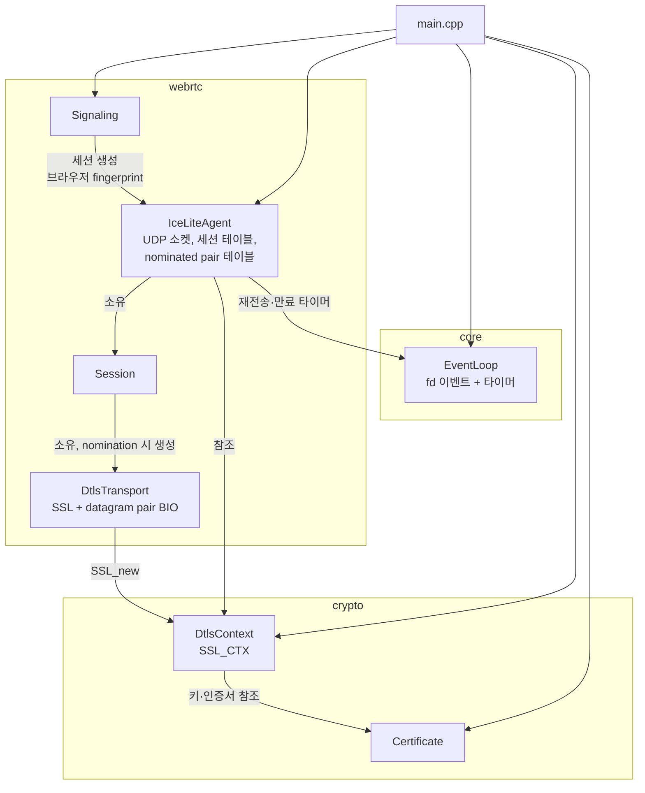
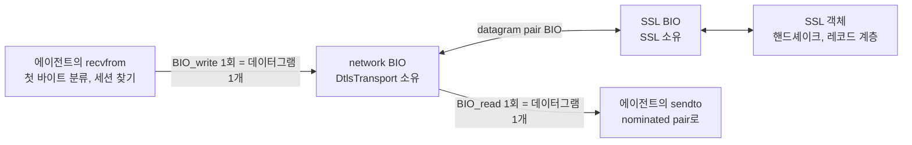
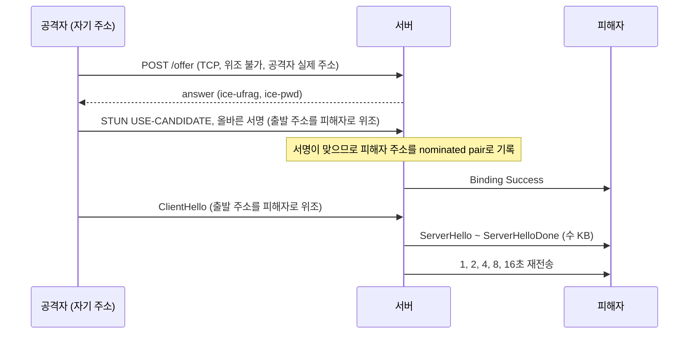
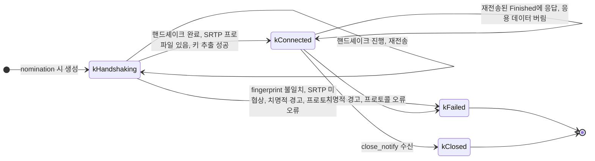
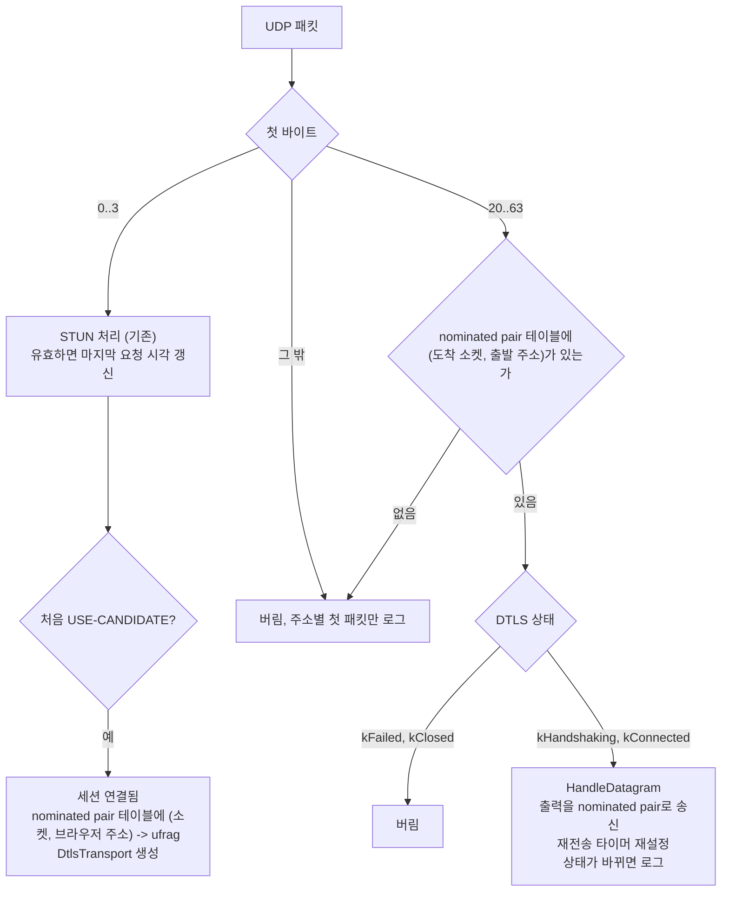
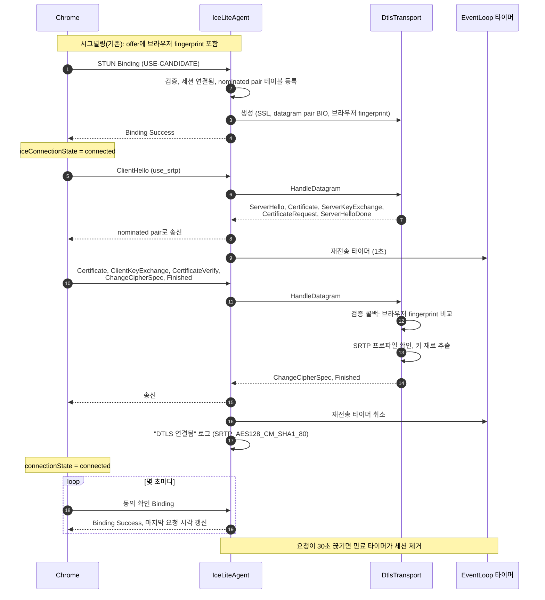

# Design

## Context

변경 이유는 proposal.md "Why"를 따른다. 요구 동작은 이 change의 `specs/`(`dtls-transport`, `ice-lite`, `webrtc-signaling`)를 따른다.

현재 상태:

- `IceLiteAgent`는 주소별 UDP 소켓과 서버 ufrag를 키로 하는 세션 테이블를 소유하고, 패킷을 첫 바이트로 분류한다(RFC 7983).
  - STUN이 아닌 패킷은 원격 주소별로 처음 한 번만 로그를 남기고 버린다.
  - 세션은 처음 nomination을 받은 pair(`socket_index`, `remote_endpoint`)를 보관한다.
- `Certificate`는 ECDSA P-256 키와 자체 서명 인증서를 프로세스 수명 동안 소유하지만, 아직 외부에 꺼내 주지 않는다.
- answer는 이미 `a=setup:passive`와 서버 fingerprint를 알린다. 따라서 서버는 DTLS 서버이고, 브라우저의 ClientHello가 도착하면 핸드셰이크를 시작한다.
- `EventLoop`는 `epoll_wait`을 무한 대기(`-1`)로 호출하며 타이머가 없다.
- OpenSSL은 `libcrypto`만 링크한다. 개발 환경의 OpenSSL은 3.5.5다.

제약:

- C++23, `-fno-exceptions`, 외부 라이브러리는 C API만 사용한다.
- 서버는 단일 스레드이며, 모든 처리는 이벤트 루프 스레드에서 한다.

## Goals / Non-Goals

**Goals:**

- DTLS 처리(OpenSSL 호출, 상태 판정, 키 추출)를 소켓·루프와 분리해, 테스트 클라이언트와 메모리 안에서 데이터그램을 주고받는 단위 테스트로 검증할 수 있게 한다.
- 타이머를 이벤트 루프의 일반 기능으로 넣어, 이후 HTTP 유휴 타임아웃과 lingering close가 그대로 쓸 수 있게 한다.
- 다음 change가 SRTP 송신을 붙일 지점을 정한다.
  - 세션별 SRTP 키 재료
  - nominated pair로의 송신 경로

**Non-Goals:**

- 반복 타이머 API. 필요한 곳은 핸들러 안에서 다시 등록한다.
- DTLS 쿠키 교환(HelloVerifyRequest). 결정 4에서 이유를 적는다.
- 세션 수 제한과 offer 요청 속도 제한. 세션 만료로 세션이 시간이 지나며 계속 쌓이지는 않지만, 동시에 살아 있는 세션 수는 offer 요청 속도에 비례한다. 지금은 개발자 본인만 접속하므로 넣지 않는다. 내부 네트워크의 다른 사람이나 인터넷에서 접속할 수 있게 하기 전에, HTTPS 시그널링과 함께 따로 넣는다.
- nomination 변경을 따라 DTLS 경로 갱신. 처음 nomination을 받은 pair만 쓴다(ice-lite 명세 "연결 수립 기록").

## Decisions

### 1. 모듈과 디렉터리 구성

```
src/
  apps/web_server/main.cpp        DtlsContext 생성과 에이전트 전달 추가
  core/
    event_loop.h/.cpp             일회성 타이머 추가
  crypto/
    certificate.h/.cpp            키·인증서 접근자, 임의 인증서의 SHA-256 fingerprint 함수 추가
    dtls_context.h/.cpp           DTLS 서버용 SSL_CTX 래퍼 (신규)
  webrtc/
    sdp.h/.cpp                    offer의 fingerprint, setup 해석 추가
    dtls_transport.h/.cpp         세션 하나의 DTLS 상태: 데이터그램 입력 -> 출력 데이터그램 (신규)
    ice_lite_agent.h/.cpp         DTLS 분기, nominated pair 테이블, 재전송·만료 타이머
    signaling.cpp                 브라우저 fingerprint를 세션 생성에 전달
web/
  index.html, app.js              DTLS 상태와 SRTP 암호 표시
tests/
  core/event_loop_test.cpp        타이머 시나리오 추가
  crypto/dtls_context_test.cpp    (신규)
  webrtc/dtls_transport_test.cpp  OpenSSL DTLS 클라이언트와 메모리 안에서 핸드셰이크 (신규)
  webrtc/dtls_test_client.h/.cpp  테스트용 DTLS 클라이언트 (신규, 테스트 전용)
  webrtc/ice_lite_agent_test.cpp  UDP 위 핸드셰이크, 세션 만료 추가
  webrtc/sdp_test.cpp             fingerprint, setup 시나리오 추가
```

CMake는 `find_package(OpenSSL 3.2 REQUIRED)`로 올리고, `server_core`에 `OpenSSL::SSL`을 `PUBLIC`으로 추가한다. 테스트용 DTLS 클라이언트는 `server_core`에 넣지 않고 `tests/webrtc`의 작은 정적 라이브러리로 둔다.

### 2. 구성 요소와 소유 관계



- `main`의 생성 순서: `EventLoop` → `TerminationSignalWatcher` → `Certificate` → `DtlsContext` → `IceLiteAgent` → `Signaling` → `HttpServer`. 소멸은 그 역순이다.
- `DtlsContext`는 생성할 때 `SSL_CTX_use_certificate`와 `SSL_CTX_use_PrivateKey`로 키와 인증서를 넘긴다. 둘 다 참조 횟수를 올리므로, 생성한 뒤에는 `Certificate`의 수명과 무관하다. 순서를 위처럼 두는 것은 의존 관계를 읽기 쉽게 하기 위해서다.
- `DtlsTransport`의 `SSL` 객체는 `SSL_CTX`의 참조 횟수를 올린다. 그래도 `IceLiteAgent`가 `DtlsContext`보다 먼저 소멸하도록 둔다.

### 3. 이벤트 루프 타이머

`EventLoop`에 일회성 타이머를 추가한다.

```
TimerId AddTimer(std::chrono::milliseconds delay, TimerHandler handler);
void CancelTimer(TimerId id);
```

- **기한 관리**: 등록된 타이머는 `(기한, TimerId)` 순서의 `std::map`에 둔다. `TimerId`는 1씩 늘어나는 64비트 값이다. 기한이 같아도 등록 순서대로 실행되고, 이미 실행되었거나 취소된 ID는 재사용되지 않는다.
- **기한 시계**: 기한은 `std::chrono::steady_clock`으로 잰다. 시스템 시각을 바꿔도 영향받지 않는다.
- **대기 시간**: `Run()`은 가장 이른 기한까지 남은 시간을 밀리초로 올림해 `epoll_wait`의 대기 시간으로 쓴다. 타이머가 없으면 지금처럼 `-1`이다. 올림하는 이유는, 내림하면 기한 직전에 깨어나 아무것도 실행하지 않는 공회전이 생기기 때문이다.
- **실행 시점**: `epoll_wait`이 반환될 때마다 fd 이벤트 묶음을 먼저 처리한 뒤, 기한이 지난 타이머를 실행한다.
  - 실행 직전에 테이블에서 빼므로, 핸들러 안에서 같은 ID를 취소해도 아무 일도 없다.
  - 핸들러 안에서 새로 등록한 타이머는 기한이 이미 지났더라도 다음 반복에서 실행된다. 0초 타이머를 반복 등록해도 fd 이벤트가 굶지 않는다.
- **취소**: 없는 ID의 `CancelTimer`는 아무것도 하지 않는다. 그래서 소유자가 소멸자에서 보관한 ID를 상태와 무관하게 모두 취소할 수 있다.
- **대안: 타이머마다 `timerfd`**. 기존 `TerminationSignalWatcher`의 `signalfd`와 같은 모양이다. 하지만 타이머를 걸고 지울 때마다 fd 생성과 `epoll_ctl` 시스템 호출이 든다. 세션마다 재전송·만료 타이머가 있고, 이후 HTTP 연결마다 유휴 타이머가 생기므로 fd와 시스템 호출이 연결 수에 비례해 늘어난다.
- **대안: `timerfd` 하나와 기한 테이블**. 해상도가 나노초가 되지만, 이 change의 기한(1초 이상)에서는 밀리초로 충분하고 fd 하나와 재설정 호출이 더 든다. 정밀도가 필요해지면 대기 시간 계산 부분만 이 방식으로 바꿀 수 있다.

### 4. OpenSSL과 데이터그램의 연결: datagram pair BIO

#### BIO와 datagram pair BIO

BIO는 OpenSSL의 입출력 추상화다. `SSL` 객체는 소켓을 직접 다루지 않고, 연결된 BIO에서 바이트를 읽고 BIO에 바이트를 쓴다. 어떤 BIO를 붙이느냐에 따라 데이터의 출처와 목적지가 정해진다.

| BIO | 읽기·쓰기의 실제 동작 |
|---|---|
| 소켓 BIO (`BIO_new_dgram`) | fd에 직접 `recvfrom`·`sendto` |
| 메모리 BIO (`BIO_s_mem`) | 메모리 버퍼에 바이트를 쌓고 꺼냄. 쓰기 경계가 남지 않음 |
| datagram pair BIO (`BIO_new_bio_dgram_pair`, OpenSSL 3.2+) | 서로 연결된 두 끝. 한쪽에 쓴 데이터그램을 다른 쪽에서 같은 경계로 읽음 |

datagram pair BIO는 양 끝이 있는 파이프다. 두 끝은 각각 읽기와 쓰기를 모두 하므로, 방향(input/output)이 아니라 붙은 곳으로 부른다.

- **SSL BIO**: `SSL_set_bio(ssl, bio, bio)`로 `SSL`에 붙인 끝. 읽기와 쓰기 자리에 같은 BIO를 넘긴다. 소유권이 `SSL`로 넘어가 `SSL_free` 때 함께 해제된다.
- **network BIO**: 반대쪽 끝. `DtlsTransport`가 소유하고 직접 해제하며, 에이전트와 데이터그램을 주고받는 데 쓴다.



- 받은 데이터그램은 network BIO에 `BIO_write` 한 번으로 넣고, `SSL`이 반대쪽에서 읽는다.
- `SSL`이 쓴 데이터그램은 network BIO에서 `BIO_read` 한 번에 하나씩 경계가 보존된 채로 꺼내 `sendto`한다. 서버는 ServerHello부터 ServerHelloDone까지 여러 메시지를 한 번에 쓰므로 경계 보존이 필요하다.
- 호출이 끝날 때마다 network BIO를 모두 비우므로, 호출 사이에 BIO 버퍼는 보통 비어 있다. 연결의 지속 상태(핸드셰이크 단계, 키, 시퀀스 번호, 재전송 묶음)는 BIO가 아니라 `SSL`에 있다.
- datagram pair BIO는 `DtlsTransport`와 수명이 같다. 처음 nomination을 받을 때 만들고 세션이 제거될 때 해제한다. 핸드셰이크 뒤에도 재전송된 Finished, close_notify, 경고를 처리해야 하므로 핸드셰이크가 끝나도 남겨 둔다.

#### 소켓 BIO를 쓰지 않는 이유

소켓 BIO(`BIO_new_dgram`)를 쓰면 `SSL`이 UDP fd에서 직접 `recvfrom`·`sendto`한다. 송신 쪽은 문제가 되지 않는다. BIO가 fd를 독점하지 않으므로 같은 fd로 STUN 응답이나 이후 미디어를 보낼 수 있고, 목적지도 `BIO_dgram_set_peer`로 바꿀 수 있다. 이 서버에서 맞지 않는 이유는 수신과 테스트다.

- **수신: 소켓을 모든 세션이 함께 쓴다**: 주소별 UDP 소켓 하나로 모든 세션의 STUN, DTLS, (이후) RTP가 섞여 들어온다. `SSL`이 BIO를 통해 `recvfrom`하면 커널 큐에서 다음에 도착한 패킷을 종류와 세션에 상관없이 가져간다. 그러면 한 세션의 `SSL`이 다른 세션의 DTLS 패킷이나 STUN 동의 확인까지 삼키고, 에이전트는 그 패킷을 볼 수 없다. 첫 바이트로 프로토콜을 가르고 출발 주소로 세션을 찾는 일(결정 7)은 에이전트가 먼저 해야 한다.
- **테스트**: 소켓 없이 메모리 안에서 데이터그램을 주고받는 단위 테스트(결정 10)를 할 수 없다.

- **대안: 세션마다 connect한 UDP 소켓과 소켓 BIO**. 같은 포트에 `SO_REUSEPORT`로 소켓을 하나 더 열고 브라우저 주소로 `connect`하면, 커널이 그 주소의 패킷을 연결된 소켓으로 보내 준다. 소켓 BIO를 그대로 쓸 수 있지만 세션마다 fd가 생긴다. 또 연결된 소켓에도 STUN 동의 확인이 섞여 오므로 결국 프로토콜 분류가 다시 필요하다. nomination 전후의 소켓 전환 순서도 다뤄야 한다.
- **대안: 메모리 BIO(`BIO_s_mem`)**. 3.0에서도 쓸 수 있지만 쓰기 경계가 남지 않는다. 한 번에 쓴 여러 레코드가 한 덩어리로 붙으므로, DTLS 레코드 헤더의 길이 필드로 데이터그램을 다시 나누는 처리가 필요하다.
- **대안: `BIO_meth_new`로 직접 만든 BIO**. 쓰기 콜백 한 번을 데이터그램 하나로 다루면 3.0도 지원할 수 있다. 대신 DTLS가 요구하는 `ctrl` 명령(MTU, 대기 바이트 수, 플러시, 재전송 기한 통지 등)을 직접 구현해야 하고, 어떤 명령이 필요한지는 OpenSSL 버전마다 달라질 수 있다. 개발 환경이 3.5이므로 3.2 이상을 요구하는 쪽을 택한다. 바꾸더라도 `DtlsTransport` 내부만 바뀐다.

#### MTU

MTU는 네트워크가 쪼개지 않고 실어 나를 수 있는 패킷의 최대 크기이고, 경로 MTU는 출발지에서 목적지까지의 구간 중 가장 작은 MTU다. 데이터그램이 이보다 크면 IP 단편화가 일어나거나 버려진다. 그래서 DTLS는 인증서처럼 큰 핸드셰이크 메시지를 MTU에 맞게 직접 조각낸다.

- OpenSSL은 기본적으로 BIO에 MTU를 묻는다. 소켓 BIO는 커널에 물어 답하지만, datagram pair BIO는 소켓이 아니라 경로 MTU를 알 수 없다.
- 그래서 `SSL_OP_NO_QUERY_MTU`로 묻지 않게 하고, `DTLS_set_link_mtu(ssl, 1200)`으로 값을 직접 정한다.
- 1200바이트는 이더넷의 1500바이트보다 넉넉히 작다. 터널, VPN, IPv6 헤더로 경로 MTU가 줄어든 환경에서도 지나가도록 WebRTC 구현들이 흔히 쓰는 값이다.

#### 쿠키 교환을 하지 않는다

**증폭 공격과 쿠키**: UDP는 연결 수립 과정이 없어 출발 주소를 위조할 수 있다. 공격자가 피해자 주소를 출발 주소로 적은 작은 요청을 보내면, 서버의 큰 응답이 피해자에게 간다. 이것이 반사·증폭 공격이다. DTLS 쿠키(HelloVerifyRequest)가 이를 막는다. 서버는 처음 ClientHello에 작은 쿠키만 돌려주고, 쿠키를 담은 ClientHello가 다시 와야 큰 응답 묶음을 보낸다. 위조한 주소로는 쿠키를 받을 수 없으므로 출발 주소가 진짜인지 확인된다.

**이 서버에서 남는 공격 경로**: nominated pair의 주소에서 온 DTLS 패킷만 받지만, nomination이 주소의 소유를 증명하지는 않는다. `MESSAGE-INTEGRITY`는 보낸 쪽이 `ice-pwd`를 안다는 것만 증명한다. full ICE라면 서버가 그 주소로 직접 연결 확인을 보내 확인하지만, ICE-lite 서버는 응답만 하므로 이 확인이 없다. 그래서 다음 경로가 가능하다.



공격자는 응답을 보지 못하므로 핸드셰이크를 끝낼 수는 없지만, 증폭에는 첫 묶음과 재전송만으로 충분하다. 피해자로 가는 트래픽을 가로챌 필요도 없다.

**이번에는 쿠키 교환을 하지 않는다**: 공격 한 번의 비용과 효과가 다음처럼 제한되므로, 로컬 개발 단계에서는 위험으로 기록하고 감수한다(Risks).

- 세션마다 공격자가 자기 실제 주소로 TCP offer 요청(수 KB)을 보내야 한다.
- 세션마다 nomination은 처음 한 번뿐이다.
- 피해자에게 가는 양은 첫 묶음과 세션 만료 전까지의 재전송 약 5회다.

쿠키 교환을 넣으면 정상 연결에서도 핸드셰이크 왕복이 하나 늘어나고, 쿠키 생성·검증 콜백과 그 비밀 키 관리가 추가된다.

- **대안: 이번에 쿠키 교환 구현**. `SSL_OP_COOKIE_EXCHANGE`와 `SSL_CTX_set_cookie_generate_cb`·`SSL_CTX_set_cookie_verify_cb`로 출발 주소를 확인한다. 외부 공개 전에 offer 요청 속도 제한과 함께 다시 검토한다.

### 5. DtlsContext: SSL_CTX 설정

`SSL_CTX`는 여러 `SSL` 객체가 공유하는 설정 묶음이다. 인증서, 프로토콜 버전, SRTP 프로파일, 검증 콜백을 한 번 정해 두고, 세션마다 `SSL_new(ctx)`로 그 설정을 물려받은 `SSL`을 만든다. 시작할 때 만든 뒤에는 읽기만 하므로 모든 세션이 함께 쓴다.

| 항목 | 설정 | 이유 |
|---|---|---|
| 메서드, 버전 | `DTLS_server_method()`, 최소·최대 `DTLS1_2_VERSION` | WebRTC가 요구하는 DTLS 1.2로 고정한다. Chrome이 DTLS 1.3을 제안해도 1.2로 협상된다 |
| 인증서, 키 | `Certificate`의 인증서와 키 | answer의 `a=fingerprint`는 이 인증서로 계산했다. 핸드셰이크에서 다른 인증서를 보내면 브라우저의 fingerprint 비교가 실패한다 |
| SRTP | `SSL_CTX_set_tlsext_use_srtp(ctx, "SRTP_AES128_CM_SHA1_80")` | 아래 "SRTP 프로파일" 참고. 이 함수는 성공하면 0을 돌려주므로 반환값 해석에 주의한다 |
| 피어 인증서 | `SSL_VERIFY_PEER \| SSL_VERIFY_FAIL_IF_NO_PEER_CERT`, 검증 콜백 | 브라우저에 인증서를 요구하고, 결정 6의 fingerprint 비교를 콜백에서 한다 |
| 재전송 시간 | OpenSSL 기본값 | 아래 "재전송 시간" 참고 |

**SRTP 프로파일**: SRTP 프로파일은 이후 미디어를 암호화할 알고리즘 조합이다. 브라우저는 지원하는 프로파일 목록을 ClientHello의 `use_srtp` 확장에 담아 보내고, OpenSSL 서버는 자기 목록의 순서대로 보면서 브라우저 목록에도 있는 첫 번째를 고른다.

| 프로파일 | 암호화 | 위조 방지 | 특징 |
|---|---|---|---|
| `SRTP_AES128_CM_SHA1_80` | AES 카운터 모드 | HMAC-SHA1, 80비트 태그 | WebRTC 필수 프로파일. 모든 구현이 지원 |
| `SRTP_AEAD_AES_128_GCM` | AES-GCM | 암호화와 위조 방지를 한 번에 | 더 새롭고, AES-NI가 있으면 더 빠름 |

이번에는 `SRTP_AES128_CM_SHA1_80` 하나만 알린다.

- **대안: GCM 프로파일도 함께 알림**. 서버 목록에 GCM을 넣으면 Chrome과 GCM으로 협상될 수 있다. 그러면 다음 change에서 미디어를 암호화할 libsrtp도 GCM을 지원해야 한다. libsrtp는 빌드 설정(OpenSSL 연동 여부)에 따라 GCM 지원 여부가 다르다. 그래서 다음 change에서 쓸 libsrtp가 GCM을 지원하는지 확인한 뒤 추가한다.

**재전송 시간**: OpenSSL 기본값은 1초에서 시작해 재전송할 때마다 두 배로 늘리고 최대 60초다. RFC 6347의 권장값과 같다. `DTLS_set_timer_cb`는 "다음 재전송까지 기다릴 시간"을 돌려주는 콜백을 등록해 이 간격을 바꾸는 함수인데, 기본값으로 충분하므로 쓰지 않는다. 재전송 테스트가 너무 느려지면 테스트에서만 이 함수로 시작값을 짧게 줄 수 있다(Risks).

### 6. DtlsTransport: 세션 하나의 DTLS 상태

`DtlsTransport`는 소켓과 루프를 모른다. 입력은 받은 데이터그램과 "타이머 만료"이고, 출력은 보낼 데이터그램 목록과 다음 타이머 기한이다.

```
std::vector<Datagram> HandleDatagram(std::span<const std::uint8_t> datagram);
std::vector<Datagram> HandleTimeout();
std::optional<std::chrono::milliseconds> NextTimeout() const;   // DTLSv1_get_timeout
DtlsState State() const;
const std::optional<SrtpKeyMaterial>& SrtpKeys() const;
```



- **핸드셰이크 진행**: 데이터그램을 넣을 때마다 다음을 한다.
  - `kHandshaking`이면 `SSL_do_handshake`를 호출한다. `SSL_ERROR_WANT_READ`는 다음 데이터그램을 기다린다는 뜻이다.
  - `kConnected`이면 `SSL_read`를 반복 호출해 레코드를 처리한다. 브라우저가 서버의 마지막 묶음을 못 받아 Finished를 다시 보내면, OpenSSL이 이 과정에서 서버의 마지막 묶음을 다시 보낸다. 응용 데이터는 읽어서 버린다.
  - 어느 경우든 끝나면 네트워크 쪽 BIO에 쌓인 데이터그램을 모두 꺼내 돌려준다. 실패할 때 OpenSSL이 쓴 경고(alert)도 함께 나가므로, 테스트 클라이언트는 바로 실패를 알 수 있다.
- **완료 판정**: 핸드셰이크가 끝나면 다음을 확인한다. 하나라도 실패하면 `kFailed`다.
  1. `SSL_get_selected_srtp_profile`이 `SRTP_AES128_CM_SHA1_80`이다.
  2. `SSL_export_keying_material(ssl, out, 60, "EXTRACTOR-dtls_srtp", ...)`로 60바이트를 꺼낸다. 순서는 RFC 5764에 따라 브라우저 키(16), 서버 키(16), 브라우저 솔트(14), 서버 솔트(14)다. 서버가 DTLS 서버이므로 "client"가 브라우저다.
  3. 꺼낸 값을 `SrtpKeyMaterial{local_key, local_salt, remote_key, remote_salt}`로 나눠 보관한다. 소멸할 때 `OPENSSL_cleanse`로 지운다.
- **브라우저 인증서 확인**: `SSL_set_app_data`로 `DtlsTransport`를 `SSL`에 연결하고, `SSL_CTX` 검증 콜백에서 깊이 0인 인증서의 SHA-256 fingerprint를 offer의 값과 비교한다.
  - 인증 기관 검증 결과(`preverify_ok`)는 무시한다. 자체 서명 인증서이기 때문이다.
  - 일치 여부만으로 통과를 정한다. 불일치하면 콜백이 0을 돌려줘 OpenSSL이 `bad_certificate` 경고를 보내고 핸드셰이크를 끝낸다. 실패 원인은 `DtlsTransport`에 기록해 로그에 쓴다.
  - fingerprint 문자열은 `Certificate`와 같은 함수(`X509_digest` → 대문자 16진수, `:` 구분)로 만들고, offer 값은 해석할 때 대문자로 정규화해 둔다.
  - **대안: 핸드셰이크 뒤 `SSL_get1_peer_certificate`로 비교**. 구현은 단순하지만, 핸드셰이크가 이미 성공으로 끝난 뒤라 브라우저에 실패를 알릴 경고를 보낼 수 없다. 브라우저는 `connected`를 보고하게 된다.
- **오류 큐**: 모든 OpenSSL 호출 뒤 실패면 `openssl_error`로 오류 큐를 읽어 원인 문구를 만들고 큐를 비운다. 한 세션의 오류가 다른 세션의 판정에 섞이지 않게 하기 위해서다.
- **대안: 송신 콜백을 받는 구조**. `DtlsTransport`가 콜백으로 바로 보내면 반환값이 없어지지만, 테스트에서 데이터그램을 가로채려면 콜백 안에서 버퍼를 쌓아야 한다. 결과를 반환값으로 돌려주면 에이전트와 테스트가 같은 방식으로 다룰 수 있다.

### 7. 에이전트: DTLS 분기, nominated pair 테이블, 타이머



- **nominated pair 테이블**: DTLS 패킷이 어느 세션의 것인지 찾는 테이블이다.
  - **필요한 이유**: STUN 요청은 `USERNAME`에 서버 ufrag가 있어 세션 테이블에서 바로 찾지만, DTLS 패킷에는 세션 표시가 없다. 서버가 아는 것은 패킷이 도착한 소켓과 `recvfrom`이 알려 주는 출발 주소·포트뿐이다. 그래서 nomination을 받을 때 그 pair를 기록해 두고, DTLS 패킷이 오면 이 테이블로 세션을 찾는다.
  - **키와 값**: 키는 `{소켓 순번, 브라우저 IPv4 주소, 브라우저 포트}` 구조체이고, 값은 서버 ufrag다. 세 값을 합친 것이 "서버 주소:포트 ↔ 브라우저 주소:포트" pair 하나에 해당한다.

    | 키 구성 요소 | 의미 | 출처 |
    |---|---|---|
    | 소켓 순번 | 서버 쪽 주소와 포트. 소켓마다 바인드한 주소가 하나씩 정해져 있다 | 패킷이 도착한 소켓 |
    | 브라우저 IPv4 주소 | 브라우저 쪽 주소 | `recvfrom`의 출발 주소 |
    | 브라우저 포트 | 브라우저 쪽 포트. 그 pair에 쓰인 브라우저 candidate의 포트 | `recvfrom`의 출발 포트 |

  - **소켓 순번을 넣는 이유**: 서버가 ICE 주소를 여러 개 쓰면(예: 소켓 0은 `172.27.209.81:50000`, 소켓 1은 `192.168.0.10:50000`), 같은 브라우저 주소라도 어느 서버 주소로 보냈느냐에 따라 다른 pair다.
    - 브라우저가 (브라우저 주소 ↔ 소켓 0)을 nominated pair로 골랐다면, 소켓 1로 들어온 DTLS 패킷은 nominated pair가 아니므로 받지 않는다.
    - 응답은 nominated pair의 소켓에서 나가야 출발 주소가 브라우저가 보낸 목적지와 같아진다.
  - **브라우저 포트를 넣는 이유**: 같은 PC의 탭 두 개가 각각 연결하면 IP는 같고 포트만 다르다. 포트가 있어야 두 세션의 DTLS 패킷을 구분한다.
  - **기존 코드와의 관계**: 기존 `EndpointKey`는 주소와 포트를 64비트 정수 하나로 합쳐 "DTLS 패킷 버림" 로그의 중복 방지에 쓴다. nominated pair 테이블은 여기에 소켓 순번을 더한 구조체를 키로 쓴다.
  - **항목의 수명**: 처음 nomination을 받을 때 `DtlsTransport`를 만든 뒤 넣고, 세션을 제거할 때 지운다. `DtlsTransport` 생성에 실패하면 넣지 않으므로, 그 세션의 DTLS 패킷은 nominated pair가 아닌 주소의 패킷처럼 버려진다(결정 11). 다른 pair의 nomination 변경에는 바꾸지 않는다(이 절의 "nomination 변경"). 따라서 세션 하나당 항목은 많아야 하나이고, 테이블에 있는 세션은 항상 `DtlsTransport`를 가진다.
- **DtlsTransport 생성 시점**: 처음 nomination을 받을 때 만든다.
  - **첫 ClientHello에 만들 때의 문제**: "nomination은 받았지만 DTLS 상태가 없음"이라는 중간 상태가 생긴다. 그러면 DTLS 패킷을 처리할 때마다 transport가 있는지 확인하고, 없으면 만들고, 만들다 실패하는 경우까지 다뤄야 한다.
  - **nomination 시점에 만들 때**: "nominated pair 테이블에 있는 세션은 항상 `DtlsTransport`가 있다"는 규칙 하나로 정리된다. DTLS 패킷 처리는 찾은 세션의 transport에 넘기기만 하면 된다.
  - **비용**: ClientHello가 끝내 오지 않아도 `SSL` 객체를 미리 만들어 두지만, 크기가 작고 세션 만료 때 함께 사라진다.
- **재전송 타이머**: `HandleDatagram`·`HandleTimeout`을 호출한 뒤 세션의 기존 재전송 타이머를 취소한다. 그다음 `NextTimeout()`에 값이 있으면 그 시간으로 다시 건다.
  - 핸들러는 에이전트 주소와 서버 ufrag를 캡처한다. 실행될 때 세션을 다시 찾으므로, 그 사이 세션이 제거되었으면 아무것도 하지 않는다.
  - 핸드셰이크가 끝나면 `NextTimeout()`이 비어 타이머가 더 걸리지 않는다.
- **상태 변경 로그**: 다음 경우에 세션 ufrag와 브라우저 주소를 넣어 한 번씩 로그를 남긴다.
  - `kConnected`: 협상된 프로파일 이름을 함께 남긴다.
  - `kFailed`: 원인을 함께 남긴다.
  - `kClosed`
- **세션 만료**: 세션은 생성 시각과 마지막 유효 Binding 요청 시각을 `steady_clock`으로 보관하고, 세션마다 만료 타이머 하나를 둔다.
  - 타이머가 실행되면 `마지막 시각 + 30초`와 현재 시각을 비교한다. 아직 남았으면 남은 시간으로 다시 걸고, 지났으면 세션을 제거한다.
  - 요청마다 타이머를 취소하고 다시 걸지 않으므로, 몇 초마다 오는 동의 확인 요청이 타이머 테이블를 바꾸지 않는다.
  - 30초는 `IceLiteAgentConfig::session_timeout`(기본 30초)으로 두어, 테스트가 짧은 값을 쓸 수 있게 한다. 명령행 인자로는 노출하지 않는다.
- **세션 제거**: 다음 순서로 한다. 로그에는 세션 ufrag와 nominated pair의 브라우저 주소를 남긴다.
  1. 재전송·만료 타이머를 취소한다.
  2. nominated pair 테이블에서 항목을 지운다.
  3. 세션을 지운다. `DtlsTransport`의 `SSL`이 함께 해제된다.
- **에이전트 소멸**: 남은 모든 세션의 타이머를 취소한 뒤 소켓 등록을 해제한다. 루프보다 먼저 소멸하므로, 소멸한 에이전트를 가리키는 타이머 핸들러가 실행되지 않는다.
- **nomination 변경**: 처음 nomination을 받은 pair만 nominated pair 테이블에 넣는다. 다른 pair의 `USE-CANDIDATE`에는 성공 응답만 보낸다. nomination 변경을 따라가려면 다음이 필요하다.
  1. 해시 테이블은 원소의 키를 그 자리에서 바꿀 수 없으므로, nominated pair 테이블에서 옛 키의 원소를 지우고 새 키(새 소켓 순번, 새 브라우저 주소와 포트)로 다시 넣는다.
  2. 세션의 `nominated_pair`(소켓 순번, 브라우저 주소)를 새 pair로 바꿔 DTLS 송신 목적지를 옮긴다.
  3. `MESSAGE-INTEGRITY` 검증을 통과한 `USE-CANDIDATE`에만 반응해, 위조 패킷으로 목적지를 바꿀 수 없게 한다.

  `DtlsTransport`와 SRTP 키 재료는 주소와 무관하므로 바뀌지 않는다. 이는 이후 마일스톤에서 미디어 송신과 함께 처리한다(이전 change design.md 결정 8 "nomination 변경").

### 8. SDP offer 해석 확장

- `a=fingerprint:<해시> <값>`은 협상 대상 섹션의 값을 우선하고, 없으면 세션 수준의 값을 쓴다. 해시 이름이 `sha-256`(대소문자 무시)인 줄만 쓰고, 여러 줄이면 첫 번째 `sha-256` 줄을 쓴다.
  - 값은 `:`로 구분한 16진수 32쌍이어야 하며, 대문자로 정규화한다.
  - `sha-256` 줄이 없거나 값 형식이 틀리면 offer 해석 오류다.
- `a=setup`도 같은 규칙으로 찾는다. 값이 `actpass`나 `active`가 아니면 오류다. 줄이 아예 없으면 RFC 5763의 기본값 `active`로 본다.
- `SdpOffer`에 `remote_fingerprint`를 추가한다. `Signaling`은 이를 `IceLiteAgent::CreateSession(remote_ufrag, remote_fingerprint)`로 넘긴다.
- answer 템플릿은 바뀌지 않는다.

### 9. 전체 흐름



### 10. 테스트 전략

- **`event_loop_test`**: 기한 순서대로 실행, 취소한 타이머는 실행 안 됨, 핸들러 안에서 자기 취소와 새 등록, fd 이벤트와 함께 동작, 타이머가 없을 때 무한 대기 유지(종료 시그널로 끝냄).
- **`dtls_transport_test`**: 소켓 없이 테스트 코드가 양쪽 사이에서 데이터그램을 직접 전달한다.
  - 테스트 클라이언트(브라우저 역할)는 OpenSSL `DTLS_client_method`로 만든 `SSL`과 자신의 datagram pair BIO로 구성한다.
  - 테스트 코드는 다음을 양쪽이 완료될 때까지 반복한다. 클라이언트 BIO에서 꺼낸 데이터그램을 `HandleDatagram`에 넣고, 돌려받은 데이터그램을 클라이언트 BIO에 넣는다.
  - 테스트 코드가 일부 데이터그램을 일부러 전달하지 않아 유실을 재현할 수 있다.

  다음 시나리오를 확인한다.
  - 정상 핸드셰이크: 양쪽 프로파일과 키 재료가 같다.
  - fingerprint 불일치
  - `use_srtp` 미제안
  - 첫 응답 묶음을 버린 뒤 `HandleTimeout`으로 재전송받아 완료. OpenSSL 재전송 기한이 실제 시간이므로 약 1초가 걸린다.
  - close_notify 뒤 `kClosed`
- **`ice_lite_agent_test`**: `127.0.0.1` 포트 0에서 다음을 확인한다.
  - STUN `USE-CANDIDATE` 뒤 같은 UDP 소켓으로 테스트 클라이언트가 핸드셰이크를 완료한다.
  - 다른 포트에서 보낸 ClientHello는 응답받지 못한다.
  - `session_timeout`을 200ms로 둔 에이전트에서 만료 뒤 요청에 응답하지 않는다.
  - 동의 확인을 주기적으로 보내면 만료되지 않는다.
- **`sdp_test`**: 견본 offer의 fingerprint 정규화, fingerprint 없음·`sha-1`만 있음·`a=setup:passive`의 오류를 확인한다.
- **통합 셸 테스트**: 시그널링 시나리오에 fingerprint 없는 offer와 `a=setup:passive` offer의 `400`을 추가한다.
- **수동**: Windows Chrome에서 확인한다. 브라우저 쪽 기준은 명세의 `connectionState`와 webrtc-internals 통계다.

### 11. 오류 전달

| 계층 | 형식 | 호출자의 처리 |
|---|---|---|
| `DtlsContext` 생성 | `std::expected<DtlsContext, std::string>` | 시작 단계이므로 표준 오류에 출력하고 0이 아닌 코드로 종료 |
| `DtlsTransport` 생성(`SSL_new`, BIO 생성) | `std::expected<std::unique_ptr<DtlsTransport>, std::string>` | 세션은 연결됨으로 두고 DTLS 없음으로 로그. 이후 그 주소의 DTLS 패킷은 버림 |
| 핸드셰이크·레코드 처리 | `DtlsTransport`의 상태(`kFailed`)와 실패 원인 문구 | 에이전트가 상태 변경을 로그로 남김. 그 세션의 이후 DTLS 패킷은 버림 |
| offer의 fingerprint·setup | 기존 `SdpOffer` 해석 오류 문구 | 로그 후 `400` |

## Risks / Trade-offs

- [Chrome이 nomination(`USE-CANDIDATE`)보다 ClientHello를 먼저 보낼 수 있다] → nomination 전에 온 ClientHello는 nominated pair 테이블에 없어 버려진다. Chrome이 1초 뒤 다시 보내므로 연결은 되지만 약 1초 늦어진다. 수동 검증에서 서버 로그의 "DTLS 패킷 버림"과 연결까지 걸린 시간을 확인한다. 실제로 생기면 다음 change에서 처리 방식을 바꾼다. 유효한 Binding 요청이 온 주소를 "nomination 후보"로 기록하고, 그 주소의 ClientHello도 받는 방식이다.
- [OpenSSL 3.2 미만 환경(예: Ubuntu 24.04의 3.0)에서 빌드할 수 없다] → CMake 구성 단계에서 버전 오류로 바로 드러난다. README에 요구 버전을 적는다. 그런 환경을 지원해야 하면 결정 4의 직접 만든 BIO로 바꾼다. `DtlsTransport` 내부만 바뀐다.
- [Chrome이 DTLS 1.3을 제안하면서 ClientHello가 커질 수 있다] → 큰 키 공유(ML-KEM 등) 때문에 ClientHello가 여러 데이터그램으로 조각나도, OpenSSL이 핸드셰이크 조각을 다시 맞춘다. 수신 버퍼(4 KiB)는 데이터그램 하나보다 크다. 최대 버전을 1.2로 고정하므로 1.2로 협상된다.
- [재전송 테스트가 약 1초 걸린다] → OpenSSL DTLS 타이머는 실제 시간을 쓴다. 테스트 하나만 해당하므로 감수한다. 길어지면 `DTLS_set_timer_cb`로 테스트에서만 짧은 시작값을 주도록 바꾼다.
- [실패하거나 닫힌 DTLS 세션도 브라우저가 동의 확인을 계속 보내면 만료되지 않는다] → 브라우저가 `RTCPeerConnection`을 닫거나 탭을 닫으면 동의 확인이 끊겨 30초 뒤 제거된다. 연결 버튼을 다시 누르면 페이지가 이전 연결을 닫는다.
- [위조한 출발 주소로 nomination과 ClientHello를 보내, 서버의 핸드셰이크 응답과 재전송을 제3자에게 보내게 할 수 있다(결정 4 "쿠키 교환을 하지 않는다")]
  - 지금 감수하는 이유: 세션마다 위조할 수 없는 offer 요청이 필요하고, nomination은 한 번뿐이며, 응답량은 첫 묶음과 재전송 약 5회로 제한된다. 지금은 개발자 본인만 접속한다.
  - 외부 공개 전 대응: offer 요청 속도 제한을 넣어 공격자가 만들 수 있는 세션 수를 줄이고, DTLS 쿠키 교환을 다시 검토한다.
- [SRTP 키 재료가 메모리에 남는다] → 프로세스 안에만 있고 로그나 응답에 내보내지 않는다. 세션을 제거할 때 `OPENSSL_cleanse`로 지운다.
- [세션 만료 시점이 최대 1회 재설정만큼 늦을 수 있다] → 만료 타이머는 "마지막 시각 + 30초"에 맞춰 다시 걸리므로 오차는 루프 지연 정도다. 명세의 30초 기준을 지킨다.

## Migration Plan

- 빌드 환경에 OpenSSL 3.2 이상의 `libssl-dev`가 필요하다. 개발 환경(3.5.5)은 이미 만족한다. README의 필요한 도구를 고친다.
- 명령행 인자, HTTP 동작, answer 형식은 바뀌지 않는다.
- offer 검증이 엄격해진다(fingerprint, setup).
  - Chrome offer는 항상 둘 다 갖추므로 연결 확인 페이지와 통합 테스트의 견본 offer(`chrome_offer.sdp`)에는 영향이 없다.
  - 코드에서 직접 만든 offer에는 `a=fingerprint:sha-256` 줄이 있어야 한다. `a=setup`은 없으면 `active`로 보므로 필요 없다.
  - `tests/webrtc/sdp_test.cpp`에서 해석 성공을 기대하는 직접 만든 offer들에 이 줄을 넣는다(tasks 5.1).
- 되돌리기: 이 change의 커밋을 되돌리면 DTLS 패킷을 버리던 이전 동작으로 돌아간다. 서버는 파일이나 DB에 아무것도 저장하지 않는다. 세션, 인증서, 키는 메모리에만 있고 시작할 때 새로 만든다. 그래서 되돌릴 때 데이터 변환이나 정리할 것이 없다.
