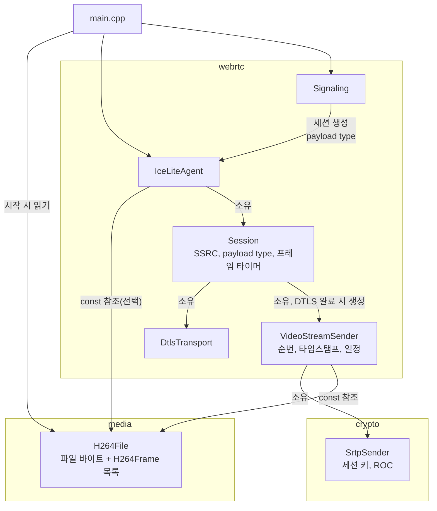
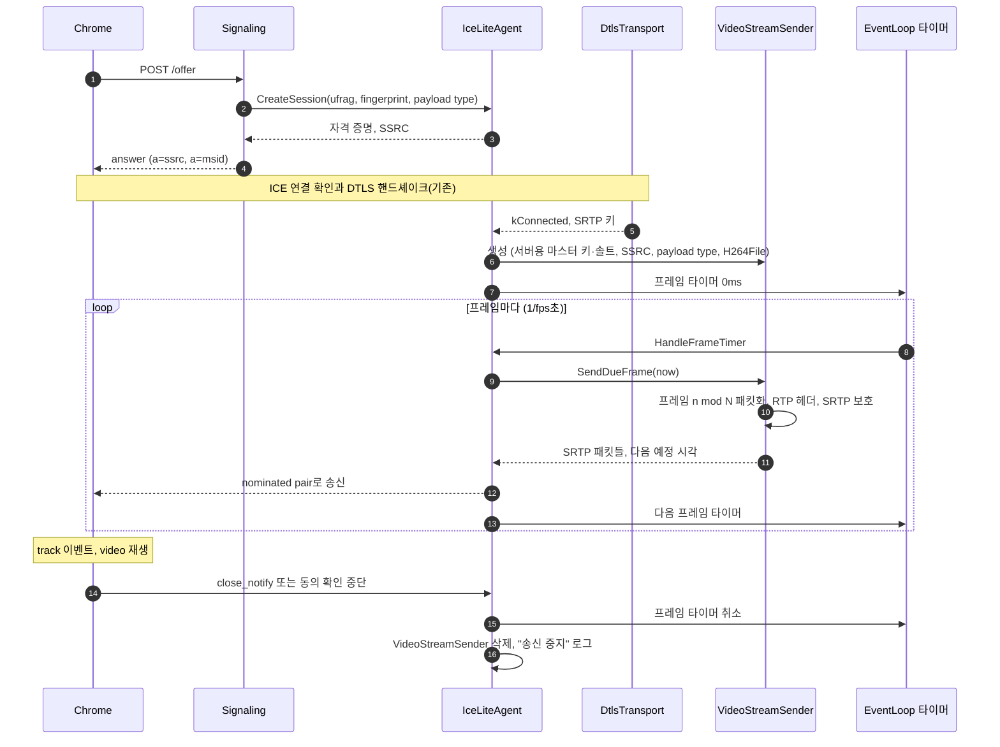

# Design

## Context

변경 이유는 proposal.md "Why"를 따른다. 요구 동작은 이 change의 `specs/`(`srtp`, `video-file-source`, `rtp-video-streaming`, `webrtc-signaling`)를 따른다.

현재 상태:

- `IceLiteAgent`는 주소별 UDP 소켓, 서버 ufrag를 키로 하는 세션 테이블, nominated pair 테이블을 소유한다.
  - 세션마다 `DtlsTransport`와 DTLS 재전송 타이머, 만료 타이머를 가진다.
  - DTLS 상태 변화는 `FinishDtlsStep`에서 한 곳으로 모여 처리된다.
- `DtlsTransport::SrtpKeys()`는 `kConnected`가 된 뒤 서버용(`local_*`)·브라우저용(`remote_*`) 마스터 키와 솔트를 돌려준다.
- `Signaling::HandleOffer`는 `CreateSession(remote_ufrag, remote_fingerprint)`로 세션을 만든 뒤 `BuildSdpAnswer`로 answer를 만든다. answer의 H.264 payload type은 `SdpOffer::h264.payload_type`(문자열)이다. 세션은 이 값을 모른다.
- `crypto::ComputeHmacSha1`은 여러 데이터 조각을 이어 붙이지 않고 서명할 수 있다. `crypto::FillRandomBytes`로 난수를 만든다.
- 이벤트 루프 타이머는 밀리초 단위로 올림한 일회성 타이머다.

제약:

- C++23, `-fno-exceptions`, 외부 라이브러리는 C API만 사용한다.
- 서버는 단일 스레드이며, 모든 처리는 이벤트 루프 스레드에서 한다.

## Goals / Non-Goals

**Goals:**

- 패킷 처리(SRTP, 패킷화, 송신 일정 계산)를 소켓·루프와 분리한다. `DtlsTransport`처럼 입력을 받아 보낼 데이터그램을 돌려주는 형태로 만들어, 단위 테스트에서 시간과 패킷을 직접 다룬다.
- 동영상 소스를 송신과 분리하여, 이후 MP4 파일, 카메라 실시간 영상, HLS도 같은 프레임 단위(`media::H264Frame`)를 쓸 수 있게 한다.
- 송신 경로 전체(SRTP 복호화 → RTP 해석 → 프레임 재조립)를 브라우저 없이 테스트 클라이언트로 검증한다.

**Non-Goals:**

- 송신 대역폭 제어와 혼잡 제어. RTCP가 없으므로 브라우저의 수신 상태를 알 수 없다.
- 여러 세션이 하나의 패킷화 결과를 공유하는 최적화. 세션마다 SSRC·순번·키가 달라 SRTP 결과는 어차피 다르다. 패킷화는 프레임 수가 적어 비용이 작다.
- 범용 비트 리더와 SPS 해석. `first_mb_in_slice`가 0인지는 첫 비트만 보면 된다(결정 4).

## Decisions

### 1. 모듈과 디렉터리 구성

| 위치 | 내용 | 의존 |
|---|---|---|
| `src/crypto/srtp.h/.cpp` | 세션 키 유도, AES-CM 키스트림, `SrtpSender` | OpenSSL `libcrypto`, `hmac_sha1` |
| `src/media/h264_file.h/.cpp` | Annex-B 분할, 프레임 묶기, 파일 읽기와 검증 | 없음 |
| `src/webrtc/rtp_packet.h/.cpp` | RTP 고정 헤더 쓰기 | 없음 |
| `src/webrtc/h264_packetizer.h/.cpp` | 프레임 → RTP 페이로드(단일 NAL, FU-A) | `media` |
| `src/webrtc/video_stream_sender.h/.cpp` | 세션별 송신 상태와 일정 | `crypto/srtp`, `media`, 패킷화 |

- `media`를 새 디렉터리로 둔다. 프로젝트 목표에서 미디어 소스는 WebRTC, HLS, Qt 클라이언트가 함께 쓰는 공통 기반이다. 따라서 `webrtc` 아래에 두지 않는다.
- SRTP는 `crypto`에 둔다. RTP 헤더 형식은 알아야 하지만 WebRTC 시그널링과 무관하고, `hmac_sha1`과 같은 암호 계층이다. SRTP가 읽는 헤더 필드는 순번, SSRC, 헤더 길이(CSRC 수, 확장)뿐이며, `srtp.cpp` 안에서 직접 읽는다.

### 2. 구성 요소와 소유 관계



- `main`은 `--video-file`이 있을 때 `IceLiteAgent`보다 먼저 `H264File`을 읽는다. 그리고 `IceLiteAgentConfig`에 `const media::H264File*`로 넘긴다. 없으면 `nullptr`이고, 그러면 `VideoStreamSender`를 만들지 않는다.
- `H264File`은 파일 바이트(`std::vector<std::uint8_t>`)와 `H264Frame` 목록을 소유한다. `H264Frame`의 NAL 뷰는 그 바이트 버퍼를 가리키므로, `H264File`이 살아 있는 동안만 유효하다. 모든 세션이 같은 객체를 읽기 전용으로 공유한다.
- `VideoStreamSender`는 소켓과 루프를 모른다. `DtlsTransport`와 같은 방식이다. 에이전트가 반환된 데이터그램을 보내고, 반환된 다음 기한으로 타이머를 건다.

### 3. SRTP 직접 구현

RFC 3711의 `AES_CM_128_HMAC_SHA1_80`만 구현한다. OpenSSL에는 SRTP 패킷 보호 API가 없으므로, 그 아래 단계인 AES와 HMAC을 조합한다.

공개하는 단위는 다음과 같다.

- `DeriveSrtpSessionKeys(master_key, master_salt) -> SrtpSessionKeys`
  - 레이블 0x00(암호화 키 16바이트), 0x01(인증 키 20바이트), 0x02(세션 솔트 14바이트)를 만든다.
  - 레이블마다 x = 마스터 솔트 XOR (레이블 << 48)이다. 키 유도 주기가 0이므로 인덱스 항은 0이다.
  - 마스터 키로 IV = x << 16인 AES-CM 키스트림을 필요한 길이만큼 만든다.
- `XorAesCmKeystream(key, iv, data)`: `EVP_aes_128_ctr`로 data에 키스트림을 XOR한다. CTR 모드는 128비트 카운터 전체를 1씩 올린다. SRTP의 AES-CM도 IV의 하위 16비트를 블록 카운터로 쓰고, 패킷 하나는 2^16블록을 넘지 않는다. 따라서 결과가 같다.
- `SrtpSender::Create(master_key, master_salt)`: 세션 키를 유도하고, 재사용할 `EVP_CIPHER_CTX`를 만든다.
- `SrtpSender::Protect(rtp_packet) -> std::expected<std::vector<std::uint8_t>, std::string>`
  1. 헤더에서 순번과 SSRC를 읽고 헤더 길이를 계산한다.
  2. 직전 순번보다 작아졌으면 ROC를 1 올린다(첫 패킷 제외). 패킷 인덱스는 ROC × 65536 + 순번이다.
  3. IV = (세션 솔트 << 16) XOR (SSRC << 64) XOR (인덱스 << 16)로 페이로드를 암호화한다.
  4. 암호화한 패킷과 ROC(4바이트)를 `ComputeHmacSha1`의 두 조각으로 넘기고, 앞 10바이트를 붙인다.

이 구조를 고른 이유:

- 키 유도와 키스트림을 함수로 공개하면 RFC 3711 부록 B.2·B.3의 벡터로 각각 검증할 수 있다. 테스트의 수신 측 복호화(결정 9)도 이 함수들로 만든다.
- 복호화(`Unprotect`)는 서버 코드에 넣지 않는다. 지금 서버는 SRTP를 받지 않는다. 수신 측의 ROC 추정과 재생 공격 방지는 RTCP나 수신을 구현할 때 함께 설계한다.

대안:

- libsrtp2: explore 단계에서 검토했다. 프로토콜을 직접 다루기로 해서 쓰지 않는다. `SrtpSender`의 공개 인터페이스(마스터 키로 생성, 패킷 보호)는 libsrtp로 바꿔도 그대로 유지된다.
- 패킷마다 `EVP_CIPHER_CTX`를 새로 만들기: 단순하지만 할당이 패킷마다 생긴다. 하나를 재사용하고 `EVP_EncryptInit_ex`로 IV만 바꾼다.

키 수명: `SrtpSender`는 세션 키를 소유하고, 소멸할 때 `OPENSSL_cleanse`로 지운다. 마스터 키는 `DtlsTransport`가 그대로 보관한다(기존 동작).

### 4. H.264 파일 읽기와 프레임 분할

`H264File::Load(path)`가 다음 순서로 처리한다.

1. **읽기**: 파일 크기를 확인한다. 64MiB를 넘으면 실패한다. 그다음 전체를 읽는다.
2. **NAL 분할**: `00 00 01`을 찾아 NAL 경계를 정한다. 4바이트 시작 코드의 앞 `00`과 NAL 끝의 0 바이트(trailing zero)는 NAL에서 뺀다.
3. **프레임 묶기**: specs `video-file-source` "프레임 분할"의 규칙을 따른다.
   - `first_mb_in_slice`는 슬라이스 헤더의 첫 ue(v) 값이다. 0이면 비트열이 `1`로 시작한다. 따라서 NAL 헤더 다음 바이트의 최상위 비트만 확인한다.
   - 에뮬레이션 방지 바이트(`00 00 03`)는 첫 바이트에 나타날 수 없으므로 신경 쓰지 않는다.
4. **검증**: 첫 프레임에 SPS, PPS, IDR이 모두 있는지 확인한다.

NAL 분할과 프레임 묶기는 바이트 버퍼를 받는 함수(`H264File::FromBytes`)로도 공개한다. 그래서 단위 테스트는 파일 없이 합성 데이터를 쓴다.

결과 프레임은 `media::H264Frame`으로 표현한다. 프레임 단위를 파일 형식과 분리해, 이후 MP4 파일, 카메라, HLS 소스도 같은 타입으로 프레임을 내놓고 패킷화와 송신 코드를 그대로 쓰게 한다.

- `H264Frame`은 액세스 단위 하나를 이루는 NAL 뷰 목록(`std::vector<std::span<const std::uint8_t>>`)이다. 각 뷰는 시작 코드를 뺀 NAL 단위 하나(NAL 헤더 포함)다.
- `H264File`은 `H264Frame` 목록을 파일 순서대로 제공한다(`Frames()`).
- 뷰는 `H264File`이 소유한 바이트 버퍼를 가리킨다. `std::vector`는 이동해도 버퍼 주소가 바뀌지 않으므로, `H264File`은 이동만 허용하고 복사는 막는다. 복사하면 새 객체의 뷰가 원래 객체의 버퍼를 가리키게 되기 때문이다.

대안:

- 송신할 때마다 파일에서 읽기: 메모리를 아끼지만 세션마다 파일 위치와 읽기 오류를 다뤄야 한다. 테스트 파일은 수 MB이므로 시작할 때 한 번 읽는다. 크기 상한으로 실수로 큰 파일을 지정하는 것을 막는다.
- AUD만으로 프레임 나누기: ffmpeg에 `aud=1`을 강제해야 하고, 다른 도구로 만든 파일에서는 동작하지 않는다.

### 5. RTP 패킷화

`PacketizeH264Frame(const media::H264Frame& frame, max_payload_size = 1200)`는 RTP 페이로드 목록을 돌려준다. 헤더는 `VideoStreamSender`가 붙인다.

- NAL 크기가 1200 이하이면 NAL을 그대로 페이로드로 쓴다(단일 NAL 패킷).
- 1200보다 크면 FU-A로 나눈다.
  - NAL 헤더(1바이트)는 떼어 FU indicator(F·NRI + 28)와 FU header(S/E + 원래 유형)로 옮긴다.
  - 조각마다 본문 최대 1198바이트를 싣는다.
- AUD(유형 9)는 건너뛴다. RFC 6184에서 선택 사항이고, 브라우저는 marker 비트와 타임스탬프로 프레임 경계를 안다.

1200바이트를 고른 이유:

- 1200(RTP 페이로드) + 12(RTP 헤더) + 10(SRTP 태그) + 28(IPv4/UDP)은 1250바이트다. 일반 MTU 1500보다 충분히 작다.
- DTLS 처리에서 쓰는 MTU 1200(이전 change)과 맞춘다.

STAP-A를 쓰지 않는 이유: 작은 NAL(SPS, PPS)은 IDR 프레임마다 두 개뿐이다. 묶어서 아끼는 패킷 수가 적은 데 비해 패킷화와 테스트 재조립이 복잡해진다.

### 6. 세션별 송신 상태와 재생 일정

`VideoStreamSender`가 세션 하나의 송신 상태를 가진다.

| 상태 | 초기값 | 갱신 |
|---|---|---|
| `next_sequence_number` | 무작위 16비트 | 패킷마다 +1(순환) |
| `initial_timestamp` | 무작위 32비트 | 바뀌지 않음 |
| `sent_frame_count`(n) | 0 | 프레임마다 +1. 반복 재생해도 계속 늘어남 |
| `schedule_origin`, `schedule_origin_frame` | 송신 시작 시각, 0 | 늦어졌을 때 재설정 |

- 프레임 n의 소스 위치는 n mod (프레임 수)다. 이렇게 하면 반복 재생이 별도 분기 없이 이어진다.
- RTP 타임스탬프는 initial_timestamp + ⌊n × 90000 / fps⌋(모듈러 2^32)다. 누적 덧셈 대신 n에서 바로 계산하므로, fps가 90000의 약수가 아니어도 오차가 쌓이지 않는다.
- 프레임 n의 예정 시각은 schedule_origin + (n − schedule_origin_frame) / fps다.

`SendDueFrame(now)`은 프레임 하나의 SRTP 패킷 목록과 다음 예정 시각을 돌려준다.

- 다음 예정 시각이 이미 한 프레임 간격 넘게 지났으면 schedule_origin = now, schedule_origin_frame = n으로 다시 잡는다.
- 이렇게 하는 이유: 루프가 잠시 멈췄다가 돌아왔을 때 밀린 프레임을 한 번에 몰아 보내면, 브라우저 지터 버퍼가 넘치거나 소켓 송신 버퍼가 가득 찬다.
- 타임스탬프는 n으로 계산하므로 재설정해도 프레임 간격이 유지된다.

시간은 인자로 받는다(`std::chrono::steady_clock::time_point`). 그래서 단위 테스트가 실제로 기다리지 않고 일정과 재설정을 검증한다.

SRTP 보호가 실패하면 그 프레임의 나머지 패킷을 보내지 않고 오류를 돌려준다. 이런 경우는 OpenSSL 내부 오류뿐이다. 에이전트는 로그를 남기고 그 세션의 송신을 멈춘다.

### 7. 에이전트 연동

세션 생성:

- `CreateSession`이 `IceSessionRequest`(remote_ufrag, remote_fingerprint, H.264 payload type)를 받는다.
- 반환하는 `IceSessionParameters`에 자격 증명과 함께 송신 SSRC를 담는다.
  - SSRC는 0이 아닌 무작위 32비트 값이다. 세션 테이블에 있는 SSRC와 겹치지 않게 만든다.
  - SSRC와 payload type은 `Session`에 보관한다. 동영상 파일이 없어도 만들어, answer 형식이 설정과 무관하게 같게 한다.
- payload type은 `Signaling`이 offer 문자열을 0~127 정수로 바꿔 넘긴다. `SelectH264Codec`이 offer의 포맷 목록에서 고른 값이므로 범위를 벗어나면 offer 오류(`400`)로 처리한다.

송신 시작과 중지는 기존 `FinishDtlsStep`의 상태 변화 처리에 넣는다.

- `kHandshaking` → `kConnected`이고 동영상이 설정되어 있으면 다음을 한다.
  - `SrtpKeys()`의 `local_key`·`local_salt`로 `VideoStreamSender`를 만든다.
  - 0ms 프레임 타이머를 걸고 "송신 시작" 로그를 남긴다.
- `kConnected` → `kClosed`/`kFailed`이면 프레임 타이머를 취소하고 `VideoStreamSender`를 지운 뒤 "송신 중지" 로그를 남긴다.
- `RemoveSession`은 기존 타이머와 함께 프레임 타이머도 취소한다. 송신 중이었으면 "송신 중지" 로그를 남긴다.

`HandleFrameTimer(local_ufrag)`는 다음 순서로 처리한다.

1. 세션이 없으면 아무것도 하지 않는다. `VideoStreamSender`가 없어도 마찬가지다.
2. `SendDueFrame(steady_clock::now())`의 패킷을 nominated pair로 `sendto`한다.
3. 다음 예정 시각까지 남은 시간(밀리초 올림)으로 타이머를 다시 건다.

`sendto` 실패(`EAGAIN` 포함) 처리:

- 그 패킷만 버린다.
- 로그는 세션의 `has_logged_send_failure`로 처음 한 번만 남긴다.
- 키프레임 하나는 수십 개 패킷(약 100KB)이다. Linux UDP 기본 송신 버퍼(약 208KB) 안에 들어가므로, 보통은 실패하지 않는다.

대안: `VideoStreamSender`가 자체 타이머를 루프에 거는 방식이 있다. 하지만 그러면 `VideoStreamSender`가 루프와 소켓을 알아야 한다. 또 세션 제거와 DTLS 종료 시 정리 경로가 두 곳으로 나뉜다. 기존 재전송 타이머와 같은 방식으로 에이전트가 모든 세션 타이머를 관리한다.

### 8. SDP answer와 웹 페이지

`SdpAnswerParameters`에 `ssrc`, `cname`, `media_stream_id`, `track_id`를 추가한다. 협상 대상 섹션의 `a=fmtp` 뒤에 다음 줄을 넣는다.

```text
a=msid:<media_stream_id> <track_id>
a=ssrc:<ssrc> cname:<cname>
```

- cname은 세션마다 무작위 16자다(RFC 7022 권고). `GenerateIceCharString`을 재사용한다.
- 스트림 ID와 트랙 ID는 고정 문자열 `vms`, `video`다. 세션마다 `RTCPeerConnection`이 따로 있으므로 겹쳐도 문제가 없다.
- `a=ssrc`가 없어도 Chrome은 처음 보는 SSRC를 첫 수신 트랙에 연결한다(unsignaled SSRC). 그래도 SSRC를 알려 연결을 확실하게 하고, 테스트가 answer에서 SSRC를 읽을 수 있게 한다.

웹 페이지:

- `<video id="remote-video" autoplay muted playsinline>`을 추가한다.
- `track` 이벤트에서 `event.streams[0]`(없으면 그 트랙으로 만든 `MediaStream`)을 `srcObject`로 둔다.
- 다시 연결할 때는 이전 `srcObject`를 비운다.
- `muted`는 Chrome 자동 재생 정책 때문에 필요하다. 오디오가 없어도 음소거여야 사용자 동작 없이 재생된다.

### 9. 전체 흐름



### 10. 테스트 전략

- **`srtp_test`**
  - RFC 3711 부록 B.3의 세션 키 유도
  - 부록 B.2의 키스트림
  - 보호한 패킷의 형태: 헤더는 같고, 페이로드는 길이가 같고, 끝에 10바이트가 붙음
  - 테스트 수신 측 복호화로 원래 패킷 복원
  - 순번 65535 → 0에서 ROC 1로 계산되는지
- **테스트 수신 측**: `tests/crypto/srtp_test_receiver.h/.cpp`
  - 공개된 키 유도·키스트림 함수와 `ComputeHmacSha1`로 태그를 검증하고 복호화한다.
  - ROC는 수신 순번의 순환을 세어 정한다(테스트에서는 손실과 재정렬이 없다).
  - 서버 코드와 같은 함수를 쓰지만, 조립 순서와 IV 계산은 테스트 쪽에서 따로 작성한다. 그래서 `Protect`의 조립 실수는 잡힌다. 다만 키 유도와 키스트림 함수 자체의 오류는 B.2·B.3 벡터가 잡는다.
- **`h264_file_test`**
  - 합성 NAL 데이터로 3·4바이트 시작 코드, 프레임 경계(SPS/PPS/SEI/AUD, `first_mb_in_slice`), 한 프레임의 여러 슬라이스를 확인한다.
  - 슬라이스 없는 끝 프레임 버림, 첫 프레임 검증 실패를 확인한다.
  - 임시 파일로 없는 파일과 64MiB 초과(희소 파일)를 확인한다.
- **`h264_packetizer_test`**: 100바이트 NAL과 3000바이트 NAL의 결과, FU-A 비트, 재조립 결과를 확인한다.
- **`video_stream_sender_test`**: 시각을 직접 넘기며 다음을 확인한다.
  - 프레임 간격과 타임스탬프 증가(30fps에서 3000)
  - 반복 재생 시 순번·타임스탬프 연속
  - 늦었을 때 일정 재설정(몰아 보내지 않음)
  - marker 비트
- **`ice_lite_agent_test`**(확장): 합성 `H264File`(프레임 몇 개)을 설정한 에이전트와 테스트 DTLS 클라이언트로 다음을 확인한다.
  - 핸드셰이크 뒤 클라이언트가 받은 패킷을 복호화하면 SSRC·payload type이 세션 값과 같고, 순번이 연속되며, 재조립한 프레임이 원본과 같다.
  - close_notify 뒤 송신이 멈춘다.
  - 동영상이 없는 에이전트는 핸드셰이크 뒤에도 RTP를 보내지 않는다.

  SSRC를 알기 위해 `CreateSession`의 반환값을 쓴다. 테스트 클라이언트에는 SRTP 키 재료를 꺼내는 기능이 이미 있다(이전 change).
- **`sdp_test`**: answer에 `a=msid`와 `a=ssrc` 줄이 들어가는지 확인한다.
- **통합 셸 테스트**: `--video-fps` 오류, 없는 `--video-file`, 시작 코드 없는 파일에 대해 0이 아닌 종료 코드를 확인한다.
- **수동**: ffmpeg로 만든 파일과 Windows Chrome으로 다음을 확인한다.
  - 영상 표시, `framesPerSecond`, 반복 재생
  - 탭 두 개 동시 재생
  - 다시 연결

### 11. 오류 전달

| 계층 | 형식 | 호출자의 처리 |
|---|---|---|
| `H264File::Load` | `std::expected<H264File, std::string>` | 시작 단계이므로 표준 오류에 출력하고 0이 아닌 코드로 종료 |
| `--video-fps` 파싱 | 기존 명령행 오류 문구 | 사용법과 함께 출력하고 종료 |
| `SrtpSender::Create` | `std::expected<std::unique_ptr<SrtpSender>, std::string>` | 에이전트가 로그를 남기고 그 세션은 송신하지 않음. DTLS는 연결된 채로 둔다 |
| `SrtpSender::Protect`, `SendDueFrame` | `std::expected<..., std::string>` | 로그 후 그 세션의 송신 중지 |
| `sendto` | `errno` | 패킷 버림, 세션당 첫 실패만 로그 |
| payload type 변환 | offer 해석 오류 | 로그 후 `400` |

## Risks / Trade-offs

- [offer에 42e01f가 없으면 서버가 고른 코덱과 파일 프로파일이 다를 수 있다] → Chrome은 항상 42e01f를 제안한다. README의 ffmpeg 명령은 그 프로파일로 인코딩한다. 파일이 여러 개가 되면 이후 마일스톤에서 파일 SPS로 코덱을 고른다.
- [RTCP가 없어 패킷 손실 시 다음 키프레임(최대 1초)까지 화면이 깨진다] → 같은 LAN에서는 손실이 드물다. README 명령의 키프레임 주기를 1초로 둔다. PLI·NACK는 이후 마일스톤에서 RTCP와 함께 넣는다.
- [RTCP SR이 없어 브라우저가 RTP 타임스탬프와 실제 시각을 연결하지 못한다] → 비디오만 있으므로 립싱크가 필요 없다. Chrome은 SR 없이도 수신 시각으로 재생한다. 수동 검증에서 `framesPerSecond`와 지터를 확인한다.
- [키프레임 패킷을 한꺼번에 보내 순간 송신량이 커진다] → 720p 테스트 영상의 키프레임은 수십 개 패킷이다. LAN에서는 문제가 없고 송신 버퍼 안에 들어간다. 프레임 안 패킷 간격 조절은 범위 밖이다.
- [밀리초 타이머로 33.3ms 간격을 맞추므로 프레임마다 최대 1ms 지터가 생긴다] → 예정 시각을 n에서 바로 계산하므로 오차가 쌓이지 않는다. 브라우저 지터 버퍼가 흡수한다.
- [일정을 재설정하면 RTP 타임스탬프와 실제 송신 시각의 관계가 바뀐다] → 루프가 한 프레임 넘게 멈춘 경우에만 생긴다. 브라우저는 지연이 한 번 늘어난 것으로 처리한다.
- [세션마다 같은 파일을 따로 패킷화·암호화한다] → 30fps × 세션 수만큼의 작업이다. 개발 중 세션 수(몇 개)에서는 무시할 만하다. 카메라 실시간 영상에서 시청자가 많아지면 패킷화 결과 공유를 검토한다.
- [AES-CM과 IV 계산을 직접 구현해 미묘한 오류가 생길 수 있다] → RFC 벡터, 독립 작성한 테스트 수신 측, Chrome 통계(복호화 실패 수)의 세 단계로 확인한다. SRTP를 tasks의 첫 단계로 두어 다른 부분과 섞이기 전에 검증한다.
- [같은 키로 IV가 겹치면 AES-CM의 기밀성이 깨진다] → IV는 SSRC와 48비트 인덱스로 만들어진다. 세션마다 DTLS 키가 다르고, 한 세션에서 2^48개 패킷을 보내지 않는 한 겹치지 않는다. 30fps 영상이 그 수에 이르려면 수만 년이 걸린다.

## Migration Plan

- 새 의존성이 없다. ffmpeg는 테스트 영상을 만들 때만 필요하다(README).
- `--video-file`이 선택 인자라 기존 실행 방법과 통합 테스트는 그대로 동작한다.
- answer에 두 줄이 늘어난다. Chrome과 기존 테스트의 answer 검사에는 영향이 없다.
- `IceLiteAgent::CreateSession`의 인자와 반환형이 바뀐다. 호출자는 `Signaling`과 `ice_lite_agent_test`뿐이며 이 change에서 함께 고친다.
- 되돌리기: 이 change의 커밋을 되돌리면 송신하지 않던 이전 동작으로 돌아간다. 저장하는 데이터가 없다.
