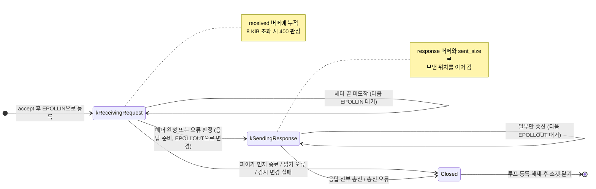

# Design

## Context

저장소에는 아직 소스 코드와 빌드 구성이 없다. 이 change가 첫 코드이므로, 여기서 정하는 디렉터리 구조, 이벤트 루프, 오류 전달 방식이 이후 마일스톤(M2 ICE, M3 DTLS/SRTP/RTP)의 기반이 된다. 요구 동작은 `specs/http-server/spec.md`를 따른다.

제약:

- C++23, CMake, GCC 15(WSL2 Ubuntu). `-fno-exceptions`로 빌드하고 오류는 반환값(`std::expected`, `std::error_code`)으로 전달한다.
- 이후 마일스톤에서 같은 프로세스가 TCP(HTTP)와 UDP(ICE/DTLS/RTP), 타이머(DTLS 재전송, RTP 페이싱)를 함께 처리해야 한다.

## Goals / Non-Goals

**Goals:**

- 이후 UDP 소켓과 타이머를 그대로 등록할 수 있는 단일 스레드 이벤트 루프를 만든다.
- HTTP 처리를 요청 해석, 경로 해석, 응답 생성으로 나눠 각각 소켓 없이 단위 테스트할 수 있게 한다.
- 요청 경로의 문법 검사로 웹 루트 밖 접근을 차단한다.

**Non-Goals:**

- 멀티스레드 처리, 높은 처리량을 위한 최적화(`sendfile`, 응답 캐시)
- 유휴 연결 타임아웃(타이머가 들어오는 M2 이후로 미룬다)
- 범용 HTTP 라이브러리 수준의 표준 준수(청크 전송, keep-alive, 본문 처리)

## Decisions

### 1. 디렉터리와 빌드 타깃 구성

```
CMakeLists.txt
src/
  apps/
    web_server/
      main.cpp                인자 해석, 시그널 설정, 서버 조립과 실행
  core/
    unique_fd.h               파일 디스크립터 RAII 래퍼
    system_error.h            errno -> std::error_code
    event_loop.h/.cpp         epoll 기반 이벤트 루프
    termination_signal_watcher.h/.cpp   signalfd 기반 종료 시그널 처리
  http/
    http_request.h/.cpp       요청 헤더 파싱
    http_response.h/.cpp      상태 코드와 응답 바이트 생성
    mime_type.h/.cpp          확장자 -> Content-Type
    static_files.h/.cpp       요청 경로 -> 웹 루트 안의 파일
    http_server.h/.cpp        리스닝 소켓과 연결별 상태 관리
web/
  index.html, app.js
tests/                        src/와 같은 디렉터리 구조
  test_support.h              공통 검사 도구
  core/, http/                모듈별 단위 테스트
  integration/
    http_server_test.sh       실행 파일 대상 통합 테스트(curl, nc)
```

실행 파일의 진입점은 `src/apps/<역할>/main.cpp`에 두고, 객체를 만들고 연결하는 일만 맡긴다. 그 밖의 `src/` 코드는 정적 라이브러리 `server_core`로 묶고, 실행 파일 `vms_web_server`와 테스트 실행 파일이 이를 링크한다. 실행 파일 이름은 `vms_<역할>` 형식을 따르며, 웹 페이지를 제공하는 이 서버는 `vms_web_server`다. 실행 파일이 늘어나도 같은 규칙으로 `src/apps/` 아래에 진입점을 추가한다.

공통 컴파일 옵션은 `-fno-exceptions -Wall -Wextra -Wpedantic`이며 `CMAKE_CXX_EXTENSIONS OFF`로 C++23 표준 모드를 강제한다.

### 2. 이벤트 루프: epoll, level-triggered, fd별 핸들러

`EventLoop`는 fd와 핸들러(`std::move_only_function<void(uint32_t events)>`)를 등록받아 `epoll_wait` 결과를 핸들러로 전달한다. 루프는 fd를 소유하지 않고, fd를 가진 객체(리스너, 연결)가 자신의 수명 동안 등록과 해제를 책임진다.

- **level-triggered를 선택한 이유**: edge-triggered는 `EAGAIN`까지 반복해 읽어야 하고 빠뜨리면 연결이 멈춘다. M1의 부하에서는 성능 차이가 없으므로 실수 여지가 적은 쪽을 택한다.
- **대안 - 연결마다 스레드**: 구현은 단순하지만 M2 이후 UDP·타이머와 상태를 공유하려면 동기화가 필요해진다. 단일 스레드 루프로 시작하면 모든 세션 상태를 락 없이 다룰 수 있다.
- 핸들러 실행 중 연결이 스스로 해제될 수 있으므로, 해제 요청은 즉시 지우지 않고 현재 `epoll_wait` 결과를 모두 처리한 뒤 정리한다.

### 3. 시그널 처리: signalfd를 이벤트 루프에 등록

시작 시 `SIGINT`, `SIGTERM`을 `sigprocmask`로 막고 `signalfd`를 루프에 등록한다. 시그널이 오면 일반 이벤트처럼 핸들러에서 루프 종료 플래그를 세운다.

- **대안 - `sigaction` 핸들러**: 핸들러 안에서는 async-signal-safe 함수만 쓸 수 있어 `volatile sig_atomic_t` 플래그와 `epoll_wait`의 `EINTR` 처리를 따로 맞춰야 한다. signalfd는 이 경계를 없애 종료 흐름을 다른 이벤트와 같은 경로로 처리한다.

### 4. 연결 상태 머신과 응답 버퍼



`kReceivingRequest`, `kSendingResponse`는 `HttpServer::Connection::State`의 값이고, `Closed`는 상태 값이 아니라 연결 객체가 제거되는 시점이다.

응답은 헤더와 파일 내용을 하나의 버퍼로 만들어 두고, 쓸 수 있을 때마다 남은 부분을 `send`한다. 정적 파일은 수 KiB 규모의 페이지와 스크립트뿐이고 동영상은 HTTP가 아니라 RTP로 전달되므로, 파일 전체를 메모리로 읽는 단순한 방식으로 충분하다. 송신에는 `MSG_NOSIGNAL`을 사용해 끊긴 연결에 쓸 때 `SIGPIPE`로 종료되지 않게 한다.

### 5. 요청 해석: 헤더 경계까지 모은 뒤 한 번에 해석

수신 버퍼에 `\r\n\r\n`이 나타날 때까지 모으고, 그 전에 8 KiB를 넘으면 `400`으로 판정한다. 해석 결과는 `std::expected<HttpRequest, HttpStatus>`로 반환하여 호출자가 성공 시 처리, 실패 시 해당 상태 코드 응답으로 바로 분기한다.

- 요청 줄은 `메서드 SP 대상 SP HTTP/1.x` 형식만 허용한다.
- 헤더는 `이름: 값` 형식만 검사하고 값은 보관하지 않는다. M1에서 사용하는 헤더가 없기 때문이며, 시그널링에서 `Content-Length`가 필요해지면 그때 보관한다.
- 메서드 검사(`405`)는 파서가 아니라 라우팅 단계에서 한다. 파서는 문법만 판단하고, 어떤 메서드를 지원할지는 엔드포인트가 정하게 하여 M2에서 `POST` 추가 시 파서를 바꾸지 않게 한다.

### 6. 경로 해석: 요청 경로의 문법 검사만 적용

1. 쿼리 문자열을 제거하고, 대상이 `/`로 시작하지 않으면 `400`, `/`이면 `/index.html`로 바꾼다.
2. `/`로 나눈 구성 요소 중 `..`이 있으면 `403`으로 거절한다.
3. 웹 루트와 결합한 경로가 일반 파일이 아니거나 존재하지 않으면 `404`.
4. 파일을 읽지 못하면 `500`. 경로 확인과 읽기 사이에 파일이 지워졌거나 읽기 권한이 없는 경우다.

웹 루트 안에 심볼릭 링크가 없다고 가정하고, 링크를 따라간 실제 위치는 검사하지 않는다.

- **대안 - 실제 경로 검사**: 결합한 경로를 `std::filesystem::weakly_canonical`로 정규화해 심볼릭 링크를 해석하고, 결과가 정규화한 웹 루트 아래인지 경로 구성 요소 단위로 비교한다. 웹 루트 안의 링크가 밖을 가리키는 경우까지 막을 수 있지만, 지금은 웹 루트의 파일을 운영자만 구성하므로 위험이 낮아 도입을 미룬다. 재검토 조건은 Risks에 기록한다.

`std::filesystem`은 `-fno-exceptions` 환경에서 예외를 던지는 오버로드를 호출하면 프로그램이 중단되므로, 반드시 `std::error_code&`를 받는 오버로드만 사용한다.

### 7. 오류 전달 규칙

- 시스템 호출 실패: `std::expected<T, std::error_code>`로 반환하며 `std::error_code(errno, std::system_category())`를 담는다.
- HTTP 처리 실패: `HttpStatus` 열거형으로 반환하고, 연결 계층이 이를 오류 응답으로 바꾼다.
- 메모리 할당 실패는 `-fno-exceptions` 환경에서 프로그램 중단으로 이어지며, 이 프로젝트에서는 별도로 처리하지 않는다.

### 8. 로그

`std::println(stderr, ...)`로 시작 정보(주소, 웹 루트), 요청당 한 줄(`메서드 경로 상태코드`), 종료 메시지를 출력한다. 로그 계층과 수준 구분은 필요해질 때 도입한다.

### 9. 테스트

- **단위 테스트**: 요청 해석, 경로 해석, MIME 판정, 응답 생성. 외부 프레임워크 없이 CTest에 등록한 테스트 실행 파일로 작성하고, 실패 시 메시지를 출력하고 0이 아닌 코드로 끝낸다.
- **통합 테스트**: 셸 스크립트가 임시 웹 루트와 고정 포트(기본 18080, `HTTP_SERVER_TEST_PORT`로 변경 가능)로 `vms_web_server`를 띄우고 `curl`로 명세의 시나리오(200/400/403/404/405/500, 헤더)를 확인한 뒤 `SIGTERM`으로 종료 코드 0을 검증한다. 형식이 잘못된 요청은 `curl` 대신 `nc`로 보낸다. 빈 포트를 자동으로 찾으려면 외부 도구가 필요하거나 서버가 실제로 바인드한 포트를 알려 줘야 하므로, 고정 포트와 환경 변수로 충돌을 피하는 단순한 방식을 택한다.
- **대안 - GoogleTest**: `-fno-exceptions`에서도 쓸 수 있지만 첫 단계에서 외부 의존성과 다운로드를 늘린다. 테스트가 많아지면 그때 도입을 검토한다.
- **수동 확인**: Windows 브라우저에서 `http://localhost:8080/` 접속.

## Risks / Trade-offs

- [유휴 연결 타임아웃이 없어 헤더를 끝내지 않는 연결이 fd를 계속 점유한다] → 로컬 개발용이므로 감수하고, M2에서 타이머를 추가할 때 연결 타임아웃을 함께 넣는다.
- [파일 전체를 메모리로 읽는다] → 정적 파일은 작고 동영상은 HTTP로 보내지 않는다. 큰 파일을 HTTP로 제공해야 하면 `sendfile`로 바꾼다.
- [WSL2에서 Windows 브라우저가 `localhost`로 접속하지 못할 수 있다] → TCP는 WSL2 기본 localhost 포워딩으로 대부분 동작한다. 실패하면 WSL의 IP로 접속하거나 네트워크 모드를 조정하며, UDP를 포함한 상세 검토는 M2 디버깅 때 진행한다.
- [퍼센트 인코딩을 해석하지 않는다] → 공백이나 비ASCII 파일 이름은 제공할 수 없다. 현재 정적 파일 이름은 ASCII뿐이며, 해석을 추가할 때는 디코딩 후 6장의 경로 검사를 다시 적용해야 한다.
- [웹 루트 안의 심볼릭 링크는 그대로 따라가므로, 웹 루트 밖을 가리키는 링크가 있으면 그 파일이 제공된다] → 운영자가 웹 루트에 링크를 만들지 않는다고 가정한다. 클라이언트 입력으로 파일을 선택하는 기능을 추가하거나, 운영자가 아닌 주체가 파일을 넣을 수 있는 디렉터리를 제공할 때 6장의 실제 경로 검사 도입을 다시 검토한다.
- [읽지 않은 요청 데이터가 수신 버퍼에 남은 채 `close`하면 FIN 대신 RST가 전송되어, 클라이언트가 이미 보낸 응답을 받지 못할 수 있다] → 브라우저가 보내는 본문 없는 `GET`에서는 발생하지 않는다. 요청 본문을 받는 엔드포인트를 추가할 때, 응답 후 `shutdown(SHUT_WR)`으로 송신만 닫고 남은 데이터를 시간 제한 안에서 읽어 버린 뒤 닫는 lingering close를 함께 도입한다.

## 향후 확장 지점

이후 마일스톤에서 예상되는 필요와, 그에 대비해 이 설계에서 정한 결정의 대응 관계다. 바꾸기 비싼 결정만 미리 맞추고, 나머지는 필요해질 때 추가한다.

| 예상되는 필요 | 대응하는 결정 | 추가 시 작업 |
|---|---|---|
| TCP(HTTP), UDP(ICE/DTLS/RTP), 타이머를 한 프로세스에서 처리 | 2장 fd 핸들러 방식 이벤트 루프 | UDP 소켓과 `timerfd`를 루프에 등록 |
| 시그널링, 패킷 수신, 타이머가 같은 세션 상태를 갱신 | 2장 단일 스레드 루프 | 락 없이 세션 객체에 직접 접근 |
| 여러 코어 활용 | 세션은 자기 루프 밖의 상태에 접근하지 않음 | 루프를 코어 수만큼 두고 세션을 루프에 고정 배정, 루프별 UDP 포트 사용 |
| 시그널링 `POST` 엔드포인트 | 5장 파서와 라우팅 분리 | 라우팅에 엔드포인트 추가, `Content-Length` 기반 본문 수신, lingering close |
| 모든 계층의 오류 처리 | 7장 `std::expected`, `std::error_code` 규칙 | 같은 규칙을 그대로 적용 |
| 동영상 목록과 선택 | 6장 경로 해석 | 클라이언트 입력 경로에 대한 실제 경로 검사 재검토 |
