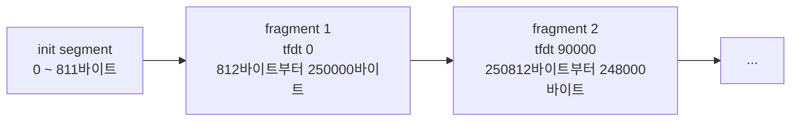

# Background

## 읽는 순서

1. 이 문서의 "개념" 절을 읽는다.
2. 이 문서의 "식별자" 절을 읽는다.
3. 이 문서의 "이 change가 하는 일" 절을 읽는다.
4. proposal을 읽는다.
5. specs의 `recording-playback`, `video-catalog`, `webrtc-signaling`을 읽는다.
6. design을 읽는다.
7. tasks를 읽는다.

specs의 `recording-playback`은 재생 목록의 줄을 하나씩 정한다. 그 spec을 읽을 때는 이 문서의 [재생 목록 태그](#재생-목록-태그) 절을 함께 본다.

다른 문서는 이 문서의 소제목으로 용어를 링크한다. 다만 specs는 change를 아카이브할 때 `openspec/specs/`로 옮겨진다. 그래서 specs는 이 문서로 링크하지 않고, 용어를 처음 쓰는 자리에서 뜻을 직접 쓴다.

## 개념

### 녹화 파일의 구조

#### 녹화 파일

녹화 파일은 서버가 카메라마다 만드는 fragmented MP4(fMP4) 파일이다. 확장자는 `.mp4`다. 서버는 `--record-segment`초(기본 60초)마다 새 녹화 파일을 연다. 녹화 파일은 맨 앞의 init segment 하나와 그 뒤의 fragment 여러 개로 이루어진다. init segment와 fragment는 바로 아래 소제목에서 설명한다.

#### init segment

init segment는 녹화 파일 맨 앞의 `ftyp` 상자와 `moov` 상자다. 이 용어는 Media Source Extensions 명세의 initialization segment를 줄인 말이다.

- init segment는 해상도와 코덱 설정(SPS, PPS)을 담는다.
- init segment는 영상 데이터를 담지 않는다.
- 디코더는 fragment를 디코딩하기 전에 init segment를 먼저 읽어야 한다.
- init segment의 크기는 보통 수백 바이트다.

#### fragment

fragment는 `moof` 상자와 `mdat` 상자 한 쌍이다. 이 용어는 ISO/IEC 14496-12의 movie fragment에서 왔다.

- 녹화기는 GOP 하나를 fragment 하나로 쓴다. GOP는 키프레임부터 다음 키프레임 직전까지의 프레임이다.
- vms-cam 기본 설정에서 GOP 하나의 재생 시간은 약 1초다.
- fragment는 항상 키프레임으로 시작한다. 그래서 디코더는 앞 fragment 없이 fragment 하나를 디코딩할 수 있다.

#### `tfdt`

`tfdt`는 [fragment](#fragment) 안에 있는 상자다. `tfdt`는 그 fragment 첫 프레임의 타임스탬프를 담는다.

- 타임스탬프의 단위는 1/90000초다.
- 타임스탬프의 기준점은 녹화 파일의 첫 프레임이다. 그래서 새 녹화 파일의 타임스탬프는 0부터 다시 시작한다.

아래 그림은 녹화 파일 하나의 앞부분이다.



#### 색인 파일

색인 파일은 녹화 파일과 이름이 같고 확장자가 `.idx`인 파일이다.

- 색인 파일은 헤더 하나와 레코드 여러 개로 이루어진다.
- 헤더는 녹화 파일의 시작 시각을 담는다.
- 녹화기는 fragment 하나를 쓸 때마다 레코드 하나를 색인 파일에 더한다. 레코드의 내용은 [`RecordingIndexRecord`](#recordingindexrecord)에서 설명한다.

색인 파일이 필요한 이유는 다음과 같다. 녹화 파일만 있으면 n번째 fragment의 위치를 알기 위해 녹화 파일을 처음부터 읽어야 한다. 색인 파일이 있으면 녹화 파일을 읽지 않고 위치를 얻는다.

#### 닫힌 파일

닫힌 파일은 [녹화 스레드](#녹화-스레드)가 쓰기를 마친 녹화 파일이다.

- 녹화 스레드는 녹화 파일을 디스크와 동기화한 뒤 닫는다.
- 녹화 스레드는 닫힌 파일을 다시 열지 않는다. 그래서 닫힌 파일의 내용은 바뀌지 않는다.
- 이 change는 닫힌 파일만 재생한다.

### HTTP 범위 요청

#### `Range` 요청

클라이언트는 `Range` 헤더로 파일의 바이트 범위를 요청할 수 있다. 서버는 그 범위만 `206 Partial Content`로 응답한다.

- 예를 들어 `Range: bytes=812-250811`은 812번째 바이트부터 250811번째 바이트까지를 요청한다.
- 범위의 끝 위치도 범위에 들어간다. 그래서 이 요청의 크기는 250000바이트다.
- 이 서버의 `Range` 처리는 `http-server` capability가 정한다.

### HLS

#### HLS 방식

HLS는 재생 목록과 세그먼트로 영상을 전달하는 방식이다. 재생 목록은 `.m3u8` 텍스트 파일이다. 재생기는 재생 목록을 먼저 받는다. 그다음 재생기는 재생에 필요한 세그먼트를 HTTP로 하나씩 받는다.

이 change가 HLS를 쓰는 이유는 다음과 같다.

- 브라우저의 `<video>` 요소는 여러 녹화 파일을 이어서 재생하지 못한다.
- `<video>` 요소는 녹화 파일 안에서 재생 위치에 해당하는 바이트 위치를 스스로 찾지 못한다.
- 재생 목록은 재생할 바이트 범위와 재생 시간을 순서대로 담는다. 재생기는 그 순서대로 바이트 범위를 받아 이어서 재생한다.

#### 세그먼트

세그먼트는 재생 목록의 항목 하나다. 이 change에서는 녹화 파일의 [fragment](#fragment) 하나가 세그먼트 하나다.

#### VOD 재생 목록

VOD 재생 목록은 항목이 더 늘지 않는 재생 목록이다. 재생기는 VOD 재생 목록을 한 번만 받는다. 이 change의 재생 목록에는 녹화 중인 파일이 들어가지 않는다. 그래서 이 change는 VOD 재생 목록을 만든다.

#### 재생 목록 태그

아래 예는 `front` 폴더에 녹화 파일 두 개가 있을 때의 재생 목록이다.

```text
#EXTM3U                                                   (1)
#EXT-X-VERSION:7                                          (2)
#EXT-X-PLAYLIST-TYPE:VOD                                  (3)
#EXT-X-INDEPENDENT-SEGMENTS                               (4)
#EXT-X-TARGETDURATION:1                                   (5)
#EXT-X-MAP:URI="/api/recordings/file.mp4?camera=front&file=20261108T090000Z",BYTERANGE="812@0"   (6)
#EXT-X-PROGRAM-DATE-TIME:2026-11-08T09:00:00.000Z         (7)
#EXTINF:1.000,                                            (8)
#EXT-X-BYTERANGE:250000@812                               (9)
/api/recordings/file.mp4?camera=front&file=20261108T090000Z
#EXTINF:0.999,
#EXT-X-BYTERANGE:248000@250812
/api/recordings/file.mp4?camera=front&file=20261108T090000Z
...
#EXT-X-DISCONTINUITY                                      (10)
#EXT-X-MAP:URI="/api/recordings/file.mp4?camera=front&file=20261108T092000Z",BYTERANGE="812@0"
#EXT-X-PROGRAM-DATE-TIME:2026-11-08T09:20:00.000Z
#EXTINF:1.000,
...
#EXT-X-ENDLIST                                            (11)
```

1. `#EXTM3U`: 이 파일이 HLS 재생 목록임을 나타낸다. 이 태그는 첫 줄에 온다.
2. `#EXT-X-VERSION`: 재생 목록이 쓰는 기능의 버전을 나타낸다. fMP4 세그먼트와 `#EXT-X-MAP`에는 버전 6 이상이 필요하다. 이 change는 버전 7을 쓴다.
3. `#EXT-X-PLAYLIST-TYPE:VOD`: 이 재생 목록이 [VOD 재생 목록](#vod-재생-목록)임을 나타낸다.
4. `#EXT-X-INDEPENDENT-SEGMENTS`: 재생기가 세그먼트 하나를 앞 세그먼트 없이 디코딩할 수 있음을 나타낸다. 녹화 파일의 fragment는 항상 키프레임으로 시작한다. 그래서 이 태그의 주장은 참이다.
5. `#EXT-X-TARGETDURATION`: 세그먼트 재생 시간의 상한을 나타낸다. 단위는 초이고 값은 정수다. 각 `#EXTINF` 값을 반올림한 값은 이 값 이하여야 한다. 예를 들어 패킷 손실 때문에 재생 시간이 1.5초인 fragment가 있으면 이 값은 2다.
6. `#EXT-X-MAP`: 뒤에 오는 세그먼트들의 [init segment](#init-segment) 위치를 나타낸다. `BYTERANGE="812@0"`은 0번째 바이트부터 812바이트를 가리킨다.
7. `#EXT-X-PROGRAM-DATE-TIME`: 바로 뒤 세그먼트의 첫 프레임이 녹화된 실제 시각(UTC)을 나타낸다. 재생기는 이 시각에 세그먼트 재생 시간을 차례로 더한다. 그 결과가 각 재생 위치의 실제 시각이다.
8. `#EXTINF:<초>,`: 다음 세그먼트의 재생 시간을 나타낸다. 예를 들어 재생 시간 89910(1/90000초 단위)은 `0.999`로 쓴다.
9. `#EXT-X-BYTERANGE:<크기>@<시작 위치>`: 다음 줄 URL의 파일에서 세그먼트가 차지하는 바이트 범위를 나타낸다. 재생기는 이 값을 `Range: bytes=812-250811`로 바꿔 요청한다.
10. `#EXT-X-DISCONTINUITY`: 이 줄 뒤에서 타임스탬프와 init segment가 바뀐다는 표시다. 녹화 파일마다 타임스탬프가 0부터 다시 시작한다. 그래서 서버는 녹화 파일 경계마다 이 태그를 넣는다. 재생기는 이 태그를 보고 두 파일을 재생 막대 위에서 이어 붙인다. 그 결과 카메라가 꺼졌던 09:01~09:20 구간은 재생 막대에 나타나지 않는다.
11. `#EXT-X-ENDLIST`: 재생 목록의 끝을 나타낸다.

### URL 인코딩

#### 퍼센트 인코딩

퍼센트 인코딩은 URL에 그대로 쓸 수 없는 바이트를 `%XX`로 바꾸는 규칙이다. `XX`는 바이트 값을 대문자 16진수 두 자리로 쓴 것이다.

- 예를 들어 공백은 `%20`이 된다.
- `정`의 UTF-8 바이트 `EC A0 95`는 `%EC%A0%95`가 된다.
- 영문자, 숫자, `-`, `.`, `_`, `~`는 바꾸지 않는다. RFC 3986은 이 문자들을 unreserved 문자라고 부른다.

이 change에 퍼센트 인코딩이 필요한 이유는 다음과 같다. 카메라 폴더 이름에는 한글, 공백, `&`, `"`가 들어갈 수 있다. `&`는 쿼리 매개변수를 나누는 문자다. `"`는 `#EXT-X-MAP:URI="..."`에서 URI의 끝을 나타낸다. 그래서 이런 문자를 그대로 쓰면 URL이나 재생 목록의 뜻이 바뀐다.

### 브라우저의 HLS 재생

#### Media Source Extensions

Media Source Extensions(MSE)는 브라우저 기능이다. 자바스크립트는 MSE로 영상 바이트를 `<video>` 요소에 넣는다. Chrome은 HLS 재생 목록을 직접 해석하지 않는다. 그래서 Chrome에서는 자바스크립트 라이브러리가 재생 목록을 해석하고 MSE로 영상 바이트를 넣는다.

#### hls.js

hls.js는 MSE로 HLS를 재생하는 자바스크립트 라이브러리다. 라이선스는 Apache License 2.0이다.

hls.js는 다음 순서로 동작한다.

1. hls.js는 재생 목록을 받는다.
2. hls.js는 재생 목록을 해석한다.
3. hls.js는 현재 재생 위치에 필요한 [세그먼트](#세그먼트)를 요청한다.
4. hls.js는 받은 세그먼트를 MSE로 `<video>` 요소에 넣는다.

`#EXT-X-DISCONTINUITY`를 만나면 hls.js는 다음 세그먼트의 타임스탬프를 고친다. 고친 타임스탬프는 앞 세그먼트의 끝에서 이어진다.

이 change는 hls.js의 다음 API를 쓴다.

- `hls.playingDate`: 현재 재생 위치의 실제 시각이다. 재생 목록에 `#EXT-X-PROGRAM-DATE-TIME`이 있을 때만 값이 있다.
- `Hls.Events.ERROR`: hls.js가 오류를 알리는 이벤트다. 이벤트의 `fatal`이 참이면 hls.js는 그 오류에서 스스로 복구하지 못한다.

`fatal`이 참인 오류의 예는 다음과 같다. 지워진 파일의 세그먼트를 요청하면 서버는 `404`로 응답한다. hls.js는 같은 요청을 몇 번 다시 보낸다. 다시 보낸 요청도 실패하면 hls.js는 `fatal`이 참인 오류를 알린다.

### 스레드

#### 이벤트 루프 스레드

이벤트 루프 스레드는 `EventLoop::Run()`을 실행하는 스레드다. 이 스레드는 HTTP 요청을 처리한다.

#### 녹화 스레드

녹화 스레드는 [`RecordingWriter`](#recordingwriter)가 만드는 스레드다.

- 녹화 스레드는 녹화 파일과 색인 파일을 쓴다.
- 녹화 스레드는 녹화 파일을 닫는다.
- 녹화 스레드는 보관 기간이 지난 녹화 파일을 지운다.

#### 파일 읽기 스레드

파일 읽기 스레드는 HTTP 서버가 파일 응답의 본문을 읽는 스레드다. 직전 change `add-async-file-response`가 이 스레드를 만들었다. 핸들러가 `HttpFileResponse`를 돌려주면 파일 읽기 스레드가 그 파일을 연다. 파일을 열 수 없으면 HTTP 서버는 `404`로 응답한다.

#### `EventLoop::Post()`

`EventLoop::Post()`는 다른 스레드가 [이벤트 루프 스레드](#이벤트-루프-스레드)에 함수를 넘기는 함수다.

- `Post()`를 부른 스레드는 넘긴 함수의 실행을 기다리지 않는다.
- 이벤트 루프 스레드는 다음 반복에서 넘겨받은 함수를 실행한다.
- `Post()`를 부르는 스레드는 `EventLoop`가 소멸하기 전에 끝나야 한다.
- `EventLoop::Run()`이 반환된 뒤 넘긴 함수는 실행되지 않는다. 그 함수는 `EventLoop`가 소멸할 때 실행 없이 파괴된다.

이 change에 `Post()`가 필요한 이유는 다음과 같다. 이벤트 루프 스레드는 [`RecordingLibrary`](#recordinglibrary)를 읽는다. 녹화 스레드가 `RecordingLibrary`를 직접 고치면 두 스레드가 같은 객체에 동시에 접근한다. 그러면 잠금이 필요하다. 녹화 스레드가 `Post()`로 변경 작업을 넘기면 `RecordingLibrary`를 고치는 스레드는 이벤트 루프 스레드 하나뿐이다. 그래서 잠금이 필요 없다.

## 식별자

이 절은 이 change의 문서가 쓰는 코드 식별자를 설명한다. "새로 만든다"라고 쓰지 않은 식별자는 이 change 전부터 있던 것이다.

### 녹화 파일과 메모리 표현

#### `camera_folder`

`camera_folder`는 녹화 디렉터리(`--record-dir`) 아래의 카메라 폴더 이름이다.

- 녹화기는 카메라 이름으로 폴더를 만든다.
- 등록하지 않은 카메라의 폴더도 녹화 디렉터리에 남아 있을 수 있다.
- 쿼리 매개변수 `camera`의 값은 `camera_folder`다.

#### `stem`

`stem`은 [녹화 파일](#녹화-파일) 이름에서 확장자를 뺀 부분이다.

- `stem`은 파일 시작 시각(UTC)을 `20261108T090000Z` 형식으로 쓴 문자열이다.
- 같은 `stem`이 이미 있으면 녹화기는 `-1`, `-2`를 붙인다.
- 녹화 파일과 색인 파일은 같은 `stem`을 쓴다.
- 쿼리 매개변수 `file`의 값은 `stem`이다.

#### `start_unix_ms`

`start_unix_ms`는 녹화 파일의 시작 시각이다. 단위는 밀리초이고, 기준점은 1970-01-01T00:00:00Z다. 녹화기는 이 값을 [색인 파일](#색인-파일)의 헤더(`RecordingIndexHeader::start_unix_ms`)에 쓴다.

#### `RecordingIndexRecord`

`RecordingIndexRecord`는 [색인 파일](#색인-파일)의 레코드 하나다. 레코드 하나는 [fragment](#fragment) 하나를 가리킨다.

| 필드 | 뜻 | 단위와 기준점 |
| --- | --- | --- |
| `start_time` | fragment 첫 프레임의 타임스탬프. [`tfdt`](#tfdt) 값과 같다. | 1/90000초, 녹화 파일 첫 프레임 기준 |
| `duration` | fragment의 재생 시간 | 1/90000초 |
| `offset` | 녹화 파일 안에서 fragment가 시작하는 위치 | 바이트, 녹화 파일 시작 기준 |
| `size` | fragment의 크기 | 바이트 |
| `fragment_crc32` | fragment 바이트 전체의 CRC32 | - |

위 그림의 녹화 파일이라면 레코드 두 개의 (`start_time`, `duration`, `offset`, `size`)는 (0, 90000, 812, 250000)과 (90000, 90000, 250812, 248000)이다. 첫 fragment의 `offset` 812는 [init segment](#init-segment)의 크기와 같다.

#### `RecordedFragment`

`RecordedFragment`는 이 change가 새로 만드는 구조체다. `RecordedFragment`는 [`RecordingIndexRecord`](#recordingindexrecord)에서 `fragment_crc32`를 뺀 것이다. 멤버는 `start_time`, `duration`, `offset`, `size`다.

#### `RecordedFile`

`RecordedFile`은 [닫힌 파일](#닫힌-파일) 하나를 메모리에서 나타내는 구조체다.

| 멤버 | 뜻 | 단위와 기준점 |
| --- | --- | --- |
| `stem` | [`stem`](#stem) | - |
| `start_unix_ms` | [`start_unix_ms`](#start_unix_ms) | 밀리초, 1970-01-01T00:00:00Z 기준 |
| `duration` | 녹화 파일의 재생 시간 | 1/90000초 |
| `fragments` | 이 change가 새로 더하는 멤버. 녹화 파일 안 순서의 [`RecordedFragment`](#recordedfragment) 목록 | - |

#### `RecordedFileCatalog`

`RecordedFileCatalog`는 [`camera_folder`](#camera_folder)를 키로 쓰는 `std::map`이다. 값은 [`RecordedFile`](#recordedfile) 목록이다. 목록은 `start_unix_ms` 오름차순이다.

### 녹화 쪽 코드

#### `RecoverRecordings()`

`RecoverRecordings()`는 서버가 시작할 때 메인 스레드가 부르는 함수다. `RecoverRecordings()`는 다음 순서로 동작한다.

1. 녹화 디렉터리의 모든 [색인 파일](#색인-파일)을 읽는다.
2. 레코드마다 녹화 파일의 fragment 바이트로 CRC32를 계산한다.
3. 계산한 CRC32를 레코드의 `fragment_crc32`와 비교한다.
4. CRC32가 맞지 않는 첫 레코드부터 뒤를 잘라 낸다.
5. 남은 파일의 [`RecordedFileCatalog`](#recordedfilecatalog)를 돌려준다.

#### `RecordingWriter`

`RecordingWriter`는 [녹화 스레드](#녹화-스레드)를 소유하는 클래스다. 카메라가 하나 이상 등록되어 있으면 `main.cpp`가 `RecordingWriter`를 만든다. `RecordingWriter`는 소멸자에서 큐에 남은 작업을 모두 실행한다. 그다음 `RecordingWriter`는 녹화 스레드를 join한다.

#### `RecordingFileStore`

`RecordingFileStore`는 녹화 스레드에서 녹화 파일과 색인 파일을 다루는 클래스다. 이 change와 관련된 멤버는 다음과 같다.

- `closed_files_`: 녹화 스레드가 가진 [`RecordedFileCatalog`](#recordedfilecatalog)다.
- `WriteFragment()`: fragment 바이트와 레코드를 파일에 쓴다.
- `FinishFile()`: 녹화 파일을 동기화하고 닫는다. 그다음 그 파일을 `closed_files_`에 더한다.
- `ApplyRetention()`: `--record-retention`초보다 오래된 녹화 파일을 지운다.
- `DeleteOldestSegment()`: 디스크 여유 공간이 `--record-min-free`보다 작으면 가장 오래된 녹화 파일을 지운다.

#### `RecordingCatalogEvent`

`RecordingCatalogEvent`는 이 change가 새로 만드는 이벤트 타입이다. 녹화 스레드는 이 이벤트로 닫힌 파일의 변경을 알린다. `RecordingCatalogEvent`는 다음 두 구조체의 `std::variant`다.

- `RecordedFileClosed`: 녹화 스레드가 파일 하나를 닫았다는 이벤트다. 멤버는 `camera_folder`와 `file`이다. `file`은 `fragments`를 채운 [`RecordedFile`](#recordedfile)이다.
- `RecordedFileDeleted`: 녹화 스레드가 파일 하나를 지웠다는 이벤트다. 멤버는 `camera_folder`와 `stem`이다.

#### `RecordingCatalogListener`

`RecordingCatalogListener`는 이 change가 새로 만드는 함수 타입이다. 타입은 `std::move_only_function<void(RecordingCatalogEvent)>`다. 녹화 스레드는 이 함수를 불러 [`RecordingCatalogEvent`](#recordingcatalogevent)를 알린다.

### 재생 쪽 코드

#### `RecordingLibrary`

`RecordingLibrary`는 이 change가 `src/playback/`에 새로 만드는 클래스다. `RecordingLibrary`는 [이벤트 루프 스레드](#이벤트-루프-스레드)가 쓰는 닫힌 파일 목록을 보관한다. 목록의 형태는 [`RecordedFileCatalog`](#recordedfilecatalog)와 같다. 다만 목록의 `RecordedFile`은 `fragments`를 채운 값이다.

- `Apply()`: `RecordingCatalogEvent` 하나를 목록에 반영한다.
- `FindFolder()`: `camera_folder`로 파일 목록을 찾는다.
- `FindFile()`: `camera_folder`와 `stem`으로 `RecordedFile`을 찾는다.

#### `BuildHlsPlaylist()`

`BuildHlsPlaylist()`는 이 change가 새로 만드는 함수다. 이 함수는 `camera_folder`와 `RecordedFile` 목록으로 재생 목록 텍스트를 만든다. 이 함수는 디스크를 읽지 않는다.

#### `BuildRecordingFileUrl()`

`BuildRecordingFileUrl()`은 이 change가 새로 만드는 함수다. 이 함수는 `camera_folder`와 `stem`으로 녹화 파일 URL을 만든다.

#### `RecordingPlaybackEndpoints`

`RecordingPlaybackEndpoints`는 이 change가 새로 만드는 클래스다. 이 클래스는 HTTP 핸들러 두 개를 가진다.

- `HandlePlaylist()`: `GET /api/recordings/playlist.m3u8` 요청을 처리한다.
- `HandleFile()`: `GET /api/recordings/file.mp4` 요청을 처리한다.

#### `BuildSourceListResponse()`

`BuildSourceListResponse()`는 이 change가 새로 만드는 함수다. 이 함수는 `GET /api/sources`의 응답 JSON을 만든다.

#### `FindQueryParameter()`와 `EncodeQueryComponent()`

두 함수는 `src/http/query_string.h`에 있다.

- `FindQueryParameter()`: 요청 대상에서 쿼리 매개변수 하나를 찾아 [퍼센트 인코딩](#퍼센트-인코딩)을 디코딩한다. 이 함수는 잘못된 인코딩과 같은 이름의 매개변수가 두 번 이상 오는 경우를 오류로 돌려준다.
- `EncodeQueryComponent()`: 이 change가 새로 만드는 함수다. 이 함수는 값을 퍼센트 인코딩한다.

## 이 change가 하는 일

이 change는 녹화된 카메라 영상을 웹 페이지에서 재생하게 한다. 전체 흐름은 다음과 같다.

1. 서버는 카메라 영상을 [녹화 파일](#녹화-파일)로 저장한다.
2. 서버는 [fragment](#fragment)마다 녹화 파일 안 위치를 [색인 파일](#색인-파일)에 기록한다.
3. 이벤트 루프 스레드는 fragment 위치를 [`RecordingLibrary`](#recordinglibrary)에 보관한다.
4. 녹화 스레드는 파일을 닫거나 지울 때마다 [`RecordingCatalogEvent`](#recordingcatalogevent)를 알린다.
5. 이벤트 루프 스레드는 그 이벤트로 `RecordingLibrary`를 고친다.
6. 서버는 `RecordingLibrary`의 fragment 위치로 [HLS](#hls-방식) 재생 목록을 만든다.
7. 브라우저의 [hls.js](#hlsjs)는 재생 목록을 읽는다.
8. hls.js는 필요한 fragment만 [`Range` 요청](#range-요청)으로 받아 재생한다.

## 참고 문서

| 용어 | 문서 | 절 |
| --- | --- | --- |
| HLS 재생 목록 전체 | IETF RFC 8216 | 4 |
| `#EXTM3U`, `#EXT-X-VERSION` | IETF RFC 8216 | 4.3.1.1, 4.3.1.2 |
| `#EXTINF`, `#EXT-X-BYTERANGE`, `#EXT-X-DISCONTINUITY` | IETF RFC 8216 | 4.3.2.1, 4.3.2.2, 4.3.2.3 |
| `#EXT-X-MAP`, `#EXT-X-PROGRAM-DATE-TIME` | IETF RFC 8216 | 4.3.2.5, 4.3.2.6 |
| `#EXT-X-TARGETDURATION`, `#EXT-X-ENDLIST`, `#EXT-X-PLAYLIST-TYPE` | IETF RFC 8216 | 4.3.3.1, 4.3.3.4, 4.3.3.5 |
| `#EXT-X-INDEPENDENT-SEGMENTS` | IETF RFC 8216 | 4.3.5.1 |
| 프로토콜 버전과 기능 | IETF RFC 8216 | 7 |
| fMP4 세그먼트 조건 | IETF RFC 8216 | 3.3 |
| movie fragment(`moof`, `mdat`, `tfdt`) | ISO/IEC 14496-12 | 8.8 |
| initialization segment | W3C Media Source Extensions | 용어 정의 |
| Range 요청, 206, 416 | IETF RFC 9110 | 14, 15.3.7, 15.5.17 |
| 퍼센트 인코딩, unreserved 문자 | IETF RFC 3986 | 2.1, 2.3 |
| Media Source Extensions | W3C Media Source Extensions | 전체 |
| hls.js API(`loadSource`, `attachMedia`, `playingDate`, 오류 이벤트) | hls.js 저장소 `docs/API.md` | 해당 항목 |
