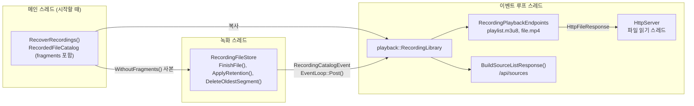

# Design

## Context

변경 이유는 proposal.md의 "Why" 절에 있다. 요구 동작은 이 change의 `specs/`(`recording-playback`, `video-catalog`, `webrtc-signaling`)에 있다. 용어와 식별자의 뜻은 [background.md](background.md)에 있다.

### 현재 상태: 녹화

- 서버가 시작할 때 `main.cpp`의 `PrepareRecordingDirectory()`가 메인 스레드에서 [`RecoverRecordings()`](background.md#recoverrecordings)를 부른다.
- `RecoverRecordings()`는 [`RecordedFileCatalog`](background.md#recordedfilecatalog)를 돌려준다.
- 지금의 [`RecordedFile`](background.md#recordedfile)은 `stem`, `start_unix_ms`, `duration`만 가진다. `RecoverRecordings()`는 [`RecordingIndexRecord`](background.md#recordingindexrecord)를 읽지만, 레코드의 `offset`과 `size`는 `RecordedFile`에 담지 않는다.
- 카메라가 하나 이상이면 `main.cpp`는 [`RecordingWriter`](background.md#recordingwriter)를 만든다. `main.cpp`는 `RecordedFileCatalog`를 `RecordingWriter`에 넘긴다.
- [`RecordingFileStore`](background.md#recordingfilestore)는 넘겨받은 `RecordedFileCatalog`를 `closed_files_`에 둔다.
- `FinishFile()`은 닫은 파일을 `closed_files_`에 더한다. `ApplyRetention()`과 `DeleteOldestSegment()`는 지운 파일을 `closed_files_`에서 뺀다.
- `main.cpp`는 `RecordingWriter`를 `EventLoop`보다 먼저 선언한다.
- [녹화 스레드](background.md#녹화-스레드)는 이벤트 루프 스레드에 아무것도 알리지 않는다.

### 현재 상태: 이벤트 루프와 HTTP

- [`EventLoop::Post()`](background.md#eventlooppost)는 다른 스레드가 이벤트 루프 스레드에 함수를 넘기는 함수다.
- HTTP 서버의 GET 엔드포인트 표는 요청 경로가 등록한 경로와 정확히 같을 때만 핸들러를 찾는다. 이때 요청 경로에서 쿼리 문자열은 뺀다.
- 핸들러는 `HttpFileResponse`를 돌려줄 수 있다. `HttpFileResponse`는 파일 경로와 `Content-Type`을 담는다.
- HTTP 서버는 `HttpFileResponse`의 파일을 [파일 읽기 스레드](background.md#파일-읽기-스레드)에서 읽는다. HTTP 서버는 `Range` 규칙에 따라 응답한다.
- `src/http/query_string.h`의 [`FindQueryParameter()`](background.md#findqueryparameter와-encodequerycomponent)는 쿼리 매개변수 하나를 찾아 디코딩한다.

### 현재 상태: 소스 목록과 웹 페이지

- `webrtc::Signaling::HandleSourceList()`가 `GET /api/sources`의 JSON을 만든다. 이 함수는 `VideoLibrary`와 `CameraList`를 읽는다.
- `web/app.js`는 고른 소스로 offer를 보낸다. 그다음 `web/app.js`는 WebRTC로 영상을 재생한다.
- `<video>` 요소는 `autoplay muted playsinline` 속성을 가진다. `<video>` 요소에는 재생 막대가 없다.

## Goals / Non-Goals

**Goals:**

- 이벤트 루프 스레드는 재생 목록을 만들 때 디스크를 읽지 않는다. 이벤트 루프 스레드는 메모리의 [`RecordingLibrary`](background.md#recordinglibrary)만 읽는다.
- `BuildHlsPlaylist()`와 `RecordingLibrary::Apply()`는 디스크와 스레드 없이 단위 테스트할 수 있다.
- 녹화 쪽 코드(`src/recording/`)는 이벤트 루프와 재생 기능을 참조하지 않는다. 녹화 스레드는 [`RecordingCatalogListener`](background.md#recordingcataloglistener)를 불러 파일을 닫거나 지운 사실만 알린다.

**Non-Goals:**

- `--record-retention`이 수 일일 때 재생 목록의 크기를 줄이는 기능. 이 문제는 "Risks / Trade-offs" 절에 적는다.
- HTTP 서버의 경로 라우팅 변경. 접두사 경로와 경로 매개변수는 다루지 않는다.

## Decisions

### 1. 구성 요소와 데이터 흐름



- 이벤트 루프 스레드만 `RecordingLibrary`를 읽고 고친다. 그래서 `RecordingLibrary`에는 잠금이 없다.
- 녹화 스레드는 생성자에서 받은 `RecordingCatalogListener`를 부른다.
- `main.cpp`가 넘기는 `RecordingCatalogListener`는 이벤트를 `EventLoop::Post()`로 이벤트 루프 스레드에 넘긴다.

### 2. `RecordedFile`에 `fragments`를 더한다

재생 목록은 [세그먼트](background.md#세그먼트)마다 바이트 범위를 쓴다. 바이트 범위에는 `RecordingIndexRecord`의 `offset`과 `size`가 필요하다. 지금의 `RecordedFile`에는 이 값이 없다. 그래서 `src/recording/recorded_file.h`에 다음 타입과 멤버를 더한다.

```cpp
struct RecordedFragment {
    std::uint64_t start_time;  // fragment 첫 프레임의 타임스탬프(1/90000초, 녹화 파일 첫 프레임 기준)
    std::uint32_t duration;    // fragment 재생 시간(1/90000초)
    std::uint64_t offset;      // 녹화 파일 안 시작 위치(바이트, 녹화 파일 시작 기준)
    std::uint32_t size;        // fragment 크기(바이트)
};

struct RecordedFile {
    // stem, start_unix_ms, duration (기존 멤버)
    std::vector<RecordedFragment> fragments;  // 녹화 파일 안 순서
};
```

- [`RecordedFragment`](background.md#recordedfragment)는 `RecordingIndexRecord`에서 `fragment_crc32`를 뺀 것이다.
- [init segment](background.md#init-segment)의 크기는 따로 저장하지 않는다. init segment는 녹화 파일의 0바이트부터 첫 fragment 직전까지다. 그래서 init segment의 크기는 `fragments[0].offset`과 같다.

#### `RecoverRecordings()`가 `fragments`를 채운다

`RecoverRecordings()`는 서버가 시작할 때 CRC를 확인하려고 모든 `RecordingIndexRecord`를 읽는다. `RecoverRecordings()`는 CRC가 맞는 레코드를 `RecordedFragment`로 바꾼다. `RecoverRecordings()`는 바꾼 `RecordedFragment`를 `RecordedFile::fragments`에 더한다. 그래서 `RecoverRecordings()`는 `fragments`를 채우려고 디스크를 더 읽지 않는다.

#### `RecordingFileStore`가 `fragments`를 모은다

`RecordingFileStore::WriteFragment()`는 다음 순서로 동작한다.

1. 열린 녹화 파일에 fragment 바이트를 쓴다.
2. 열린 색인 파일에 `RecordingIndexRecord`를 쓴다.
3. 그 fragment의 `RecordedFragment`를 `OpenRecording::fragments`에 더한다.

쓰기에 실패하면 `WriteFragment()`는 그 fragment를 되돌린다. 이때 `WriteFragment()`는 `OpenRecording::fragments`에 그 fragment를 더하지 않는다. 그래서 파일을 닫는 시점의 `OpenRecording::fragments`는 디스크에 남은 fragment와 같다.

#### 이유

`fragments`가 없으면 재생 목록 요청마다 `.idx`를 읽어야 한다. 이벤트 루프 스레드는 디스크를 읽지 않는다("Goals" 절). 그래서 `RecordingLibrary`가 `fragments`를 메모리에 가진다.

#### 녹화 스레드의 `closed_files_`에서는 `fragments`를 비운다

`ApplyRetention()`과 `DeleteOldestSegment()`는 지울 파일을 고를 때 `start_unix_ms`와 `duration`만 쓴다. 그래서 `closed_files_`에는 `fragments`가 필요 없다.

- `main.cpp`는 `RecoverRecordings()`의 결과를 `RecordingLibrary`에 복사한다.
- `main.cpp`는 `WithoutFragments()`로 `fragments`를 비운 사본을 만든다. `main.cpp`는 그 사본을 `RecordingWriter`에 넘긴다.
- `FinishFile()`은 `fragments`를 비운 `RecordedFile` 사본을 `closed_files_`에 더한다.

#### 대안

파일 읽기 스레드가 재생 목록 요청마다 `.idx`를 읽을 수 있다. 이 방법은 메모리를 덜 쓴다. 하지만 HTTP 서버에 새 종류의 작업이 필요하다. 새 작업은 파일을 읽어 응답 본문을 만드는 작업이다. 그래서 이 방법은 택하지 않는다.

### 3. 녹화 스레드는 `RecordingCatalogListener`로 파일 닫기와 삭제를 알린다

`src/recording/recording_catalog_event.h`에 [`RecordingCatalogEvent`](background.md#recordingcatalogevent)와 `RecordingCatalogListener`를 둔다.

| 이벤트 | 멤버 | 알리는 함수와 시점 |
| --- | --- | --- |
| `RecordedFileClosed` | `camera_folder`, `file` | `FinishFile()`. 파일을 동기화해 닫고 `closed_files_`에 더한 뒤 |
| `RecordedFileDeleted` | `camera_folder`, `stem` | `ApplyRetention()`, `DeleteOldestSegment()`. `.mp4`와 `.idx`를 지운 뒤 |

`RecordedFileClosed::file`은 `fragments`를 채운 `RecordedFile`이다.

#### 생성자 인자

- `RecordingWriter`의 생성자는 `RecordingCatalogListener`를 받는다.
- `RecordingWriter`는 그 함수를 `RecordingFileStore`의 생성자에 넘긴다.
- `RecordingFileStore`는 그 함수를 멤버 `listener_`에 둔다.
- 녹화 스레드가 `listener_`를 부른다.
- `listener_`가 빈 함수면 `RecordingFileStore`는 알리지 않는다.
- 기존 테스트는 빈 함수를 넘긴다. 새 테스트는 받은 이벤트를 벡터에 모으는 함수를 넘긴다.

#### 알리지 않는 경우

fragment가 하나도 없는 파일은 `FinishFile()`이 `.mp4`와 `.idx`를 지운다. 이 경우 `RecordingFileStore`는 알리지 않는다. 그 파일은 `closed_files_`에 들어간 적이 없기 때문이다.

#### 알리는 시점

- `RecordingFileStore`는 파일을 지운 뒤에 `RecordedFileDeleted`를 알린다. 그래서 이벤트 루프 스레드가 넘겨받은 작업을 실행하기 전까지, 지운 파일이 `RecordingLibrary`에 남는다. 그 사이에 클라이언트가 지운 파일을 요청하면 파일 읽기 스레드가 파일을 열지 못한다. 그러면 HTTP 서버는 `404`로 응답한다(`http-server`의 기존 규칙). 이 응답은 `RecordingLibrary`에 없는 파일의 응답과 같다.
- `RecordingFileStore`는 파일을 동기화해 닫은 뒤에 `RecordedFileClosed`를 알린다. 그래서 `RecordingLibrary`에 들어간 파일의 fragment는 모두 디스크에 있다.

### 4. `main.cpp`의 선언 순서를 바꾼다

`main.cpp`는 `EventLoop`를 `RecordingWriter`보다 먼저 선언한다. 선언 순서는 다음과 같다.

1. `RecordingLibrary`
2. `EventLoop`
3. `RecordingWriter`
4. 카메라 녹화 상태
5. …
6. `HttpServer`

#### 이유

- `Post()`를 부르는 녹화 스레드는 `EventLoop`가 소멸하기 전에 끝나야 한다. 지역 변수는 선언의 역순으로 소멸한다. 그래서 `RecordingWriter`는 `EventLoop`보다 먼저 소멸한다. `RecordingWriter`는 소멸자에서 큐에 남은 `RecordingTask`를 모두 실행한다. 그다음 `RecordingWriter`는 녹화 스레드를 join한다.
- 종료 중에 `RecordingWriter`의 소멸자는 마지막 파일을 닫는다. 이때 녹화 스레드는 `Post()`로 작업을 넘긴다. 이 시점에는 `EventLoop::Run()`이 이미 반환되었다. 그래서 이 작업은 실행되지 않는다. 이 작업은 `EventLoop`가 소멸할 때 파괴된다.
- 이 작업은 `RecordingLibrary`의 주소를 가진다. 하지만 작업이 실행되지 않으므로, 작업은 그 주소로 `RecordingLibrary`에 접근하지 않는다.
- `RecordingLibrary`는 `EventLoop`보다 먼저 선언한다. 그래서 `RecordingLibrary`는 `EventLoop`가 소멸할 때까지 살아 있다.
- HTTP 핸들러는 `RecordingLibrary`를 참조한다. `HttpServer`는 `RecordingLibrary`보다 나중에 선언한다. 그래서 `HttpServer`가 `RecordingLibrary`보다 먼저 소멸한다.

#### 카메라가 없을 때

카메라가 없으면 `main.cpp`는 지금처럼 `RecordingWriter`를 만들지 않는다. 그래도 `main.cpp`는 `RecoverRecordings()`의 결과로 `RecordingLibrary`를 채운다. 그래서 사용자는 녹화 디렉터리에 남은 녹화를 재생할 수 있다.

### 5. `src/playback/` 모듈

| 구성 요소 | 역할 |
| --- | --- |
| `RecordingLibrary` | `camera_folder`별 `RecordedFile` 목록을 보관한다. |
| [`BuildHlsPlaylist()`](background.md#buildhlsplaylist) | 재생 목록 텍스트를 만든다. |
| [`RecordingPlaybackEndpoints`](background.md#recordingplaybackendpoints) | 재생 목록 요청과 녹화 파일 요청을 처리한다. |
| [`BuildSourceListResponse()`](background.md#buildsourcelistresponse) | `/api/sources` 응답을 만든다. |

#### `RecordingLibrary`

- `RecordingLibrary`의 생성자는 `RecordedFileCatalog`를 받는다.
- 생성자는 이름이 UTF-8이 아닌 폴더를 뺀다. 생성자는 뺀 폴더를 표준 오류에 로그로 남긴다.
- 생성자는 파일이 없는 폴더를 뺀다.
- 각 폴더의 파일 목록은 `start_unix_ms` 오름차순이다.
- `Apply()`는 `RecordingCatalogEvent` 하나를 목록에 반영한다.
- `Apply()`가 폴더의 마지막 파일을 빼면 `Apply()`는 그 폴더도 지운다.
- `FindFolder()`는 `camera_folder`로 파일 목록을 찾는다. `FindFile()`은 `camera_folder`와 `stem`으로 `RecordedFile`을 찾는다.

#### `RecordingPlaybackEndpoints`

- `RecordingPlaybackEndpoints`는 요청의 쿼리 매개변수를 해석한다.
- `RecordingPlaybackEndpoints`는 `RecordingLibrary`에서 폴더나 파일을 찾는다.
- `HandlePlaylist()`는 재생 목록 본문을 돌려준다.
- `HandleFile()`은 `HttpFileResponse`를 돌려준다.

#### 소스 목록 생성 위치

`webrtc::Signaling::HandleSourceList()`를 지운다. `BuildSourceListResponse()`가 그 역할을 맡는다.

이유는 다음과 같다. 소스 목록은 이제 녹화 소스도 담는다. 녹화 소스는 WebRTC와 관계가 없다. `HandleSourceList()`를 `webrtc` 모듈에 두면 `webrtc` 모듈이 `RecordingLibrary`를 참조해야 한다. 재생할 수 있는 소스를 모으는 `playback` 모듈에 두면 이 참조가 필요 없다.

기존 `tests/webrtc/signaling_test.cpp`의 소스 목록 시험은 `tests/playback/source_list_test.cpp`로 옮긴다.

### 6. 녹화 파일 URL 형식

[`BuildRecordingFileUrl()`](background.md#buildrecordingfileurl)은 녹화 파일 URL을 `/api/recordings/file.mp4?camera=<camera_folder>&file=<stem>`으로 만든다. `camera_folder`와 `stem`은 쿼리 매개변수 `camera`와 `file`에 들어간다. URL 경로(`/recordings/<camera_folder>/<stem>.mp4`)에는 들어가지 않는다.

#### 이유

- GET 엔드포인트 표는 경로가 정확히 같을 때만 핸들러를 찾는다. 그래서 경로에 값을 넣으려면 HTTP 서버에 접두사 라우팅을 더해야 한다. 쿼리 매개변수에 값을 넣으면 표에 경로 하나만 등록하면 된다.
- `HandleFile()`은 요청 값으로 디스크 경로를 만들지 않는다. `HandleFile()`은 `RecordingLibrary::FindFile()`로 항목을 찾는다. 그다음 `HandleFile()`은 찾은 항목의 `camera_folder`와 `stem`으로 `<녹화 디렉터리>/<camera_folder>/<stem>.mp4`를 만든다. 그래서 `..` 같은 값은 `FindFile()`이 찾지 못한다. 그 결과 `HandleFile()`은 `404`로 응답한다. `HandleFile()`은 값에 `..`나 `/`가 있는지 따로 검사하지 않아도 된다.
- 재생 쪽 핸들러는 `POST /offer`와 같은 `FindQueryParameter()`로 쿼리를 해석한다. 그래서 쿼리 해석 규칙이 하나다.

#### 인코딩

[`EncodeQueryComponent()`](background.md#findqueryparameter와-encodequerycomponent)가 URL에 넣는 값을 [퍼센트 인코딩](background.md#퍼센트-인코딩)한다.

- `EncodeQueryComponent()`는 UTF-8 바이트 중 영문자, 숫자, `-`, `.`, `_`, `~`를 그대로 둔다.
- `EncodeQueryComponent()`는 나머지 바이트를 `%XX`로 바꾼다.
- 녹화 파일 URL은 재생 목록의 `#EXT-X-MAP:URI="..."` 안에 들어간다. 그래서 URL에는 큰따옴표와 줄바꿈이 남으면 안 된다. `EncodeQueryComponent()`는 이 두 문자도 `%XX`로 바꾼다.
- `EncodeQueryComponent()`는 `src/http/query_string.h`에 `FindQueryParameter()`와 함께 둔다.

### 7. 재생 목록 텍스트

`BuildHlsPlaylist()`가 만드는 텍스트의 구조는 다음과 같다. 태그의 뜻은 [재생 목록 태그](background.md#재생-목록-태그)에 있다.

```text
#EXTM3U
#EXT-X-VERSION:7
#EXT-X-PLAYLIST-TYPE:VOD
#EXT-X-INDEPENDENT-SEGMENTS
#EXT-X-TARGETDURATION:<가장 긴 fragment duration을 초 단위로 올림, 최소 1>
                                     <- RecordedFile마다 반복. 두 번째 파일부터 앞에 #EXT-X-DISCONTINUITY
#EXT-X-MAP:URI="<URL>",BYTERANGE="<fragments[0].offset>@0"
#EXT-X-PROGRAM-DATE-TIME:<start_unix_ms, YYYY-MM-DDTHH:MM:SS.sssZ>
#EXTINF:<duration / 90000, 소수점 아래 세 자리 반올림>,   <- RecordedFragment마다 반복
#EXT-X-BYTERANGE:<size>@<offset>
<URL>
#EXT-X-ENDLIST
```

#### 태그 선택

- `#EXT-X-VERSION:7`: fMP4 세그먼트와 `EXT-X-MAP`을 쓰는 재생 목록에는 버전 6 이상이 필요하다. 이 change는 버전 7을 쓴다.
- `#EXT-X-INDEPENDENT-SEGMENTS`: 녹화 파일의 fragment는 항상 키프레임으로 시작한다. 그래서 재생 목록에 이 태그를 넣는다. 재생기는 이 태그를 보고 세그먼트 하나만 받아도 디코딩을 시작한다.

#### 값 계산

- `#EXTINF` 값은 정수 계산으로 만든다.
  1. 밀리초 = (`duration` × 1000 + 45000) / 90000
  2. 출력 = `<밀리초 / 1000>.<밀리초 % 1000, 세 자리>`
- 이 계산은 부동소수점을 쓰지 않는다. 그래서 같은 입력에서 항상 같은 문자열이 나온다.
- `#EXT-X-TARGETDURATION`은 반올림한 `#EXTINF` 값이 아니라 원래 `duration`을 올림한다. HLS 규칙은 반올림한 각 `#EXTINF` 값이 `#EXT-X-TARGETDURATION` 이하이기를 요구한다. 원래 값을 올림하면 이 규칙을 항상 만족한다.
- `BuildHlsPlaylist()`는 `start_unix_ms`를 `std::chrono::sys_time<milliseconds>`로 바꾼다. 그다음 `BuildHlsPlaylist()`는 그 값을 `std::format("{:%FT%T}Z", ...)`로 쓴다. 값의 정밀도가 밀리초이므로 소수점 아래 세 자리가 나온다.

### 8. 웹 페이지

#### hls.js 배포 파일

- 1.x 안정 버전 하나를 고른다.
- 그 버전의 `hls.min.js`와 `LICENSE`를 `web/vendor/hls.js-<버전>/`에 넣는다. 디렉터리 이름에 버전이 있다. 그래서 파일 경로로 hls.js 버전을 알 수 있다.
- `index.html`은 `<script>`로 `hls.min.js`를 불러온다.

#### 재생 상태

`app.js`는 재생 상태로 `RTCPeerConnection`과 `Hls` 객체 중 하나만 가진다. 연결 버튼을 누르면 `app.js`는 다음 순서로 동작한다.

1. `RTCPeerConnection.close()`를 부른다.
2. `hls.destroy()`를 부른다.
3. `<video>` 요소의 `srcObject`와 `src`를 비운다.
4. 고른 소스의 `type`이 `recording`이면 녹화 재생을 시작한다. 아니면 WebRTC 연결을 시작한다.

#### 녹화 재생

녹화 재생은 다음 순서로 동작한다.

1. `app.js`는 `Hls.isSupported()`를 확인한다.
2. `app.js`는 `loadSource(재생 목록 URL)`를 부른다.
3. `app.js`는 `attachMedia(<video>)`를 부른다.
4. `app.js`는 `<video>` 요소의 `controls`를 켠다.
5. hls.js가 재생 목록을 해석하면 `MANIFEST_PARSED` 이벤트가 온다. 이 이벤트에서 `app.js`는 `play()`를 부른다.

#### 녹화 시각

- `<video>` 요소의 `timeupdate` 이벤트마다 `app.js`는 `hls.playingDate`를 읽는다.
- `app.js`는 그 값을 `toLocaleString()`으로 바꿔 표시한다.
- 재생 위치가 파일 경계의 `#EXT-X-DISCONTINUITY`를 지나면, hls.js는 다음 파일의 `#EXT-X-PROGRAM-DATE-TIME`을 기준으로 `playingDate`를 계산한다.

#### 오류

- `Hls.Events.ERROR`의 `fatal`이 참이면 `app.js`는 `type`과 `details`를 표시한다. 그다음 `app.js`는 `hls.destroy()`를 부른다.
- `fatal`이 거짓이면 hls.js가 요청을 다시 시도한다. 그래서 `app.js`는 그 오류를 표시하지 않는다.

#### 화면 항목

- 화면에 "녹화 재생" 항목과 "녹화 시각" 항목을 더한다. "녹화 재생" 항목은 녹화 재생의 상태와 오류를 표시한다.
- WebRTC 상태 항목(시그널링, ICE, DTLS 등)은 그대로 둔다. 녹화를 재생할 때 `app.js`는 이 항목들에 `-`를 표시한다.

## Risks / Trade-offs

### `--record-retention`이 길면 재생 목록이 커진다

- fragment 하나는 재생 목록에서 약 110바이트를 차지한다.
- `--record-retention`이 최대값(604800초)이면 폴더 하나의 재생 목록은 약 66MB다.
- 이벤트 루프 스레드가 이 문자열을 만드는 동안 다른 요청의 처리가 늦어진다.

완화: `--record-retention`이 기본값(300초)이면 재생 목록은 약 33KB다. README에 `--record-retention`과 재생 목록 크기의 관계를 적는다. 시간 범위를 지정하는 재생 목록은 타임라인 change에서 다룬다.

### 재생 중에 파일이 지워지면 재생이 멈춘다

VOD 재생 목록은 요청한 시점의 목록이다. 재생 중에 `ApplyRetention()`이 파일을 지우면, 그 파일의 세그먼트 요청이 실패한다.

완화: 웹 페이지는 오류를 표시하고 재생을 멈춘다. 사용자가 다시 연결하면 웹 페이지는 새 재생 목록을 받는다. `--record-retention`이 기본값(300초)일 때 오래된 부분을 재생하면 이 문제가 생길 수 있다. 그래서 README에 이 문제를 적는다.

### `closed_files_`와 `RecordingLibrary`가 따로 있다

녹화 스레드의 `closed_files_`에는 `fragments`가 없다. 이벤트 루프 스레드의 `RecordingLibrary`에는 `fragments`가 있다. 이벤트 루프 스레드가 `RecordingLibrary::Apply()`를 실행하기 전까지 두 목록은 다르다.

완화: 두 목록의 차이는 다음 두 경우뿐이다.

- 닫힌 파일이 아직 `RecordingLibrary`에 없다.
- 지운 파일이 아직 `RecordingLibrary`에 있다. 이 파일을 요청하면 HTTP 서버는 `404`로 응답한다.

두 경우 모두 `Apply()`가 실행된 뒤의 재생 목록 요청에서는 사라진다.

### 메모리

- `RecordingLibrary`는 `RecordedFragment` 하나에 약 32바이트를 쓴다.
- `--record-retention`이 604800초면 `RecordingLibrary`는 카메라 하나에 약 19MB를 쓴다.
- `closed_files_`도 `fragments`를 가지면 카메라 하나에 약 38MB가 된다.

완화: `closed_files_`는 `fragments`를 비운다. 그래서 카메라 하나의 메모리는 약 19MB로 유지된다.

### 브라우저 지원

hls.js는 [Media Source Extensions](background.md#media-source-extensions)가 있는 브라우저에서만 동작한다.

완화: `Hls.isSupported()`가 거짓이면 웹 페이지는 오류를 표시한다. 이 change의 확인 대상 브라우저는 Windows Chrome이다.

## Open Questions

- hls.js의 버전은 구현할 때 고른다. 그 시점의 1.x 안정 버전으로 정한다. 버전이 달라도 재생 목록과 요구사항은 바뀌지 않는다.
