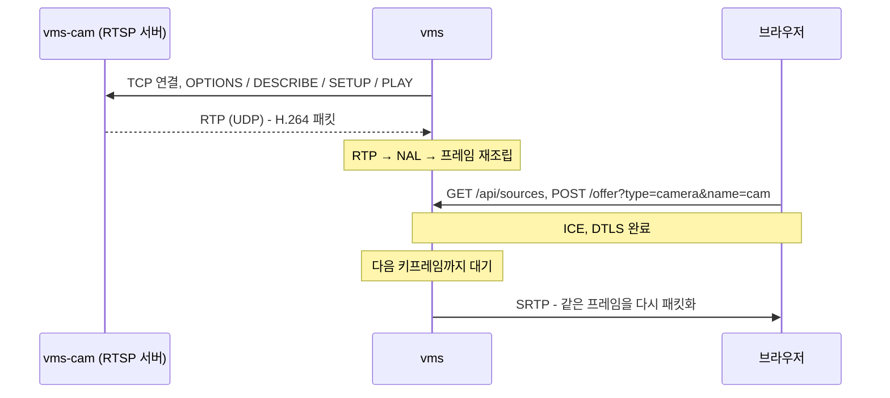

# Background

## 읽는 순서

1. 이 문서의 "전체 흐름"과 "RTSP"를 먼저 읽는다.
2. `proposal.md`에서 범위를 확인한다. 특히 범위 밖 항목(TCP interleaved, RR, 재정렬)을 본다.
3. `specs/`는 다음 순서로 읽는다.
   - `rtsp-camera-source`: 카메라에서 받아 오기
   - `rtp-video-streaming`: 브라우저로 보내기. 추가 요구사항 위주로 본다.
   - `video-catalog`: 목록
4. 이 문서의 "RTP로 받은 H.264 되돌리기", "실시간 소스를 여러 세션에 보내기"를 읽은 뒤 `design.md`, `tasks.md`를 읽는다.

이 change에서 서버는 처음으로 클라이언트가 된다. 카메라 서버(vms-cam)에 RTSP로 접속해 H.264 영상을 RTP로 받고, 그것을 프레임으로 되돌린 다음, 기존 WebRTC 송신 경로로 브라우저에 다시 보낸다. 파일과 달리 카메라 영상은 서버가 원하는 때 꺼낼 수 없고 도착하는 대로 처리해야 한다. 카메라는 끊겼다가 돌아올 수도 있다.

## 개념

### 전체 흐름



### RTSP

**RTSP(Real Time Streaming Protocol)**
- 정의: 스트리밍 서버에 "이 영상을 이 주소로 보내 달라"고 요청하는 텍스트 제어 프로토콜. 형식은 HTTP/1.1과 거의 같다.
- 왜 필요한가: IP 카메라와 vms-cam이 영상을 내보내는 표준 방식이다. 영상 자체는 RTSP가 아니라 RTP로 따로 온다.
- 동작: 요청 줄 `메서드 URL RTSP/1.0`, 헤더, 빈 줄로 이루어진다. 응답은 `RTSP/1.0 200 OK`로 시작한다. 모든 요청과 응답에 같은 `CSeq` 번호를 넣어 짝을 맞춘다.
- 쓰이는 곳: `rtsp-camera-source` "RTSP 연결 절차", `design.md` 결정 3·4.

**메서드 네 가지와 유지 요청**

| 순서 | 메서드 | 하는 일 | 응답에서 쓰는 것 |
| --- | --- | --- | --- |
| 1 | `OPTIONS` | 서버가 지원하는 메서드 확인. 연결 확인 용도 | `Public` |
| 2 | `DESCRIBE` | 스트림 설명(SDP) 받기 | 본문 SDP, `Content-Base` |
| 3 | `SETUP` | 트랙 하나의 전송 방식과 포트 정하기 | `Session`, `Transport` |
| 4 | `PLAY` | 전송 시작 | (상태 코드) |
| 유지 | `OPTIONS` + `Session` | 세션이 만료되지 않게 알림 | (상태 코드) |
| 종료 | `TEARDOWN` | 세션 끝내기 | 기다리지 않음 |

예시 교환:

```text
C->S  DESCRIBE rtsp://127.0.0.1:8554/cam RTSP/1.0
      CSeq: 2
      Accept: application/sdp

S->C  RTSP/1.0 200 OK
      CSeq: 2
      Content-Base: rtsp://127.0.0.1:8554/cam/
      Content-Type: application/sdp
      Content-Length: 260

      v=0 ... m=video 0 RTP/AVP 96
      a=rtpmap:96 H264/90000
      a=fmtp:96 packetization-mode=1;profile-level-id=42c01e;sprop-parameter-sets=...
      a=control:stream=0
```

**`Session` 헤더와 timeout**
- 정의: SETUP 응답에서 서버가 정해 주는 세션 ID. 예: `Session: 1234ABCD;timeout=60`
- 왜 필요한가: 이후 요청이 어느 세션에 대한 것인지 알린다. 서버는 timeout(초) 동안 아무 요청도 없으면 세션을 끝낸다.
- 동작: timeout이 60이면 30초마다 `OPTIONS`에 `Session: 1234ABCD`를 넣어 보낸다.
- 쓰이는 곳: `rtsp-camera-source` "세션 유지와 끊김 감지".

**control URL과 `Content-Base`**
- 정의: SDP의 `a=control`은 그 트랙을 SETUP할 주소다. 상대 주소면 `Content-Base`를 기준으로 붙인다.
- 동작: `Content-Base: rtsp://127.0.0.1:8554/cam/`와 `a=control:stream=0`이면 SETUP 주소는 `rtsp://127.0.0.1:8554/cam/stream=0`이다. `a=control:*`는 기준 주소 자체를 뜻한다.
- 쓰이는 곳: `design.md` 결정 4의 `ResolveControlUrl`.

**`Transport` 헤더와 포트 쌍**
- 정의: SETUP에서 RTP를 어떻게 받을지 정하는 헤더.
- 왜 필요한가: 서버는 이 값을 보고 RTP와 RTCP를 어느 포트로 보낼지 정한다.
- 동작:

  ```text
  C->S  Transport: RTP/AVP;unicast;client_port=50000-50001
  S->C  Transport: RTP/AVP;unicast;client_port=50000-50001;server_port=6970-6971;ssrc=1A2B3C4D
  ```

  - RTP는 서버 6970에서 클라이언트 50000으로 온다.
  - RTCP는 서버 6971에서 클라이언트 50001로 온다.
  - RTP는 짝수, RTCP는 그다음 홀수 포트를 쓰는 것이 RFC 3550의 관례라서 vms도 연속된 짝수·홀수 쌍을 잡는다.
- 쓰이는 곳: `rtsp-camera-source` "UDP 미디어 수신".

**UDP 전송과 TCP interleaved**
- 정의: RTP를 별도 UDP 포트로 받는 방식과, RTSP TCP 연결 안에 `$` 표시로 끼워 받는 방식.
- 왜 필요한가: UDP는 지연이 작고 패킷이 늦어지면 버려진다. TCP interleaved는 방화벽을 통과하기 쉽지만 재전송 때문에 지연이 쌓일 수 있다.
- 쓰이는 곳: 이 change는 UDP만 쓴다(proposal "범위 밖").

### RTP 수신

**RTP 헤더에서 쓰는 값**

| 필드 | 크기 | 수신 쪽에서의 쓰임 |
| --- | --- | --- |
| 버전 | 2비트 | 2가 아니면 버림 |
| marker(M) | 1비트 | H.264에서는 프레임의 마지막 패킷 |
| payload type | 7비트 | SETUP한 트랙(예: 96)만 처리 |
| 순번 | 16비트 | 1씩 늘지 않으면 손실. 65535 다음은 0 |
| 타임스탬프 | 32비트 | 같은 값이면 같은 프레임. 90kHz 단위 |
| SSRC | 32비트 | 바뀌면 다른 스트림(카메라 재시작 등) |

- 쓰이는 곳: `rtsp-camera-source` "H.264 프레임 재조립".

**90kHz 타임스탬프와 32비트 순환**
- 정의: 비디오 RTP 타임스탬프는 1초에 90000씩 늘어난다. 32비트라서 약 13시간 15분마다 0으로 돌아간다.
- 동작
  - 30fps면 프레임 간격은 3000이다.
  - 차이는 부호 없는 32비트 뺄셈으로 구한다. 예: `0x00000BB8 - 0xFFFFFC18 = 0x00000FA0`(4000), 순환해도 간격이 맞다.
- 쓰이는 곳: `rtp-video-streaming` "카메라 프레임 송신", `design.md` 결정 6.

**RTCP SR과 RR**
- 정의: RTP와 함께 오가는 제어 보고. SR(Sender Report)은 보내는 쪽이, RR(Receiver Report)은 받는 쪽이 보낸다.
- 동작: 이 change에서 vms는 카메라의 SR을 읽어 버리고, RR은 보내지 않는다.
- 쓰이는 곳: `rtsp-camera-source` "UDP 미디어 수신".

### RTP로 받은 H.264 되돌리기

**패킷화 모드 1의 세 가지 패킷**

RTP 페이로드 첫 바이트의 하위 5비트(유형)로 구분한다.

| 유형 | 이름 | 내용 |
| --- | --- | --- |
| 1~23 | 단일 NAL | 페이로드 전체가 NAL 하나(헤더 포함) |
| 24 | STAP-A | 작은 NAL 여러 개. `[STAP-A 헤더 1B][크기 2B][NAL][크기 2B][NAL]...` |
| 28 | FU-A | 큰 NAL의 조각. `[FU indicator 1B][FU header 1B][조각]` |

FU-A를 되돌리는 예(3000바이트 IDR NAL, 원래 헤더 `0x65`):

```text
조각 1: 7C 85 <1198바이트>   FU indicator 0x7C = F0 NRI3 유형28, FU header 0x85 = S=1 유형5
조각 2: 7C 05 <1198바이트>   S=0 E=0
조각 3: 7C 45 <603바이트>    E=1 (marker 켜짐)
복원 NAL 헤더 = (0x7C & 0xE0) | (0x85 & 0x1F) = 0x60 | 0x05 = 0x65
복원 NAL = 65 + 조각1 + 조각2 + 조각3 (1 + 1198 + 1198 + 603 = 3000바이트)
```

- 쓰이는 곳: `rtsp-camera-source` "H.264 프레임 재조립", `design.md` 결정 5.

**프레임 경계**
- 정의: 같은 타임스탬프의 NAL 단위가 한 프레임(액세스 단위)이다.
- 동작: marker 비트가 켜진 패킷이 프레임의 끝이다. marker가 든 패킷이 사라져도 다음 패킷의 타임스탬프가 바뀌면 앞 프레임이 끝났음을 알 수 있다.

**키프레임과 GOP**
- 정의: 키프레임은 앞 프레임 없이 디코딩할 수 있는 프레임이다. 이 프로젝트에서는 SPS·PPS·IDR 슬라이스를 모두 담은 프레임을 말한다. GOP는 키프레임부터 다음 키프레임 전까지의 묶음이다.
- 왜 필요한가: 나머지 프레임은 앞 프레임과의 차이만 담고 있다. 그래서 중간부터 받기 시작했거나 패킷이 빠졌다면 다음 키프레임까지 화면을 제대로 만들 수 없다.
- 동작: vms-cam은 `--keyint`(기본 30프레임 = 1초)마다 키프레임을 보내고, 그 앞에 SPS/PPS를 붙인다(`config-interval=-1`).
- 쓰이는 곳: `rtp-video-streaming` "카메라 송신 시작", "카메라 손실 회복".

**Constrained Baseline과 `profile-level-id`**
- 정의: H.264 프로파일 중 B 프레임 등을 쓰지 않는 가장 단순한 것. SDP의 `profile-level-id` 앞 두 바이트가 `42e0` 또는 `42c0`이면 Constrained Baseline이다.
- 왜 필요한가: 브라우저 WebRTC가 모두 지원하는 프로파일이라, 카메라 영상을 다시 인코딩하지 않고 그대로 보낼 수 있다.
- 동작: vms-cam의 640x480 30fps는 레벨 3.0(`42c01e` 근처)이다. 브라우저 offer의 `42e01f`(레벨 3.1) 범위 안에 든다.
- 쓰이는 곳: proposal "Why".

### 실시간 소스를 여러 세션에 보내기

**꺼내 쓰기(pull)와 밀어 주기(push)**
- 정의: 파일은 송신 쪽이 시간에 맞춰 다음 프레임을 꺼내 쓰고, 카메라는 소스가 프레임이 생길 때마다 받는 쪽에 밀어 준다.
- 왜 필요한가: 카메라 프레임은 미리 있지 않으므로 세션마다 위치를 따로 가질 수 없다. 모든 세션이 같은 "지금" 프레임을 받는다.
- 쓰이는 곳: `design.md` 결정 1·2.

**팬아웃(fan-out)**
- 정의: 하나의 입력을 여러 출력에 나눠 주는 것.
- 동작: 카메라 연결 하나에서 재조립한 프레임을 그 카메라를 고른 모든 세션에 넘긴다. 세션마다 SSRC, 순번, 타임스탬프, SRTP 키가 다르므로 패킷은 세션마다 따로 만든다.
- 쓰이는 곳: `rtp-video-streaming` "카메라 송신 시작"의 "같은 카메라의 두 세션".

**지수 백오프(exponential backoff)**
- 정의: 실패할 때마다 다음 재시도까지의 간격을 두 배로 늘리고, 상한에서 멈추는 방식.
- 왜 필요한가: 꺼진 카메라에 너무 자주 접속을 시도하지 않으면서, 짧은 끊김에서는 빨리 돌아오기 위해서다.
- 동작: 1, 2, 4, 8, 10, 10, ... 초. 연결에 성공하면 다시 1초부터 센다.
- 쓰이는 곳: `rtsp-camera-source` "재연결".

**DTLS close_notify**
- 정의: DTLS 연결을 정상적으로 끝낸다는 알림 레코드(TLS alert).
- 동작: 지금까지는 브라우저가 보낸 close_notify만 받았다. 이 change에서는 카메라가 30초 안에 돌아오지 않으면 서버가 먼저 보낸다. 브라우저는 이를 받고 연결을 닫힘 상태로 바꾼다.
- 쓰이는 곳: `rtp-video-streaming` "카메라 대기 시간 초과", `design.md` 결정 8.

## 참고 문서

| 용어 | 문서 | 절 |
| --- | --- | --- |
| RTSP 메시지, 메서드, `CSeq`, `Session`, `Transport` | RFC 2326 Real Time Streaming Protocol | 6, 7, 10, 12.17, 12.37, 12.39 |
| `Content-Base`와 control URL | RFC 2326 | 12.11, C.1.1 |
| RTP 헤더, 순번, 타임스탬프, 짝수·홀수 포트 관례 | RFC 3550 RTP | 5.1, 11 |
| RTCP SR·RR | RFC 3550 | 6.4 |
| 단일 NAL, STAP-A, FU-A | RFC 6184 RTP Payload Format for H.264 | 5.6, 5.7.1, 5.8 |
| `profile-level-id`, `sprop-parameter-sets` | RFC 6184 | 8.1 |
| H.264 프로파일, NAL 유형, IDR | ITU-T H.264 | 7.4.1, A.2.1.1 |
| DTLS close_notify | RFC 8446 TLS 1.3 / RFC 6347 DTLS 1.2 | 6.1 / 4.2.7 |
| gst-rtsp-server 세션 타임아웃 | GStreamer `GstRTSPSession` 문서 | timeout 속성 |
| `getaddrinfo` | POSIX.1-2017 | getaddrinfo |
