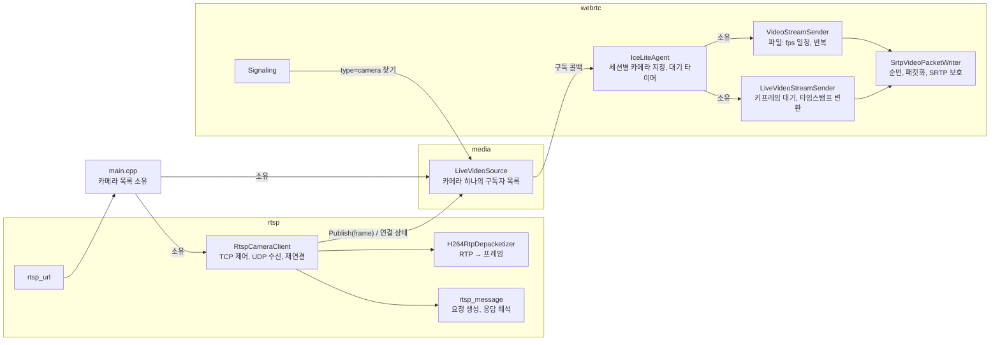
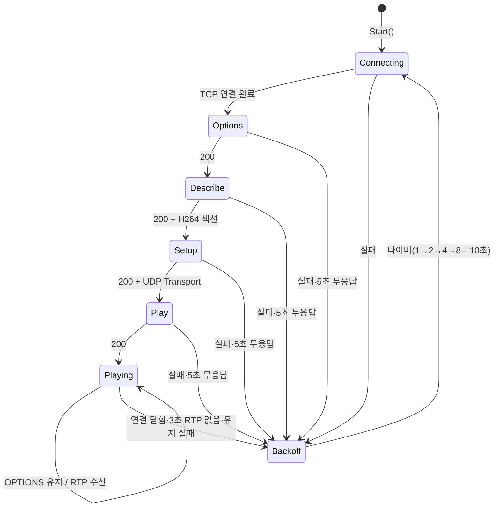
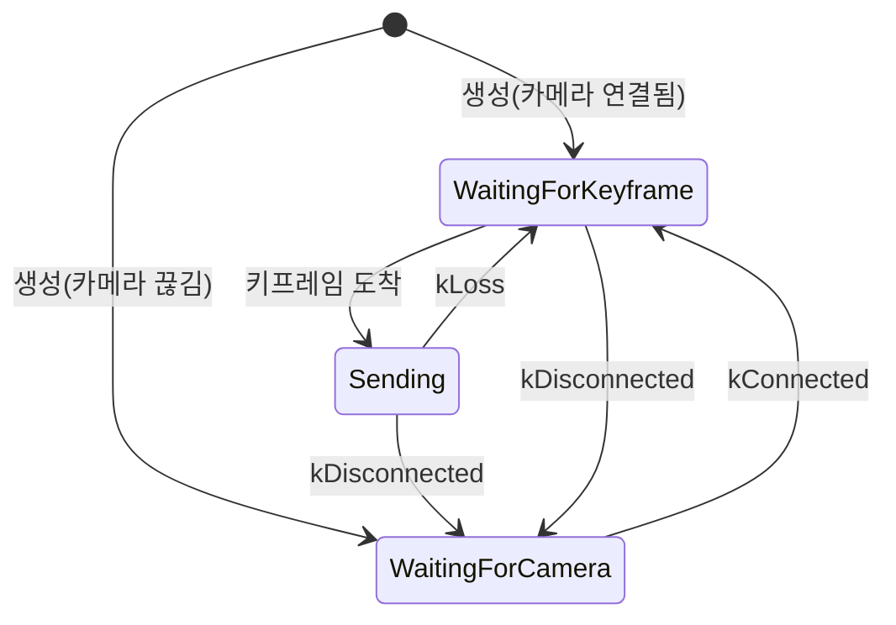

# Design

## Context

변경 이유는 proposal.md "Why"를 따른다. 요구 동작은 이 change의 `specs/`(`rtsp-camera-source`, `rtp-video-streaming`, `video-catalog`)를 따른다.

현재 상태:

- 서버는 단일 스레드 `core::EventLoop`(epoll) 위에서 HTTP 서버, ICE-lite 에이전트, 타이머를 함께 돌린다. TCP 클라이언트 연결 코드는 없다.
- `IceLiteAgent`의 세션은 `const media::H264File* video`를 가진다. DTLS가 `kConnected`가 되면 `StartVideoStream`이 `VideoStreamSender`를 만들고 세션마다 프레임 타이머로 보낸다.
- `VideoStreamSender`에는 세 가지가 섞여 있다.
  - 일정: fps 간격, 반복 재생
  - RTP 헤더: 순번, 타임스탬프, marker
  - 보호: `PacketizeH264Frame`으로 패킷화하고 `SrtpSender`로 보호
- `DtlsTransport`는 브라우저의 close_notify를 받아 `kClosed`가 되는 경로만 있다. 서버가 먼저 닫는 경로는 없다.
- `signaling.cpp`의 `FindRequestedSource`는 `type=camera`를 항상 404로 돌려준다. 이 change는 그 자리에 카메라 찾기를 넣는다.
- `webrtc/sdp.h`의 `ParseSdp`는 offer 전용이 아닌 일반 SDP 해석기다. 미디어 섹션과 속성 목록을 돌려준다.
- vms-cam 쪽 사실(`~/vms-cam`의 `launch_description.cpp`, `camera-rtsp-stream` 명세)
  - 파이프라인: `x264enc tune=zerolatency bframes=0 ... ! video/x-h264,profile=constrained-baseline ! h264parse ! rtph264pay pt=96 config-interval=-1`
  - 키프레임 간격은 기본 `--fps`(30프레임)이고, 키프레임마다 SPS/PPS를 보낸다. UDP와 TCP 전송을 모두 받는다.

## Goals / Non-Goals

**Goals:**

- RTSP 수신 쪽(`rtsp`)과 WebRTC 송신 쪽(`webrtc`)이 서로를 모르게 하고, `media`의 실시간 소스를 통해서만 만나게 한다.
- 파일과 카메라 송신이 RTP 헤더·패킷화·SRTP 보호 코드를 함께 쓰게 해서, 패킷 규칙이 한 곳에서 정해지게 한다.
- 소켓 없이 단위 테스트할 수 있게 RTSP 메시지 처리와 RTP 재조립을 순수 함수·상태 객체로 분리한다.

**Non-Goals:**

- 파일과 카메라를 같은 인터페이스로 감싸는 소스 추상화. 파일은 송신자가 꺼내 쓰고, 카메라는 소스가 밀어 준다. 억지로 맞추면 양쪽이 모두 복잡해진다. 세션은 둘 중 하나를 가리킨다.
- 범용 RTSP 클라이언트. vms-cam(gst-rtsp-server)과 같은 표준 서버와 UDP 유니캐스트·H.264 비디오 트랙 하나만 다룬다.

## Decisions

### 1. 구성 요소와 데이터 흐름



- `main.cpp`가 카메라마다 `LiveVideoSource`와 `RtspCameraClient`를 만들어 소유한다. 둘은 세션과 에이전트보다 오래 산다.
- 카메라 목록(이름, URL, `LiveVideoSource*`)은 `media::CameraList`로 묶어 `Signaling`(목록과 찾기)과 `main.cpp`가 함께 쓴다. 파일의 `VideoLibrary`와 같은 역할이다.
- 모든 처리는 이벤트 루프 스레드 하나에서 일어난다.
  1. RTP 소켓이 읽기 가능해진다.
  2. 클라이언트가 재조립을 마친다.
  3. `LiveVideoSource::Publish`가 구독자를 동기로 호출한다.
  4. 각 세션이 패킷화해 `sendto`로 보낸다.

  잠금이나 큐는 필요 없다.

### 2. `LiveVideoSource`: 밀어 주는 소스와 프레임 수명

```cpp
// 개념 스케치
struct LiveVideoFrame {
    const H264Frame& frame;   // Publish 호출 동안만 유효
    std::uint32_t rtp_timestamp;  // 카메라 RTP 타임스탬프(90kHz)
    bool is_keyframe;         // SPS·PPS·IDR을 모두 포함
};

enum class LiveVideoEvent { kConnected, kDisconnected, kLoss };
```

- 구독은 `Subscribe(frame_handler, event_handler) → SubscriptionId`, `Unsubscribe(id)`다. 핸들러는 `std::move_only_function`이다.
- 가상 인터페이스 대신 콜백을 쓴다. 구독자가 세션(에이전트 안의 맵 항목)이라 상속할 객체가 없고, 에이전트는 서버 ufrag를 캡처한 람다로 세션을 찾는 기존 타이머 패턴을 그대로 쓸 수 있다.
- 프레임의 NAL 뷰는 재조립기의 버퍼를 가리키므로 `Publish` 호출 동안만 유효하다. 구독자는 그 안에서 패킷화를 끝내야 하며, 보관하지 않는다.
- 콜백 안에서 구독을 해지할 수 있어야 한다. 예를 들어 SRTP 실패로 송신을 멈추는 경우다. 그래서 `Publish`는 구독자 ID 목록을 복사해 순회하고, 호출 직전에 아직 구독 중인지 확인한다.
- `IsConnected()`로 현재 연결 상태를 조회한다. 에이전트는 DTLS 완료 시점에 이 값으로 대기를 시작할지 정한다.

### 3. `RtspCameraClient` 상태 기계



- 연결은 비차단 `connect()`로 시작하고, 쓰기 가능 이벤트에서 `SO_ERROR`로 결과를 확인한다. 연결 시도도 5초 응답 제한에 포함한다.
- 요청은 한 번에 하나만 보내고 응답을 기다린다. 파이프라이닝은 하지 않는다.
  - 응답은 수신 버퍼에 쌓아 두고 다음을 판정한다: 헤더 끝(`\r\n\r\n`), `Content-Length`만큼의 본문.
  - 응답 헤더 영역은 8KiB, 본문은 64KiB로 제한한다. 넘으면 실패로 본다.
- `Playing`에서 TCP로 오는 바이트는 응답으로 해석한다. 서버가 요청을 먼저 보내는 경우(ANNOUNCE 등)는 처리하지 않고 연결 실패로 본다.
- `Backoff`로 갈 때 TCP·UDP 소켓을 닫고, 재조립기를 초기화하고, `LiveVideoSource`에 `kDisconnected`를 알린다. `Playing`에 들어가면 간격을 1초로 되돌리고 `kConnected`를 알린다.
- UDP 포트 쌍은 연결할 때마다 새로 잡는다.
  - 0번 포트로 바인드해 커널이 고른 포트가 짝수이고 그다음 포트도 바인드되면 그 쌍을 쓴다.
  - 아니면 닫고 다시 시도하며, 최대 16회까지 한다.
  - 포트를 인자로 고정하지 않는 것은 같은 호스트에서 쓰는 지금 단계에서 방화벽을 고려할 필요가 없기 때문이다.
- 종료할 때(`Stop()` 또는 소멸) `Playing`이면 `TEARDOWN`을 비차단으로 한 번 쓰고 닫는다.

### 4. RTSP 메시지 처리 (`rtsp_message`)

다음은 소켓 없는 순수 함수다.

- `BuildRtspRequest(method, url, cseq, headers)`: 요청 문자열을 만든다. `User-Agent: vms`를 넣는다.
- `ParseRtspResponse(bytes)`: 미완성, 완성(상태 코드·헤더·본문·소비한 바이트 수), 형식 오류 중 하나를 돌려준다. 헤더 이름은 대소문자를 구분하지 않는다.
- `ParseSessionHeader("1234ABCD;timeout=60")`: `{id, timeout}`. timeout이 없으면 60초다.
- `ParseTransportHeader(...)`: `RTP/AVP` 또는 `RTP/AVP/UDP`, `unicast`, `server_port`를 확인한다.
- `ResolveControlUrl(base, control)`: control이 `*`이면 base, 절대 URL(`rtsp://`)이면 그대로, 아니면 base 끝에 `/`를 보장한 뒤 이어 붙인다. base는 `Content-Base`, 없으면 `Content-Location`, 둘 다 없으면 요청 URL이다.

SDP 해석은 `webrtc::ParseSdp`를 재사용한다. RTSP 쪽이 `webrtc` 헤더 하나에 의존하게 되지만, 같은 SDP 해석기를 두 벌 두는 것보다 낫다. 나중에 의존 방향이 문제가 되면 `ParseSdp`를 `core`나 별도 `sdp` 모듈로 옮긴다.

### 5. H.264 RTP 재조립 (`H264RtpDepacketizer`)

- 입력은 RTP 패킷 하나(헤더 포함)다. 출력은 0개 이상의 이벤트(완성 프레임 또는 손실)이며, 콜백으로 바로 넘긴다.
- 상태: 기대 순번, 현재 타임스탬프, 현재 프레임 버퍼(NAL마다 바이트 벡터), FU-A 진행 중 여부.
- 규칙(명세 "H.264 프레임 재조립")
  - 첫 패킷이면 그 순번을 기준으로 삼는다.
  - 순번이 기대 값과 다르면 현재 프레임과 FU-A 상태를 버리고 손실을 알린다. 그 패킷부터 새로 시작하는데, FU-A 중간 조각이면 다음 프레임까지 버린다.
  - 타임스탬프가 바뀌면 현재 프레임(슬라이스가 있으면)을 내보내고 새 프레임을 시작한다.
  - marker가 켜져 있으면 그 패킷을 넣은 뒤 프레임을 내보낸다.
- 버퍼 형식: 프레임의 NAL을 하나의 연속 버퍼에 이어 쓰고 `(offset, size)`로 기록한다. 내보낼 때 `H264Frame`의 span 목록을 만들어 넘긴다. 재할당으로 span이 무효화되지 않도록, span은 프레임을 다 모은 뒤에만 만든다.
- 키프레임 판정: 프레임에 SPS(7)·PPS(8)·IDR(5)이 모두 있으면 키프레임이다. 파일의 첫 프레임 검증과 같은 기준이다.
- payload type이 SETUP한 값이 아니거나 RTP 버전이 2가 아닌 패킷은 손실로 치지 않고 버린다. SSRC가 바뀌면 새 스트림으로 보고 상태를 초기화한다. 이때 손실 이벤트를 하나 낸다.

### 6. 송신자 분리: `SrtpVideoPacketWriter`

`VideoStreamSender`에서 다음 상태와 동작을 떼어 `SrtpVideoPacketWriter`로 옮긴다.

- 상태: SSRC, payload type, 다음 순번, `SrtpSender`
- `WriteFrame(frame, timestamp) → expected<packets>`: 패킷화, 헤더 작성, marker, SRTP 보호를 한다.

`VideoStreamSender`(파일)는 일정과 프레임 번호를 계산하고 writer에 프레임을 넘긴다. 외부 동작은 바뀌지 않으며, 기존 테스트가 그대로 통과해야 한다.

`LiveVideoStreamSender`(카메라)는 writer와 다음 상태를 가진다.



타임스탬프 변환(명세 "카메라 프레임 송신", "카메라 끊김 대기"):

- 처음 보내는 키프레임
  - `session_ts = initial_ts`(무작위)로 둔다.
  - `camera_base = 그 프레임의 카메라 ts`, `session_base = initial_ts`로 기록한다.
- 같은 카메라 연결 안에서는 `session_ts = session_base + (camera_ts - camera_base)`다. 32비트 순환 덧셈과 뺄셈이다.
  - 손실 뒤 키프레임에서도 기준을 바꾸지 않는다. 카메라 타임스탬프가 연속이므로 간격이 그대로 유지된다.
- 재연결 뒤 첫 키프레임
  - 새 기준은 `session_base = last_sent_session_ts + ⌊경과 시간 × 90000⌋`, `camera_base = 그 프레임의 카메라 ts`다.
  - 경과 시간은 마지막으로 보낸 시각부터 지금까지(steady_clock)다.
  - 카메라가 재시작되면 타임스탬프 원점이 바뀌므로, 이전 카메라 ts와는 이어 계산할 수 없다.
  - 클라이언트는 `kConnected`마다 "연결 세대" 번호를 올리고, 송신자는 세대가 바뀌었는지로 재기준을 정한다.
- 아직 한 번도 보내지 않았으면 경과 시간 계산 없이 처음 보내는 경우로 처리한다.

### 7. 에이전트: 세션의 카메라 지정과 대기

- `IceSessionRequest`에 `media::LiveVideoSource* camera`를 추가하고, `video`와 함께 둘 중 하나만 지정한다. 로그용 이름은 `source_label`(예: `file a.h264`, `camera front`)로 바꾼다.
- 세션 필드
  - `camera`
  - `camera_subscription`(구독 ID, 없으면 비어 있음)
  - `live_stream_sender`
  - `camera_wait_timer_id`
- DTLS `kConnected`(`StartVideoStream`)
  - 카메라 세션이면 `LiveVideoStreamSender`를 만들고 구독한다.
  - `camera->IsConnected()`가 거짓이면 대기 타이머(기본 30초)를 걸고 "대기 시작"을 로그에 남긴다.
- 이벤트 처리
  - 구독 콜백 `kDisconnected`: 송신자 상태를 바꾸고 대기 타이머를 건다.
  - 구독 콜백 `kConnected`: 타이머를 취소하고 "대기 끝"을 로그에 남긴다.
  - 프레임 콜백: 송신자가 돌려준 패킷을 nominated pair로 `sendto`한다. 실패 로그는 파일 송신과 같이 세션마다 한 번 남긴다.
- 대기 타이머가 만료되면 다음 순서로 처리한다.
  1. "시간 초과"를 로그에 남긴다.
  2. `DtlsTransport::Close()`의 데이터그램을 nominated pair로 보낸다.
  3. `RemoveSession`을 호출한다.
- `StopVideoStream`과 `RemoveSession`은 카메라 구독 해지와 대기 타이머 취소를 함께 한다.
- 대기 시간은 `IceLiteAgentConfig::camera_wait_timeout`(기본 30초)이다. 명령행 인자로는 노출하지 않고, 테스트가 짧은 값을 쓰기 위해 둔다.

### 8. `DtlsTransport::Close()`

`kConnected`일 때 `SSL_shutdown`을 한 번 호출해 close_notify를 쓰고, 출력 데이터그램을 돌려주며 상태를 `kClosed`로 바꾼다. 상대의 close_notify는 기다리지 않는다. 다른 상태에서는 빈 목록을 돌려주고 상태를 바꾸지 않는다. 브라우저는 close_notify를 받으면 DTLS transport를 닫고, 서버는 세션 제거 뒤 STUN에 응답하지 않으므로 ICE도 곧 실패한다.

### 9. 명령행과 시작

- `--camera`의 해석(`=` 분리, 이름 검증)은 `ParseCommandLine`이 한다. URL 해석(`ParseRtspUrl`)과 호스트 이름 해석(`getaddrinfo`, `AF_INET`, 첫 결과)은 `rtsp_url`에 둔다.
- 호스트 이름 해석은 시작할 때 한 번만 하고, 재연결할 때 다시 하지 않는다. `getaddrinfo`가 블로킹이라 루프 안에서 부르지 않기 위해서다.
- 카메라 클라이언트는 HTTP 서버와 에이전트를 시작한 뒤 `Start()`한다. 종료 시그널을 받으면 `Stop()`해서 `TEARDOWN`을 보내고 루프를 끝낸다.
- 시작 로그: 카메라마다 이름과 URL, 해석한 주소, 마지막에 카메라 수를 남긴다.

## Risks / Trade-offs

- [UDP는 순서가 바뀌거나 조금 늦게 도착할 수 있는데, 재정렬 없이 손실로 처리한다] → 같은 호스트·LAN에서는 드물고, 손실이면 최대 키프레임 간격(기본 1초) 동안 화면이 멈춘다. 잦아지면 작은 재정렬 창을 추가한다.
- [키프레임을 기다리는 동안(최대 1초) 첫 화면이 늦게 뜬다] → 받아들인 결정이다. 마지막 GOP를 저장해 두는 방식은 향후 개선으로 남긴다.
- [카메라 프레임을 세션마다 다시 패킷화하므로 세션 수만큼 패킷화 비용이 든다] → 640x480 30fps 2Mbps 기준으로 문제가 되지 않는 수준이다. 향후 개선 항목 참고.
- [RTCP RR을 보내지 않아 gst-rtsp-server가 세션을 끊을 수 있다] → gst-rtsp-server는 RTSP 요청으로도 세션 타임아웃을 갱신하므로, timeout의 절반마다 보내는 `OPTIONS`로 충분하다. 명세 시나리오 "긴 연결"(3분)로 확인한다.
- [가상 머신이나 Docker 환경에서는 NAT 때문에 카메라 출발 주소가 등록 주소와 달라 패킷이 버려질 수 있다] → 지금은 같은 호스트(WSL2)에서만 쓴다. 필요하면 출발 주소 검사를 `server_port` 기준으로 바꾸거나 끈다.
- [`rtsp`가 `webrtc/sdp.h`에 의존한다] → design 결정 4 참고.
- [카메라 송신 중 SRTP 보호가 실패하면 구독 콜백 안에서 구독을 해지한다] → `Publish`가 순회 중 해지를 허용하도록 만든다(design 결정 2).

## 향후 개선

- **RTP 패킷 규칙 통일로 재패킷화 제거**: vms-cam의 `rtph264pay`와 vms의 패킷 규칙을 맞추면, vms는 페이로드를 그대로 두고 RTP 헤더(SSRC·순번·타임스탬프)만 바꿔 SRTP로 보호하면 된다. 맞출 규칙은 최대 페이로드 1200바이트(`mtu` 조정), packetization-mode 1, STAP-A 사용 여부, AUD 제외다. 키프레임 판정과 이후 녹화를 위해 NAL 유형 확인은 계속 필요하다.
- 마지막 GOP 저장으로 첫 화면 지연 줄이기, 브라우저 PLI에 따라 키프레임 요청하기
- 카메라 연결 상태를 `/api/sources`와 페이지에 표시하기
- 설정 파일로 카메라 등록하기
