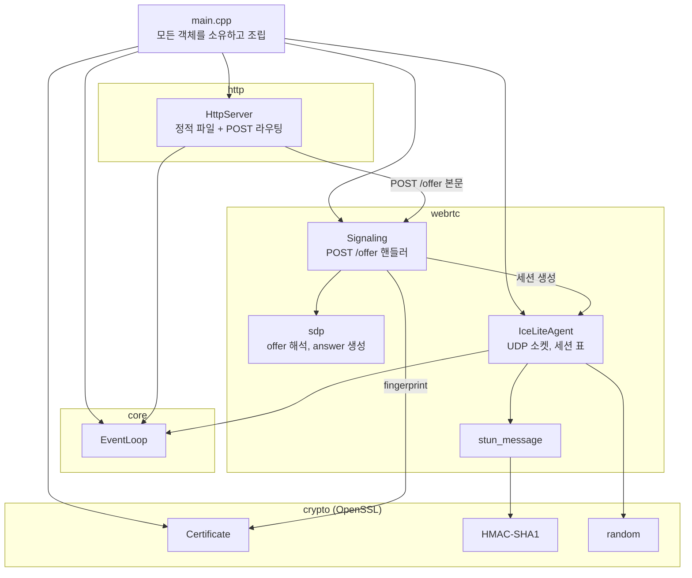
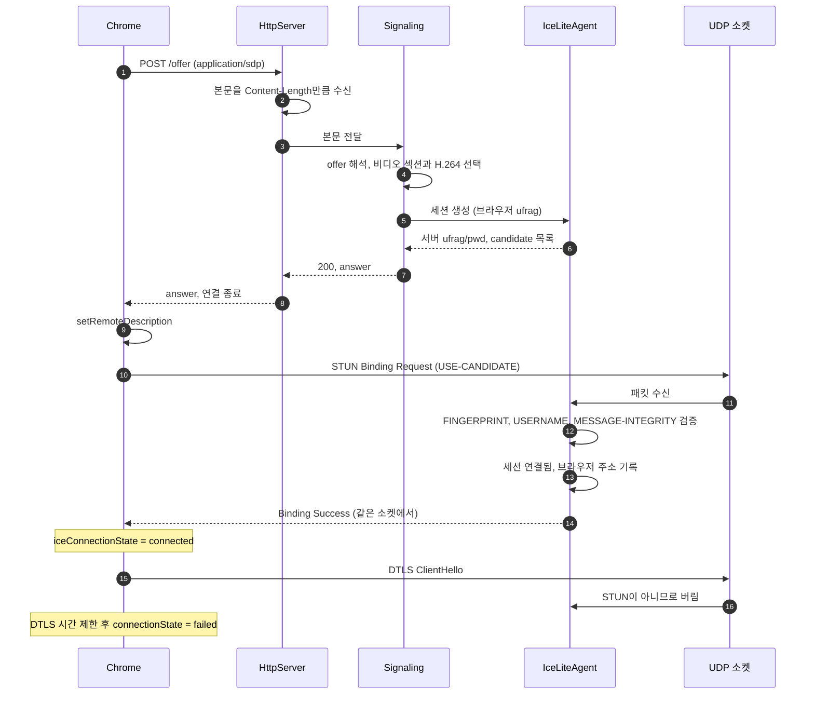
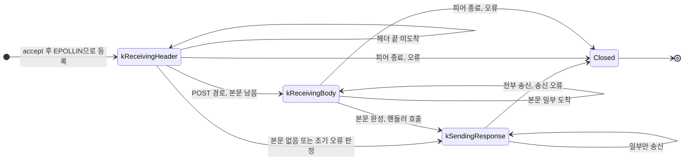
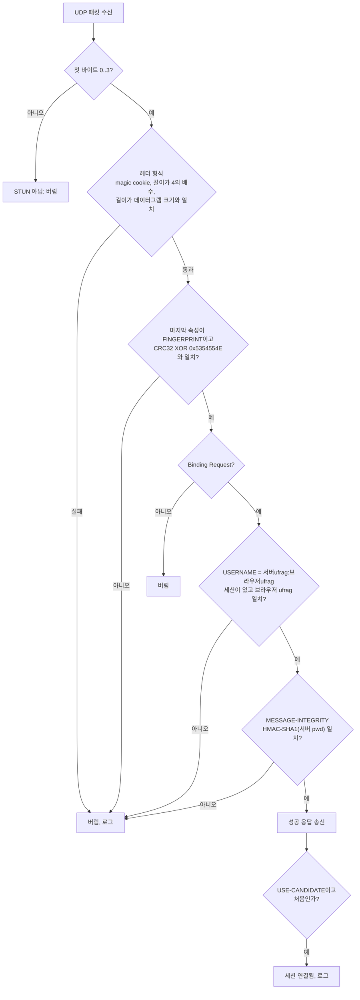

# Design

## Context

기존 change `add-http-static-server`는 다음 기반을 만들었다.

- 단일 스레드 epoll 이벤트 루프(`core::EventLoop`)와 signalfd 기반 종료 처리
- `GET` 전용 HTTP 서버. 연결마다 요청 수신 → 응답 송신 → `close` 순서로 동작한다.

그 설계의 "향후 확장 지점"은 UDP 소켓, `timerfd`, `POST` 본문 수신, lingering close를 이후 마일스톤으로 미뤄 두었다. 이번에는 ICE 연결에 꼭 필요한 UDP 소켓과 본문 수신만 넣고, 타이머와 이를 쓰는 기능은 이후 마일스톤으로 미룬다(결정 4). 요구 동작은 이 change의 `specs/`(`http-server`, `webrtc-signaling`, `ice-lite`)를 따른다.

제약:

- C++23, `-fno-exceptions`. 외부 라이브러리는 예외를 던지지 않는 C API만 사용한다. 이번에 OpenSSL 3.x(`libcrypto`)를 처음 도입한다.
- 서버는 WSL2에서, 브라우저는 Windows Chrome에서 실행한다. TCP는 localhost 포워딩으로 닿지만, UDP가 닿는지는 아직 확인하지 않았다.
- Chrome은 DTLS-SRTP를 강제하므로, DTLS를 구현하지 않는 이번 단계에서도 answer에 `a=fingerprint`와 `a=setup`이 있어야 한다.

## Goals / Non-Goals

**Goals:**

- SDP, STUN, ICE 세션 처리를 소켓 없이 단위 테스트할 수 있는 모듈로 나눈다.
- 이후 마일스톤에서 DTLS를 구현할 때 그대로 쓸 수 있도록 다음을 정한다.
  - 인증서와 키를 프로세스 수명 동안 보관한다.
  - UDP 패킷을 프로토콜별로 구분하는 지점을 하나로 둔다.
  - 세션 단위의 상태를 둔다.

**Non-Goals:**

- 타이머와 이를 쓰는 기능(세션 만료, HTTP 유휴 타임아웃, lingering close). 이후 마일스톤으로 미룬다(결정 4).
- 웹 서버와 비디오 서버를 나누는 구조. 이번에는 HTTP 서버의 `/offer` 핸들러가 ICE-lite 에이전트를 직접 호출한다(결정 2).
- STUN 오류 응답(400, 401, 487) 송신. 검증에 실패하면 응답 없이 버린다(결정 7).
- 런타임 중 인터페이스 주소 변경 감지
- 세션 수 제한과 offer 요청 속도 제한
- 비동기 엔드포인트 핸들러. answer는 요청 처리 중에 바로 만들 수 있다.

## Decisions

### 1. 모듈과 디렉터리 구성

```
src/
  apps/web_server/main.cpp        인자 해석, 인증서·ICE 에이전트·HTTP 서버 조립
  core/
    ascii.h                       대소문자 무시 비교, 공백 제거 같은 ASCII 문자열 도구 (신규)
    network_interfaces.h/.cpp     루프백이 아닌 IPv4 인터페이스 주소 조회 (신규)
  crypto/                         OpenSSL C API 래퍼 (신규)
    openssl_error.h/.cpp          OpenSSL 오류 큐 -> 오류 메시지
    random.h/.cpp                 RAND_bytes 기반 난수, ICE 자격 증명 문자열
    hmac_sha1.h/.cpp              HMAC-SHA1
    certificate.h/.cpp            자체 서명 인증서·키 생성, SHA-256 fingerprint
  http/
    http_request.h/.cpp           본문 관련 헤더 보관 추가
    http_server.h/.cpp            본문 수신, POST 라우팅
  webrtc/                         (신규)
    sdp.h/.cpp                    SDP 문법 파싱, offer 해석, answer 생성
    stun_message.h/.cpp           STUN 메시지 해석·생성, MESSAGE-INTEGRITY, FINGERPRINT(CRC32)
    ice_lite_agent.h/.cpp         UDP 소켓, 세션 표, Binding 처리
    signaling.h/.cpp              POST /offer 핸들러: offer 해석 -> 세션 생성 -> answer
tests/
  core/network_interfaces_test.cpp
  crypto/hmac_sha1_test.cpp, certificate_test.cpp
  webrtc/sdp_test.cpp, stun_message_test.cpp, ice_lite_agent_test.cpp
  webrtc/data/chrome_offer.sdp    실제 Chrome에서 받은 offer 견본
  integration/http_server_test.sh 시그널링과 본문 오류 시나리오 추가
```

`src/` 전체는 기존과 같이 `server_core`로 묶는다. CMake는 `find_package(OpenSSL 3.0 REQUIRED)`로 시스템에 설치된 OpenSSL(Ubuntu의 `libssl-dev`)을 찾고, `server_core`에 `OpenSSL::Crypto`를 `PUBLIC`으로 링크한다. 이번에는 `libssl`이 필요 없으며, 이후 마일스톤에서 DTLS를 구현할 때 `OpenSSL::SSL`을 추가한다.

- **대안: 저장소에 포함하거나 빌드 중 내려받기(git submodule, `FetchContent`, vcpkg)**. 배포판과 무관하게 버전을 고정할 수 있지만, OpenSSL 소스 빌드는 시간이 오래 걸리고 보안 업데이트를 직접 따라가야 한다. 개발과 실행 환경이 Ubuntu 하나뿐이므로 배포판 패키지를 쓴다.

### 2. 구성 요소와 소유 관계



`main`이 만드는 순서는 `EventLoop` → `TerminationSignalWatcher` → `Certificate` → `IceLiteAgent` → `Signaling` → `HttpServer`이고, 소멸은 그 역순이다. 모두 루프보다 먼저 소멸해 루프 등록을 해제한다. `Signaling`은 에이전트와 인증서를 참조만 하고 소유하지 않는다. `HttpServer`는 핸들러를 통해 `Signaling`을 참조하므로 `Signaling`보다 먼저 소멸한다.

**ICE-lite 에이전트 직접 호출**: 비디오 서버는 아직 따로 두지 않는다. `HttpServer`의 `/offer` 핸들러인 `Signaling`이 같은 프로세스의 `IceLiteAgent`를 함수로 직접 호출해 세션을 만든다. 이후 마일스톤에서 웹 서버가 offer를 HTTP로 비디오 서버에 전달하는 구조로 바꿀 수 있다. 그 구조는 그때 따로 설계하고, 이번에는 그것에 대비한 추상화를 넣지 않는다.

### 3. 전체 흐름



서버는 ICE-lite이므로 항상 controlled 역할이다. 경로를 고르고 지명하는 일은 controlling인 브라우저가 하고, 서버는 브라우저가 보낸 연결 확인 요청에 응답하고 그 지명을 받아들이기만 한다. 서버가 먼저 연결 확인 요청을 보내지는 않으므로 응답은 요청이 온 주소로 보내면 된다. 그래서 브라우저 candidate는 필요 없고, trickle ICE도, 브라우저의 mDNS host candidate 해석도 필요 없다.

### 4. 타이머는 이후 마일스톤으로 미룬다

ICE-lite 연결 확인은 브라우저의 요청에 응답만 하면 되므로 타이머 없이 완성된다. 타이머를 쓰려던 다음 세 기능은 이번 목표(`iceConnectionState` `connected`)에 영향이 없어 이번에 넣지 않는다.

| 기능 | 미루는 동안의 동작 |
|---|---|
| ICE 세션 만료 | 세션이 프로세스가 끝날 때까지 남는다 |
| HTTP 유휴 연결 타임아웃 | 요청을 끝내지 않는 연결이 fd를 계속 차지한다(기존과 같음) |
| lingering close | 본문을 다 받기 전에 오류로 응답하면 클라이언트가 RST를 받을 수 있다 |

이후 마일스톤에서 구현할 DTLS 핸드셰이크 재전송에는 타이머가 반드시 필요하다. 그때 타이머를 이벤트 루프에 추가하고, 위 세 기능을 함께 넣는다. 각 위험은 Risks에 적는다.

- **대안: 이번에 타이머와 세 기능을 함께 넣기**. 이후 마일스톤의 작업이 줄지만, 이번 change에 상태 머신 상태 하나(`kDraining`), 타이머 모듈, 10초 이상 기다리는 통합 테스트가 더해진다. 이번에 가장 먼저 검증할 것은 UDP 도달성이므로 범위를 줄이는 쪽을 택한다.

### 5. HTTP 확장

#### 요청 해석

`HttpRequest`는 다음 헤더를 보관한다. 헤더 이름은 대소문자를 구분하지 않는다.

- `Content-Length` → `std::optional<std::size_t>`
- `Content-Type` → 문자열
- `Transfer-Encoding`이 있었는지 여부

`Content-Length`가 숫자가 아니거나, 같은 헤더가 다른 값으로 여러 번 오면 `400`이다. 64 KiB 한도 검사(`413`)는 해석 직후 연결 계층에서 한다.

#### 라우팅

헤더를 받은 시점에 경로와 메서드로 라우팅을 결정한다. 본문을 기다릴지와 조기 오류 응답(`405`, `411`, `413`, `501`)이 이때 정해진다.

- 등록된 `POST` 경로(`/offer`): `POST`면 본문을 받은 뒤 핸들러를 호출하고, 다른 메서드면 `405 Allow: POST`
- 그 밖의 경로: `GET`이면 정적 파일, 다른 메서드면 `405 Allow: GET`

`POST` 핸들러는 `HttpServer::Start`의 인자로 받는다. 경로를 키로, `std::move_only_function`을 값으로 하는 표다. 핸들러는 요청과 본문을 받아 상태 코드, `Content-Type`, 본문을 담은 값을 돌려주고, 연결 계층이 이를 응답 바이트로 만든다. 핸들러를 `HttpServerConfig`에 넣지 않는 이유는, 설정이 복사 가능한 값으로 남아야 `main`의 인자 해석 코드가 바뀌지 않기 때문이다.

#### 연결 상태 머신



- 기존 `kReceivingRequest`를 `kReceivingHeader`로 이름을 바꾸고 `kReceivingBody`를 추가한다. 응답 후 바로 닫는 것은 기존과 같다.
- 헤더와 함께 도착한 본문 바이트는 수신 버퍼에 그대로 두고, 이어서 받는 바이트를 더해 `Content-Length`에 이르면 완성으로 판정한다.

### 6. SDP 처리: 문법 층과 의미 층

- **문법 층**: 줄(`\r\n` 또는 `\n`)을 `<한 글자 타입>=<값>`으로 나누고, 첫 `m=` 앞을 세션 영역, 각 `m=`부터를 미디어 섹션으로 묶는다. `a=` 줄은 `이름[:값]`으로 나눈다. 첫 줄이 `v=0`이 아니거나 `=`이 없는 줄이 있으면 형식 오류다. 모르는 타입과 속성은 보관만 하고 해석하지 않는다.
- **의미 층(offer 해석)**: 필요한 값만 꺼내 `SdpOffer` 구조체로 만든다.
  - 세션 수준 `a=group:BUNDLE`
  - BUNDLE 그룹이 있었는지 여부와, 그 그룹에 포함된 첫 `m=video` 섹션의 `mid`(없으면 형식 오류)
  - `ice-ufrag`, `ice-pwd`. 미디어 수준을 우선하고, 없으면 세션 수준을 쓴다.
  - H.264 payload type과 그 `fmtp`
  - 나머지 섹션의 미디어 종류, 프로토콜, 포맷, `mid`(거절 섹션을 만들 때 쓴다)
- **H.264 선택**: `rtpmap`이 `H264/90000`이고 `fmtp`에 `packetization-mode=1`이 있는 payload를 고른다. 그중 `profile-level-id=42e01f`(Constrained Baseline)를 우선하고, 없으면 첫 번째를 쓴다. 이후 마일스톤에서 미디어 송신을 구현할 때 서버가 보낼 스트림과 호환되는 프로파일로 바꿀 수 있으며, 명세는 바뀌지 않는다.
- **answer 생성**: 고정 템플릿에 값을 채운다. 줄 끝은 `\r\n`이다.

```
v=0
o=- <난수 세션 ID> 2 IN IP4 127.0.0.1
s=-
t=0 0
a=group:BUNDLE <mid>                                         (offer에 BUNDLE 그룹이 있을 때만)
a=ice-lite
m=video 9 UDP/TLS/RTP/SAVPF <pt>
c=IN IP4 0.0.0.0
a=mid:<mid>
a=sendonly
a=rtcp-mux
a=rtpmap:<pt> H264/90000
a=fmtp:<pt> <offer의 fmtp 그대로>
a=ice-ufrag:<서버 ufrag>
a=ice-pwd:<서버 pwd>
a=fingerprint:sha-256 <AB:CD:...>
a=setup:passive
a=candidate:<n> 1 udp <priority> <주소> <포트> typ host    (ICE 주소마다)
a=end-of-candidates
m=audio 0 <offer의 프로토콜> <offer의 포맷>                 (거절 섹션마다)
c=IN IP4 0.0.0.0
a=mid:<mid>
```

- **`a=setup:passive`**: 서버가 DTLS 서버, 브라우저가 DTLS 클라이언트가 된다. 이후 마일스톤에서 DTLS를 구현할 때 서버는 핸드셰이크를 시작할 시점을 정하지 않고, 브라우저의 ClientHello가 도착하면 응답한다. 응답 목적지도 ClientHello가 온 주소이므로 따로 정할 필요가 없다. 서버가 보낸 핸드셰이크 메시지가 사라졌을 때의 재전송은 DTLS 서버 역할에서도 필요하다.
- **candidate priority**: RFC 8445의 공식 `2^24 × 종류 선호도 + 2^8 × 로컬 선호도 + (256 - component ID)`를 따라 `(126 << 24) | ((65535 - 주소 순번) << 8) | 255`로 계산한다. 값이 클수록 브라우저가 그 후보가 들어간 쌍을 먼저 확인한다.
  - 종류 선호도 126: host 후보에 권장되는 최고값
  - 로컬 선호도 `65535 - 주소 순번`: 같은 종류의 주소가 여럿일 때 `--ice-address` 지정 순서(또는 자동 조회 순서)대로 앞선 주소를 우선한다
  - `256 - 1 = 255`: component는 RTP 하나뿐이다(RTCP도 `rtcp-mux`로 같은 포트를 쓴다)
- **candidate foundation**: 같은 종류이고 같은 기반 주소에서 나온 후보를 묶는 식별자다. full ICE 에이전트가 비슷한 쌍의 확인을 줄이는 데 쓴다. 서버 후보는 주소마다 기반 주소가 다르므로 `순번 + 1`로 서로 다른 값을 준다.
- **대안: SDP 전체를 구조화된 모델로 해석**. 쓰지 않는 속성까지 모델링하면 코드만 늘어난다. 문법 층을 일반화해 두었으므로, 필요한 속성은 의미 층에 추가하면 된다.

### 7. STUN 처리와 검증 순서

수신 패킷은 첫 바이트로 먼저 분류한다(RFC 7983).

- `0..3`: STUN
- `20..63`: DTLS
- `128..191`: RTP/RTCP
- 그 밖의 값: 버림

이번에는 STUN만 처리한다. DTLS와 RTP는 원격 주소별로 처음 한 번만 로그를 남기고 버린다. 이후 마일스톤에서 이 분기에 DTLS 처리를 연결한다.

- 로그 중복을 막으려고 기억하는 원격 주소는 256개까지만 둔다. 출발 주소를 바꿔 가며 보내는 패킷으로 메모리가 계속 늘지 않도록, 가득 차면 비우고 다시 기록한다.
- 읽기 이벤트 한 번에 최대 64개 데이터그램만 처리하고 루프로 돌아간다. 패킷이 계속 들어와도 HTTP 등 다른 소켓이 처리된다. 루프가 level-triggered이므로 남은 패킷은 다음 대기에서 다시 알려 준다.



- **MESSAGE-INTEGRITY 계산 범위**: 헤더의 길이 필드를 MESSAGE-INTEGRITY 속성 끝까지로 고친 메시지에서 MESSAGE-INTEGRITY 속성 앞까지를 HMAC-SHA1로 계산한다. FINGERPRINT는 그 뒤에 붙으므로 계산에서 빠진다. 키는 서버 `ice-pwd` 문자열 그대로다(ICE short-term credential). 비교는 `CRYPTO_memcmp`로 상수 시간에 한다.
- **성공 응답**: 같은 트랜잭션 ID, `XOR-MAPPED-ADDRESS`(IPv4), `MESSAGE-INTEGRITY`, `FINGERPRINT` 순서로 만든다.
- **CRC32는 직접 구현한다.** 다항식 `0xEDB88320`의 256개 표를 쓴다. OpenSSL에는 CRC32가 없고, 이것 하나 때문에 zlib을 추가할 필요는 없다.
- **오류 응답을 보내지 않는 이유**: 무결성 실패에 `401`을 보내도 Chrome은 재전송하다 시간 제한으로 실패하므로, 브라우저 쪽 결과는 같다. 원인은 서버 로그로 확인한다. 서버는 ICE-lite이므로 항상 controlled 역할이고, 역할 충돌(`487`)은 생기지 않는다.

### 8. ICE-lite 에이전트: 주소별 UDP 소켓과 세션 표

- **소켓**: ICE 주소마다 `(주소, 포트)`에 바인드한 UDP 소켓을 하나씩 연다. 응답은 요청이 도착한 소켓으로 보낸다. 브라우저는 요청을 보낸 주소에서 온 응답만 받아들인다. 그런데 `0.0.0.0`에 바인드한 소켓 하나를 쓰면, 주소가 여럿인 호스트에서 커널이 라우팅에 따라 다른 출발 주소를 고를 수 있다.
  - **대안: 소켓 하나와 `IP_PKTINFO`**. 도착 주소를 받아 응답의 출발 주소로 지정하는 방식으로 fd가 줄지만, `recvmsg`/`sendmsg` 제어 메시지 처리가 필요하다. 주소가 몇 개뿐이므로 소켓을 여러 개 연다.
- **주소 결정**: `--ice-address`가 없으면 시작할 때 `getifaddrs`로 `IFF_UP`이면서 `IFF_LOOPBACK`이 아닌 `AF_INET` 주소를 모은다. 사용할 주소가 없거나 바인드에 실패하면 시작 실패다.
- **host candidate만 쓴다**: answer에는 서버가 자기 인터페이스에서 읽은 주소(host candidate)만 넣는다. 외부 STUN 서버에 물어 얻는 공인 주소(server-reflexive candidate)는 쓰지 않는다. 이번 change는 브라우저와 서버가 같은 PC나 같은 내부 네트워크에 있어 내부 주소로 닿는 경우만 지원한다. `--ice-address`는 바인드할 주소와 알릴 주소가 같으므로, 이 머신의 인터페이스에 없는 공유기의 공인 주소는 넣을 수 없다(바인드가 `EADDRNOTAVAIL`로 실패한다). NAT 밖 브라우저 지원은 "향후 확장 지점"에 적는다.
- **세션**: offer 하나(브라우저의 `RTCPeerConnection` 하나)마다 세션 하나를 만든다. 세션은 서버 ufrag를 키로 하는 표에 두며, 다음을 보관한다.
  - 서버 ufrag, 서버 pwd, 브라우저 ufrag
  - 상태(`kWaitingForCheck`, `kConnected`)
  - 지명된 쌍: 브라우저 주소와, 그 요청이 도착한 서버 소켓(서버 주소)

  세션마다 소켓을 만들지 않는다. 모든 세션이 ICE 주소별 소켓을 함께 쓴다. STUN 요청은 `USERNAME`의 서버 ufrag로 세션을 찾는다. ufrag가 없는 DTLS·RTP 패킷은 이후 마일스톤에서 지명된 브라우저 주소로 세션을 찾는다.

  브라우저 `ice-pwd`는 ICE-lite가 연결 확인을 보내지 않으므로 쓰지 않는다. full ICE를 추가할 때 보관한다.
- **자격 증명**: ufrag는 8자, pwd는 24자다. RFC 8445의 최소치(4자, 22자)를 넘는다. 문자는 `ice-char`(영숫자, `+`, `/`) 64개 중에서 고른다. `RAND_bytes`의 각 바이트를 `& 63`으로 바로 대응시켜 치우침이 없다. 표에 있는 ufrag와 겹치면 다시 만든다.
- **동의 확인**: Chrome은 연결 뒤에도 몇 초마다 선택한 쌍으로 Binding 요청(RFC 7675)을 보내, 서버가 아직 패킷을 받기로 동의하는지 확인한다. 서버는 매번 응답하는 것으로 동의를 표시하고, 연결 수립 로그는 처음 지명될 때만 남긴다. 서버가 동의 확인 요청을 먼저 보내지는 않는다.
- **지명 변경**: Chrome은 연결 뒤에도 현재 쌍이 끊기거나 더 나은 쌍이 생기면 다른 쌍에 `USE-CANDIDATE`를 다시 보낼 수 있다. 새 쌍은 브라우저 주소, 서버 주소, 또는 둘 다 다를 수 있다. 이번 change는 미디어를 보내지 않으므로 처음 지명된 쌍만 기록한다. 이후 마일스톤에서 서버가 DTLS·RTP를 보낼 때는 MESSAGE-INTEGRITY 검증을 통과한 가장 최근 `USE-CANDIDATE` 요청의 쌍으로 갱신하고, 그 쌍의 서버 소켓에서 그 쌍의 브라우저 주소로 보낸다. 서명 검증 없이 출발 주소만 보고 목적지를 바꾸면, 위조 패킷 하나로 스트림을 다른 곳으로 돌릴 수 있다.
- 포트 인자 `0`을 허용해 커널이 고른 포트를 쓸 수 있게 하고, 실제 포트를 조회할 수 있게 한다. 단위 테스트에서 포트 충돌을 피하기 위해서다. 명령행에서는 1~65535만 받는다.

### 9. OpenSSL 사용 규칙

- 소유 포인터는 `std::unique_ptr`에 해제 함수를 지정한 별칭으로 다룬다(`EVP_PKEY_free`, `X509_free` 등).
- 오류는 `std::expected<T, std::string>`으로 돌려준다. 메시지는 OpenSSL 오류 큐를 `ERR_error_string_n`으로 읽어 만들고, 읽은 뒤 큐를 비운다. OpenSSL 오류는 `errno`가 아니므로 `std::error_code`로 바꾸지 않는다.
- HMAC은 OpenSSL 3의 `EVP_MAC`("HMAC", 다이제스트 SHA1)으로 계산한다. 폐지 예정인 `HMAC_CTX_*`는 쓰지 않는다.
  - 데이터를 여러 조각으로 넣을 수 있어, MESSAGE-INTEGRITY 검증 때 길이 필드를 고친 20바이트 헤더 복사본과 원본 나머지를 따로 넘긴다. 요청마다 패킷 전체를 복사하지 않는다.
  - 알고리즘 조회(`EVP_MAC_fetch`)는 처음 한 번만 하고 프로세스 수명 동안 재사용한다.
- 인증서는 다음과 같이 만든다.
  - `EVP_EC_gen("P-256")`으로 키를 만든다.
  - X509v3, 난수 일련번호, 유효 기간은 시작 1일 전부터 30일, CN은 `vms`로 하고 SHA-256으로 자체 서명한다.
  - fingerprint는 `X509_digest(EVP_sha256())` 결과를 대문자 16진수 두 자리씩 `:`로 이어 만든다.
  - ECDSA P-256은 Chrome이 기본으로 쓰는 키 종류이고, RSA보다 생성이 빠르다.
- 오류 큐는 스레드별 상태이고 서버는 단일 스레드이므로, 별도 초기화 없이 OpenSSL 3의 자동 초기화를 사용한다.

### 10. 오류 전달

| 계층 | 형식 | 호출자의 처리 |
|---|---|---|
| 시스템 호출, 소켓 | `std::expected<T, std::error_code>` (기존 규칙) | 시작 단계면 종료, 실행 중이면 로그 |
| OpenSSL | `std::expected<T, std::string>` | 시작 단계면 종료, offer 처리 중이면 `500` |
| SDP 해석 | `std::expected<SdpOffer, std::string>` (원인 문구) | 로그 후 `400` |
| STUN 검증 | `std::expected<StunMessage, StunError>` (열거형) | 원인별 로그 후 버림 |

### 11. 테스트

- **단위 테스트**
  - `network_interfaces_test`: 결과에 루프백 주소가 없고 오류 없이 반환되는지
  - `http_request_test`: `Content-Length`, `Content-Type`, `Transfer-Encoding` 해석, 잘못된 값, 다른 값으로 중복
  - `hmac_sha1_test`: RFC 2202 테스트 벡터
  - `certificate_test`: 인증서 생성, fingerprint 형식(32바이트, 95자), 같은 인증서의 fingerprint가 같은지
  - `stun_message_test`
    - CRC32: `"123456789"` → `0xCBF43926`
    - RFC 5769 2.1 견본 요청: 해석, FINGERPRINT·MESSAGE-INTEGRITY 검증(비밀번호 `VOkJxbRl1RmTxUk/WvJxBt`), 틀린 비밀번호 거부
    - RFC 5769 2.2 견본 응답: `XOR-MAPPED-ADDRESS` 해독(`192.0.2.1:32853`)
    - 직접 만든 성공 응답이 검증을 통과하는지
  - `sdp_test`: `chrome_offer.sdp` 견본에서 mid, ufrag/pwd, H.264 payload 선택. 비디오 없음, H.264 없음, 형식 오류. answer의 필수 줄 포함, 오디오 섹션 거절과 BUNDLE 제외.
  - `ice_lite_agent_test`: 루프와 에이전트를 `127.0.0.1`, 포트 0으로 띄우고 테스트 UDP 소켓으로 다음을 확인한다.
    - 서명한 요청 → 검증 가능한 응답과 `XOR-MAPPED-ADDRESS`
    - 틀린 비밀번호, 모르는 ufrag, 임의 바이트 → 응답 없음(짧은 시간 제한으로 대기)
    - `USE-CANDIDATE` → 연결됨, 이어지는 요청에도 계속 응답
- **통합 테스트**(`http_server_test.sh` 확장): 서버를 `--ice-address 127.0.0.1 --ice-port <테스트 포트>`로 띄운다(기본 18090, `ICE_TEST_PORT`로 변경). 견본 offer를 `curl --data-binary`로 보내 다음을 확인한다.
  - `200`, `application/sdp`, `a=ice-lite`, `127.0.0.1` candidate
  - `415`, `400`, `GET /offer`의 `405 Allow: POST`, `411`, `413`, `501`
  - `413`은 헤더만 보내고 본문은 보내지 않는 방식으로 검사한다. lingering close가 없어서, 본문을 보내는 중이면 RST로 응답을 잃을 수 있기 때문이다(Risks).
- **수동 확인**
  1. 구현 전에 WSL2 UDP 도달성을 확인한다(Risks 참고).
  2. Windows Chrome에서 연결 확인 페이지의 ICE 상태가 `connected`가 되는지 본다.
  3. `chrome://webrtc-internals`에서 candidate pair가 `succeeded`인지 확인한다.

## Risks / Trade-offs

- [Windows 브라우저가 WSL2의 UDP 포트에 닿지 못할 수 있다]
  - 첫 작업으로 다음 방법으로 도달성을 먼저 확인한다.
    1. WSL에서 `nc -u -l <포트>`로 기다린다.
    2. Windows PowerShell의 `System.Net.Sockets.UdpClient`로 WSL `eth0` 주소에 패킷을 보낸다.
  - NAT 모드에서 닿으면 기본 주소 자동 조회로 충분하다.
  - 닿지 않으면 다음 순서로 시도하고, 성공한 절차를 README에 적는다.
    1. `.wslconfig`의 `networkingMode=mirrored`
    2. Hyper-V 방화벽 허용
    3. `--ice-address`
  - **확인 결과(2026-10-26)**: WSL2 NAT 모드(설정 파일에 `networkingMode` 없음)에서 Windows PowerShell이 WSL `eth0` 주소(`172.27.209.81`)로 보낸 UDP가 도착했고, WSL의 응답도 Windows로 돌아갔다. Windows 쪽 출발 주소는 vEthernet(WSL) 어댑터의 `172.27.208.1`로 보였다. 따라서 NAT 모드 그대로 기본 주소 자동 조회(`eth0`)를 쓴다. 참고로 `lo`에는 `127.0.0.1` 외에 WSL DNS 터널링용 `10.255.255.254`가 붙어 있으며, 루프백 인터페이스이므로 자동 조회에서 빠진다.
- [Chrome이 answer를 예상과 다른 이유로 거부할 수 있다] → 손으로 만든 SDP가 아니라 실제 Chrome offer를 견본으로 쓴다. 거부되면 `setRemoteDescription` 오류 문구와 webrtc-internals로 원인을 좁혀 템플릿을 고친다.
- [STUN 오류 응답이 없어 브라우저 쪽에서는 실패 원인을 구분할 수 없다] → 서버가 검증 실패 원인을 패킷마다 로그로 남긴다. 반복되는 패킷 때문에 로그가 많아지면 원격 주소별로 묶는다.
- [세션 만료가 없어 offer마다 만든 세션이 프로세스가 끝날 때까지 남는다] → 세션 하나는 수백 바이트이고 로컬 개발 중 offer는 많아야 수백 번이므로 감수한다. 제거된 세션이 없으므로, 페이지를 새로 고친 뒤에도 이전 세션의 자격 증명으로 온 요청에 계속 응답한다. 이후 마일스톤에서 타이머를 넣을 때 마지막 유효 요청 후 30초 만료를 추가한다. 외부에 공개하기 전에는 세션 수와 요청 속도 제한도 넣는다.
- [HTTP 유휴 연결 타임아웃이 없어, 요청을 끝내지 않는 연결이 fd를 계속 점유한다] → 기존부터 있던 위험이며 로컬 개발용이므로 감수한다. 이후 마일스톤에서 타이머와 함께 넣는다.
- [lingering close가 없어, 본문을 다 받기 전에 `413`·`411`·`501` 등으로 응답하면 클라이언트가 응답 대신 연결 재설정(RST)을 받을 수 있다] → 연결 확인 페이지가 보내는 정상 offer(수 KiB)는 본문을 끝까지 받은 뒤 응답하므로 생기지 않는다. 통합 테스트는 본문을 보내지 않는 방식으로 조기 오류를 검사한다. 이후 마일스톤에서 타이머와 함께 넣는다.
- [인터페이스 주소는 시작할 때만 조회한다] → WSL2를 재시작하면 IP가 바뀌지만 서버도 함께 다시 시작하므로 문제가 없다. 실행 중 주소가 바뀌면 서버를 다시 시작한다.
- [브라우저는 ICE 연결 뒤 DTLS 실패로 `connectionState`가 `failed`가 된다] → 명세에 기대 결과로 적었다. 이번 change의 검증 기준은 `iceConnectionState`다.
- [SHA-1은 충돌 저항성이 약하다] → STUN 규격이 HMAC-SHA1을 정하고 있다. HMAC 용도에서는 SHA-1의 충돌 취약점이 실질적인 위협이 되지 않는다.

## Migration Plan

- 빌드하는 환경에 `libssl-dev`(OpenSSL 3.x)를 `apt`로 설치해야 한다. README의 필요한 도구에 추가하고, 없으면 CMake 구성 단계에서 실패한다.
- 기존 `GET` 동작과 실행 인자는 그대로 유지된다. `POST /`는 이전처럼 `405 Allow: GET`이고, 새로 생긴 `/offer` 경로만 `GET`에 `405 Allow: POST`로 응답한다.

## 향후 확장 지점

이후 마일스톤에서 예상되는 확장과, 이번 설계에서 그에 맞춰 둔 부분이다.

| 예상되는 필요 | 이번 설계의 대응 | 확장할 때의 작업 |
|---|---|---|
| NAT 밖 브라우저의 접속 | 후보 주소 목록 하나로 바인드와 candidate를 함께 정함(결정 8) | 아래 참고 |
| 지명 변경을 따라 미디어 목적지 갱신 | 세션이 지명된 쌍(서버 소켓, 브라우저 주소)을 보관 | 검증된 `USE-CANDIDATE`마다 쌍 갱신(결정 8 "지명 변경") |
| DTLS 핸드셰이크 | 첫 바이트 분류, `a=setup:passive`, 인증서 보관 | DTLS 분기에 OpenSSL `libssl` 연결, 타이머 추가 |

**NAT 밖 브라우저의 접속**: 서버가 공유기 뒤에 있으면 브라우저는 공유기의 공인 주소로 보내야 하고, 공유기는 그 포트를 서버로 전달(포트 포워딩)해야 한다. 방법은 둘이며, 상황에 따라 함께 쓸 수 있다.

1. **알릴 주소와 바인드할 주소 분리**: "answer에 적을 주소"(예: 공인 IP)와 "바인드할 내부 주소"를 따로 받는 실행 인자를 추가한다. 공인 IP가 고정되어 있고 포트 포워딩을 직접 설정할 수 있을 때 가장 단순하다.
2. **server-reflexive candidate 수집**: 서버가 시작할 때 외부 STUN 서버에 Binding 요청을 보내 공인 주소를 알아내고 `typ srflx` 후보로 알린다. 공인 IP가 바뀔 수 있을 때 필요하며, STUN 클라이언트 송신과 재전송 타이머가 추가된다.

어느 쪽이든 응답의 출발 주소는 바인드한 내부 소켓에서 나가고, 공유기가 공인 주소로 바꿔 준다. 따라서 결정 8의 "요청이 도착한 소켓으로 응답" 규칙은 그대로 유지된다.
