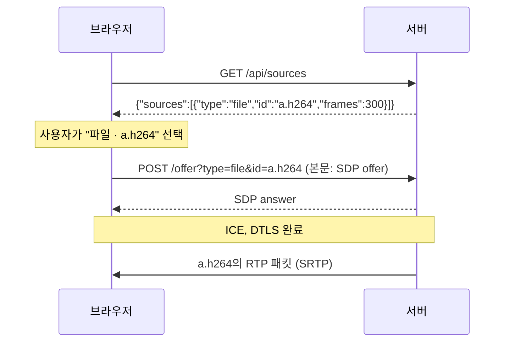

# Background

## 읽는 순서

1. 이 문서의 "전체 흐름"을 먼저 읽는다.
2. `proposal.md`에서 무엇이 바뀌는지 확인한다. 바뀌는 것은 목록 경로, JSON 형식, offer 매개변수 세 가지다.
3. `specs/`는 `video-catalog`(목록 형식) → `webrtc-signaling`(선택한 소스로 연결, 웹 페이지) → `http-server`(경로별 메서드) 순서로 읽는다.
4. 그다음 `design.md`(판정 순서와 웹 페이지의 선택 값), `tasks.md`를 읽는다.

이 change는 기능을 늘리지 않고 "무엇을 고르는가"의 표현만 바꾼다. 지금까지는 고를 수 있는 것이 파일뿐이라 파일 이름 하나로 충분했다. 다음 change에서 카메라가 들어오면 이름이 겹칠 수 있다. 그래서 목록 원소와 요청 모두 "종류 + ID" 쌍으로 소스를 가리키게 한다.

## 개념

### 전체 흐름

### 소스와 그 식별

**소스(source)**
- 정의: 서버가 세션에 보낼 영상의 출처 하나. 지금은 동영상 파일이고, 다음 change에서 카메라가 추가된다.
- 왜 필요한가: 웹 페이지 입장에서는 파일이든 카메라든 "골라서 보는 것"이다. 하나의 목록과 하나의 선택 방식으로 다루면 페이지와 시그널링이 단순해진다.
- 쓰이는 곳: `video-catalog` "동영상 목록 조회"의 `sources` 배열.

**소스 종류(`type`)와 소스 ID(`id`)**
- 정의: `type`은 소스가 무엇인지(`file`, `camera`), `id`는 같은 종류 안에서 소스를 구별하는 이름이다.
- 왜 필요한가: 파일 ID는 파일 이름이고, 카메라 ID는 운영자가 붙이는 이름이다. 정하는 주체가 달라서 겹칠 수 있다. 예를 들어 `front`라는 카메라와 `front`라는 파일이 함께 있을 수 있다.
- 동작: 둘을 쌍으로 쓰면 `(file, front)`와 `(camera, front)`는 다른 소스다. ID에 접두어를 붙이는 방식(`camera:front`)도 가능하지만, ID 안에 `:`가 있으면 다시 나눠야 하는 문제가 생긴다.
- 쓰이는 곳: 목록 원소의 `type`·`id`, offer의 `type`·`id` 매개변수(`webrtc-signaling` "Offer의 동영상 선택").

**선택 필드**
- 정의: JSON 객체에서 어떤 원소에는 있고 어떤 원소에는 없는 필드.
- 왜 필요한가: 프레임 수는 파일에만 의미가 있다. 카메라는 끝없이 이어지는 영상이라 프레임 수가 없다.
- 동작: `{"type":"file","id":"a.h264","frames":300}`와 `{"type":"camera","id":"front"}`가 같은 배열에 섞인다. 브라우저는 `type`을 보고 `frames`를 읽을지 정한다.
- 쓰이는 곳: `video-catalog` "동영상 목록 조회".

### HTTP 요청 대상과 쿼리 문자열

**쿼리 매개변수**
- 정의: 요청 대상의 `?` 뒤를 `&`로 나눈 `이름=값` 쌍.
- 왜 필요한가: `/offer`의 본문은 이미 SDP라서, 고른 소스는 본문 대신 주소에 싣는다.
- 동작: `/offer?type=file&id=a.h264`에는 쌍이 두 개 있다. 순서는 상관없어서 `?id=a.h264&type=file`도 같다. 이름이 같은 쌍이 두 번 오면 어느 값을 쓸지 모호하므로 거부한다.
- 쓰이는 곳: `webrtc-signaling` "동영상 선택 오류"의 중복 규칙.

**퍼센트 인코딩과 `encodeURIComponent`**
- 정의: 주소에 그대로 쓸 수 없는 바이트를 `%` 뒤 16진수 두 자리로 적는 방식. `encodeURIComponent`는 브라우저에서 문자열 하나를 이렇게 바꾸는 함수다.
- 왜 필요한가: ID에 `&`, `=`, 공백, 한글이 들어 있으면 쿼리의 구분자와 섞인다.
- 동작: `encodeURIComponent('시험 "1".h264')`는 `%EC%8B%9C%ED%97%98%20%221%22.h264`다. `시`는 UTF-8로 `EC 8B 9C` 세 바이트라 `%EC%8B%9C`가 된다. 서버는 이를 다시 바이트로 풀어 목록 ID와 비교한다. `%zz`처럼 16진수가 아닌 값은 풀 수 없으므로 400이다.
- 쓰이는 곳: 웹 페이지가 `type`과 `id`를 각각 인코딩해 붙인다(`webrtc-signaling` "연결 상태 확인 웹 페이지").

### 오류 상태 코드

**`400 Bad Request`와 `404 Not Found`**
- 정의: 400은 요청 형식 자체가 잘못되었다는 뜻이고, 404는 형식은 맞지만 가리키는 대상이 없다는 뜻이다.
- 왜 필요한가: 클라이언트가 고쳐야 할 것이 다르다. 400이면 요청을 만드는 코드를, 404이면 고른 값을 고친다.
- 동작: `type=disk`는 종류가 정해진 값이 아니므로 400이다. `type=camera&id=front`는 형식은 맞지만, 이 change에는 카메라가 없으므로 404다.
- 쓰이는 곳: `webrtc-signaling` "동영상 선택 오류", `design.md` 결정 2.

**`405 Method Not Allowed`와 `Allow` 헤더**
- 정의: 경로는 있지만 그 메서드(GET, POST 등)를 받지 않을 때의 응답. `Allow` 헤더로 받는 메서드를 알려 준다.
- 동작: `POST /api/sources` → `405`, `Allow: GET`.
- 쓰이는 곳: `http-server` "요청 오류 응답".

### 호환되지 않는 변경

**BREAKING CHANGE**
- 정의: 기존 사용 방식이 더 이상 같은 결과를 내지 않는 변경.
- 왜 필요한가: 사용자가 업데이트할 때 무엇을 고쳐야 하는지 알 수 있게 커밋과 문서에 표시한다.
- 동작: 이 change 후 `GET /api/videos`는 404가 된다. `POST /offer?video=a.h264`는 오류는 아니지만 영상 없는 세션이 된다. 커밋 타입에 `!`를 붙인다(예: `feat(signaling)!: ...`).
- 쓰이는 곳: `proposal.md` "What Changes"의 **BREAKING** 항목.

## 참고 문서

| 용어 | 문서 | 절 |
| --- | --- | --- |
| 요청 대상, 쿼리 | RFC 9112 HTTP/1.1 | 3.2 Request Target |
| 쿼리 구성 요소 | RFC 3986 URI Generic Syntax | 3.4 Query |
| 퍼센트 인코딩 | RFC 3986 URI Generic Syntax | 2.1 Percent-Encoding |
| `encodeURIComponent` | ECMAScript Language Specification | 19.2.6.5 encodeURIComponent |
| JSON 문자열 이스케이프 | RFC 8259 JSON | 7 Strings |
| 400, 404, 405, `Allow` | RFC 9110 HTTP Semantics | 15.5.1, 15.5.5, 15.5.6, 10.2.1 |
| 호환되지 않는 변경 표시 | Conventional Commits 1.0.0 | Specification 항목 13·14 |
