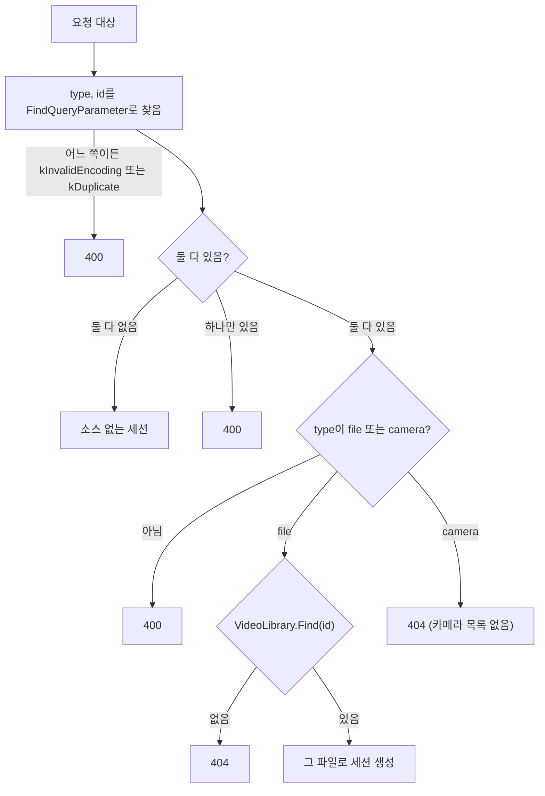

# Design

## Context

변경 이유는 proposal.md "Why"를 따른다. 요구 동작은 이 change의 `specs/`(`video-catalog`, `webrtc-signaling`, `http-server`)를 따른다.

현재 상태:

- `Signaling`이 `VideoLibrary`를 참조하고, 두 엔드포인트를 처리한다.
  - `HandleOffer`: 익명 네임스페이스의 `FindRequestedVideo`가 `http::FindQueryParameter(target, "video")`로 동영상을 찾는다. 해석 실패는 400, 목록에 없으면 404다.
  - `HandleVideoList`: `{"videos":[...]}`를 만든다.
- `FindQueryParameter`는 이름 하나의 값을 찾는다.
  - 반환값은 `std::expected<std::optional<std::string>, QueryParameterError>`다.
  - 쿼리 안 어디에든 퍼센트 인코딩이 잘못된 쌍이 있으면, 찾는 이름이 아니어도 `kInvalidEncoding`이다.
- `main.cpp`가 `HttpEndpoints`의 GET 표에 `/api/videos`를 등록한다.
- `web/app.js`는 `<select id="video-select">`의 `option.value`에 ID를 넣고, `?video=`로 offer를 보낸다.

## Goals / Non-Goals

**Goals:**

- 다음 change가 카메라 목록을 추가할 때 시그널링의 "소스 찾기"에 분기 하나만 더하면 되도록, 종류와 ID를 해석하는 지점을 한 곳에 모은다.
- 오류 판정 순서를 명확히 해서 단위 테스트로 400과 404를 구분해 검증한다.

**Non-Goals:**

- 파일과 카메라를 함께 다루는 소스 추상 인터페이스. 송신 모델(타이머로 꺼내 보내기와 도착 즉시 보내기)이 달라서, 카메라 change에서 실제 필요를 보고 정한다.
- `VideoLibrary`, `VideoEntry`, `--video-dir`의 이름 변경. 파일 소스에 대한 이름으로는 여전히 맞다.

## Decisions

### 1. 소스 종류는 시그널링의 API 표현으로 둔다

`type` 문자열과 종류 값의 대응(`"file"` ↔ 파일, `"camera"` ↔ 카메라)은 HTTP API의 형식이다. 그래서 `signaling.cpp`의 익명 네임스페이스에 `enum class SourceType { kFile, kCamera }`와 문자열을 해석하는 함수를 둔다. 목록 JSON도 같은 대응으로 `type`을 쓴다.

- 대안: `media`에 공용 열거형을 둔다. 지금은 쓰는 곳이 시그널링 하나뿐이라 공개 헤더를 늘리지 않는다. 카메라 change에서 에이전트나 소스 쪽도 종류를 알아야 하면 그때 옮긴다.

### 2. 요청 해석 순서

`FindRequestedVideo`를 `FindRequestedSource`로 바꾸고, 다음 순서로 판정한다.

- 해석 오류를 존재 여부보다 먼저 본다. `FindQueryParameter`가 쿼리 전체를 훑으며 인코딩 오류를 알려 주므로, 두 번 호출해도 결과가 같다.
- `type=camera`는 이 change에서 항상 404다. "알 수 없는 종류"(400)와 "그런 소스가 없음"(404)을 구분해 두면, 카메라 change는 404 분기 자리에 카메라 찾기만 넣으면 된다.
- 반환 형식은 지금처럼 `std::expected<const media::VideoEntry*, http::HttpStatus>`로 둔다. 카메라 change에서 세션에 넘길 소스 형식이 정해지면 바꾼다.
- 거부 로그는 원인별로 다르게 남긴다. 예: "type·id 중 하나만 옴", "알 수 없는 소스 종류", "목록에 없는 소스".

### 3. 목록 응답

`HandleVideoList`를 `HandleSourceList`로 이름을 바꾸고, 원소마다 `"type":"file"`을 `id`보다 먼저 쓴다. `id`는 기존처럼 `core::AppendJsonString`으로 이스케이프한다. 카메라가 생기면 파일 원소 뒤에 이어 쓴다.

`main.cpp`는 GET 표에 `/api/sources`만 등록하고 `/api/videos`는 등록하지 않는다. 그러면 `/api/videos`는 정적 파일 처리로 넘어가 404가 된다.

### 4. 웹 페이지의 선택 값

`option.value`에 ID를 그대로 넣으면 종류를 함께 실을 수 없다. `"file:a.h264"`처럼 이어 붙이면 ID 안의 `:`를 다시 구분해야 한다. 그래서 `loadSourceList()`가 받은 `sources` 배열을 모듈 변수에 두고, `option.value`에는 배열 인덱스를 넣는다. `connect()`는 인덱스로 원소를 찾아 `type`과 `id`를 각각 `encodeURIComponent`로 인코딩해 붙인다.

`select` 요소의 ID는 `source-select`로, 레이블은 "소스"로 바꾼다. 빈 목록 문구는 "소스 없음"이다.

## Risks / Trade-offs

- [`?video=`를 쓰는 오래된 클라이언트가 오류 없이 영상 없는 세션을 받는다] → 웹 페이지는 같은 서버가 제공하므로 함께 바뀐다. 서버의 세션 생성 로그에 "소스 없음"이 남아 원인을 찾을 수 있다. `video`를 400으로 거부하는 특례는 두지 않는다. 다른 이름은 무시한다는 규칙을 유지하는 편이 단순하다.
- [`type=camera`가 지금은 늘 404다] → 의도한 동작이다. 명세 시나리오 "종류가 다른 소스"로 고정해 둔다.
- [`option.value`가 인덱스라 목록을 다시 받으면 인덱스가 바뀔 수 있다] → 페이지는 처음 열릴 때 한 번만 목록을 받으므로 문제되지 않는다.
