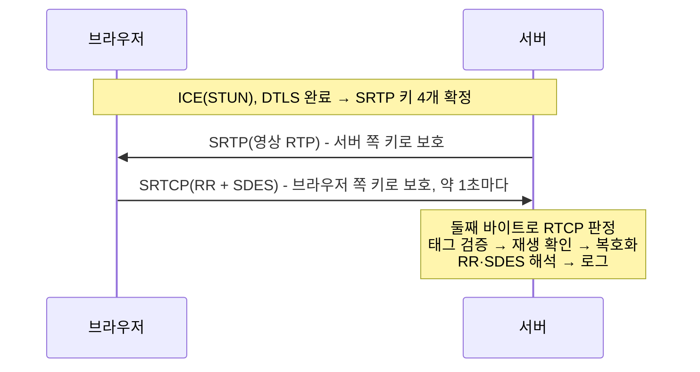
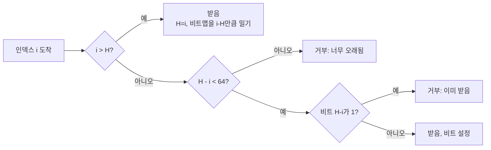

# Background

## 읽는 순서

1. 이 문서의 "전체 흐름"과 "RTCP" 절을 먼저 읽는다.
2. `proposal.md`에서 이번 범위(수신과 해석, 로그)와 범위 밖(PLI 응답, SR, NACK)을 확인한다.
3. `specs/`는 `ice-lite`(어떤 패킷을 RTCP로 보는가) → `srtp`(SRTCP 검증·복호화·재생 방지) → `rtcp`(해석과 기록) 순서로 읽는다.
4. 용어가 막히면 이 문서의 해당 절로 돌아온다. 그다음 `design.md`, `tasks.md`를 읽는다.

지금 서버는 브라우저에게 영상을 SRTP로 보내기만 하고, 브라우저가 돌려보내는 제어 메시지(RTCP)는 버린다. 이 change는 그 메시지를 받는 경로를 만든다. 같은 UDP 소켓으로 들어온 패킷 중 RTCP를 골라내고, DTLS로 정한 브라우저 쪽 키로 SRTCP 보호를 풀고, 안의 RTCP 패킷을 나누어 읽어 로그로 남긴다. 응답(키프레임 재송신, SR 송신)은 이후 change에서 이 경로 위에 올린다.

## 개념

### 전체 흐름



### RTCP

**RTCP(RTP Control Protocol)**
- 정의: RTP와 함께 쓰는 제어 프로토콜로, 수신 품질 보고, 송신 정보, 참가자 이름, 피드백 요청을 나른다.
- 왜 필요한가: RTP는 데이터만 나르므로, 보내는 쪽은 받는 쪽이 얼마나 잃었는지, 지연이 얼마인지 알 수 없다. RTCP가 그 정보를 되돌려 준다.
- 동작: 받는 쪽은 수 초 이내 간격으로(WebRTC는 보통 약 1초) RTCP를 보낸다. 패킷 종류는 헤더의 PT 필드로 구분한다.

| PT | 이름 | 내용 |
| --- | --- | --- |
| 200 | SR(Sender Report) | 보내는 쪽의 시각, 보낸 패킷·바이트 수, 그리고 보고 블록 |
| 201 | RR(Receiver Report) | 받는 쪽의 보고 블록 |
| 202 | SDES(Source Description) | CNAME 같은 참가자 정보 |
| 203 | BYE | 이 SSRC가 세션을 떠남 |
| 204 | APP | 애플리케이션 정의 |
| 205 | RTPFB | 전송 계층 피드백(NACK 등) |
| 206 | PSFB | 페이로드별 피드백(PLI, FIR 등) |

- 쓰이는 곳: `specs/rtcp` 전체, design 결정 5

**공통 헤더**
- 정의: 모든 RTCP 패킷의 첫 4바이트.
- 동작: 바이트·비트 배치는 다음과 같다.

```text
 0                   1                   2                   3
 0 1 2 3 4 5 6 7 8 9 0 1 2 3 4 5 6 7 8 9 0 1 2 3 4 5 6 7 8 9 0 1
+-+-+-+-+-+-+-+-+-+-+-+-+-+-+-+-+-+-+-+-+-+-+-+-+-+-+-+-+-+-+-+-+
|V=2|P|  count  |      PT       |             length            |
+-+-+-+-+-+-+-+-+-+-+-+-+-+-+-+-+-+-+-+-+-+-+-+-+-+-+-+-+-+-+-+-+
```

- V: 버전, 항상 2이다.
- P: padding이 있으면 1이다. 이때 패킷 마지막 바이트가 padding 길이다.
- count: RR·SR에서는 보고 블록 수, SDES에서는 청크 수, 피드백 패킷에서는 세부 종류(FMT)다.
- length: 이 패킷 길이를 32비트 단어 수로 센 값에서 1을 뺀 값이다. 예를 들어 32바이트 패킷은 32/4-1=7이다. "빼기 1"은 길이 0이 헤더만 있는 4바이트 패킷을 뜻하게 하려는 규칙이다.
- 쓰이는 곳: `specs/rtcp` "RTCP 복합 패킷 해석"

**복합 패킷(compound packet)**
- 정의: RTCP 패킷 여러 개를 이어 붙여 UDP 데이터그램 하나로 보낸 것.
- 왜 필요한가: 보고(RR)와 이름(SDES)을 매번 함께 보내야 하므로, 데이터그램 수를 줄이려고 묶는다.
- 동작: 각 패킷의 length로 다음 패킷의 시작을 찾는다. 경계 표시가 따로 없으므로, length 하나가 틀리면 그 뒤 해석이 모두 어긋난다. 그래서 하나라도 틀리면 전체를 버린다.

```text
[RR 32바이트][SDES 24바이트]   ← 데이터그램 하나(SRTCP 꼬리 제외)
```

- RFC 3550은 복합 패킷이 SR이나 RR로 시작해야 한다고 정하지만, reduced-size RTCP(RFC 5506)를 협상하면 PLI 하나만 보낼 수도 있다. design 결정 5가 이 규칙을 검사하지 않는 이유다.
- 쓰이는 곳: proposal "What Changes", `specs/rtcp`

**4바이트 단위 길이**
- 정의: RTCP 패킷의 길이는 항상 4바이트의 배수다. 반면 SRTCP 데이터그램 전체 길이는 4의 배수가 아니다.
- 왜 그런가: 헤더의 length 필드가 "32비트 단어 수 - 1"이므로, 패킷 길이는 `(length + 1) × 4`바이트로만 표현된다. 4의 배수가 아닌 길이는 적을 방법이 없다.
- 동작:
  - 내용이 4의 배수가 아니면 보내는 쪽이 채워 넣는다. SDES는 청크 끝을 0바이트로 채워 4바이트 경계를 맞춘다(아래 SDES 예시의 마지막 `00`). 또는 P 비트를 1로 하고 패킷 끝에 padding을 붙인 뒤 마지막 바이트에 padding 길이를 적는다.
  - 복합 패킷은 이런 패킷을 이어 붙인 것이므로 전체도 4의 배수다.
  - SRTCP는 복합 패킷 뒤에 E·인덱스 4바이트와 인증 태그 10바이트를 붙인다. 그래서 데이터그램 길이는 `4k + 14`이고, 4로 나눈 나머지는 항상 2다. 예를 들어 RR 32바이트와 SDES 28바이트로 된 복합 패킷(60바이트)은 SRTCP로 74바이트가 된다.
  - AES-CM은 스트림 방식이라 블록 크기에 맞출 필요가 없다. 그래서 암호화 때문에 padding이 더 붙지는 않는다.
- 주의할 점:
  - 여기서 정렬은 길이에 대한 규칙이지 메모리 주소의 정렬이 아니다. 수신 버퍼 안의 위치가 4바이트 경계에 맞는다는 보장이 없으므로, 32비트 값은 포인터를 캐스팅해 읽지 않고 바이트 단위로 빅 엔디언으로 읽는다.
  - 꼬리 14바이트를 뗀 나머지가 4의 배수가 아니면 잘못된 패킷이다. 패킷마다 length를 따라가며 데이터 끝에서 정확히 끝나는지 확인하면 이 경우도 함께 걸러진다.
- 쓰이는 곳: `specs/rtcp` "RTCP 복합 패킷 해석", `specs/srtp` "SRTCP 패킷 검증과 복호화"(너무 짧은 패킷), design 결정 5

**RR과 보고 블록(report block)**
- 정의: RR은 "보낸 쪽 SSRC" 뒤에 보고 블록을 count개 담는다. 보고 블록 하나는 특정 송신자(대상 SSRC)에 대한 수신 품질 24바이트다.
- 동작: 브라우저가 서버 영상(SSRC 305419896 = `0x12345678`)에 대해 보낸 RR의 예시다.

```text
81 C9 00 07   V=2, P=0, count=1 / PT=201(RR) / length=7 → 32바이트
00 00 00 01   보낸 쪽 SSRC = 1 (브라우저의 수신용 SSRC)
12 34 56 78   대상 SSRC = 305419896 (서버 answer의 a=ssrc)
00            손실률(fraction lost) = 0/256
00 00 00      누적 손실(cumulative lost) = 0
00 01 11 EB   확장 최고 순번 = 70123 (상위 16비트 = 순번이 넘어간 횟수 1, 하위 = 4587)
00 00 00 0C   jitter = 12 (RTP 타임스탬프 단위, 90kHz면 약 0.13ms)
00 00 00 00   LSR(마지막 SR 시각) = 받은 SR 없음
00 00 00 00   DLSR(그 SR 이후 지난 시간) = 0
```

- 손실률은 직전 보고 이후 잃은 비율을 256분율로 나타낸다. `0x19`(25)이면 약 9.8%다.
- 누적 손실은 부호 있는 24비트다. 중복 패킷 때문에 음수가 될 수 있다.
- LSR·DLSR은 서버가 SR을 보내야 의미가 생긴다(SR change에서 RTT 계산에 씀). 지금은 0이다.
- 쓰이는 곳: `specs/rtcp` "RTCP 복합 패킷 해석", "RTCP 수신 기록", design 결정 6의 로그 예시

**SR과 NTP 타임스탬프**
- 정의: SR은 보내는 쪽이 "내 RTP 타임스탬프 X는 내 시계로 NTP 시각 T다"라는 대응을 알리는 RTCP 패킷이다. NTP 타임스탬프는 1900-01-01 00:00 UTC부터의 시간을 64비트로 나타낸다. 상위 32비트는 초, 하위 32비트는 초 미만(1/2^32초 단위)이다.
- 왜 필요한가: RTP 타임스탬프는 스트림마다 따로 세는 숫자라 스트림끼리 비교할 수 없다.
  - 단위가 다르다. 영상은 보통 1초에 90,000씩(90kHz), 음성(Opus)은 48,000씩(48kHz) 는다.
  - 시작값이 다르다. RFC 3550은 스트림마다 시작값을 무작위로 정하게 한다.
  - 그래서 영상과 음성의 RTP 타임스탬프를 같은 기준(NTP 시각)으로 바꿔야, 같은 순간의 프레임과 소리를 함께 재생(립싱크)할 수 있다.
- 동작: SR은 보낸 쪽 SSRC 뒤에 송신 정보 20바이트를 두고, 그 뒤에 RR과 같은 보고 블록을 둔다. 서버 영상의 SR 예시다.

```text
80 C8 00 06   V=2, P=0, count=0 / PT=200(SR) / length=6 → 28바이트
12 34 56 78   보낸 쪽 SSRC = 305419896 (서버 영상)
EE 92 DD A0   NTP 초 = 2026-11-02 10:00:00 UTC
80 00 00 00   NTP 초 미만 = 0x80000000 / 2^32 = 0.5초
00 0F 42 40   RTP 타임스탬프 = 1,000,000 (위 NTP 시각에 해당하는 값)
00 00 03 E8   보낸 패킷 수 = 1000
00 0F 42 40   보낸 페이로드 바이트 수 = 1,000,000
```

- 받는 쪽은 스트림마다 받은 SR로 RTP 타임스탬프를 NTP 시각으로 바꾼다. 영상과 음성의 SR이 다음과 같으면, 영상 1,090,000과 음성 548,000은 둘 다 SR 시각보다 1초 뒤이므로 함께 재생한다.

| | 영상 (90kHz) | 음성 (48kHz) |
| --- | --- | --- |
| SR의 대응 | RTP 1,000,000 = 10:00:00.5 | RTP 500,000 = 10:00:00.5 |
| 받은 패킷 | 1,090,000 → +90,000 ÷ 90,000 = +1초 | 548,000 → +48,000 ÷ 48,000 = +1초 |
| NTP 시각 | 10:00:01.5 | 10:00:01.5 |

- 같은 시계여야 하는 범위: 한 참가자(같은 CNAME)의 스트림들은 SR의 NTP 시각을 **같은 시계**에서 읽어야 한다. RTP 타임스탬프의 시작값과 단위는 스트림마다 달라도 된다. 그 시계가 실제 세계 시각과 정확히 맞을 필요는 없다. 다른 참가자의 시계와는 어긋나 있을 수 있으므로, 다른 CNAME의 스트림끼리는 이 방식으로 맞추지 않는다.
- 보내는 쪽의 조건: SR의 대응은 실제 미디어 시각과 맞아야 한다. 같은 순간의 영상 프레임과 음성 샘플을 SR로 바꾸면 같은 NTP 시각이 나와야 한다. 서버가 파일의 영상과 음성을 함께 보낸다면, 두 트랙을 파일의 같은 시간축에서 NTP 시각으로 바꿔 SR을 만들어야 한다.
- RR의 LSR·DLSR과의 관계: 받는 쪽은 마지막으로 받은 SR의 NTP 타임스탬프 가운데 32비트(초의 하위 16비트 + 초 미만의 상위 16비트)를 LSR에 적는다. 위 SR이라면 `DD A0 80 00`이다. DLSR은 그 SR을 받은 뒤 RR을 보낼 때까지 지난 시간(1/65536초 단위)이다. SR을 보낸 쪽은 RR을 받은 시각 A에서 `A − LSR − DLSR`을 계산해 왕복 시간(RTT)을 구한다.
- 이 change에서는: 브라우저는 `recvonly`라 SR을 보내지 않고, 서버도 아직 SR을 보내지 않는다. 그래서 브라우저 RR의 LSR·DLSR은 0이고, NTP 시각을 쓰는 곳은 없다. 해석기는 SR이 오더라도 송신 정보를 건너뛰고 보고 블록만 읽는다(design 결정 5). 이후 서버가 SR을 보내면 RTT 계산과 브라우저의 립싱크에 쓰인다.
- 쓰이는 곳: design 결정 5의 SR 보고 블록 해석, 이후 SR 송신 change

**SDES와 CNAME**
- 정의: SDES(Source Description)는 SSRC마다 "이 스트림을 보내는 쪽이 누구인가"를 알리는 RTCP 패킷이다. 그중 CNAME(canonical name)은 같은 참가자가 보내는 여러 SSRC를 하나로 묶는 이름이다.
- 왜 필요한가: SSRC는 스트림 하나를 가리키는 32비트 무작위 번호일 뿐이라, 다음 문제를 SSRC만으로는 풀 수 없다.
  - **같은 참가자의 여러 스트림 묶기**: 한 사람이 음성과 영상을 따로 보내면 SSRC가 두 개다. 받는 쪽은 두 SSRC가 같은 사람에게서 왔다는 것을 알아야 둘을 맞춰 재생(립싱크)할 수 있다. 이때 쓰는 열쇠가 CNAME이다. SR이 알려 주는 "RTP 타임스탬프 ↔ 실제 시각" 대응을 CNAME이 같은 스트림끼리 비교해 시간을 맞춘다("SR과 NTP 타임스탬프" 참고).
    - 송신 주소로 묶으면 안 되는 이유: "같은 주소에서 왔다"와 "같은 참가자의 시계를 쓴다"는 서로 다른 사실이다. 주소가 같아도 다른 참가자일 수 있고, 주소가 달라도 같은 참가자일 수 있다.
      - 주소가 같지만 참가자가 다른 경우: SFU(중계 서버)는 여러 참가자의 스트림을 한 연결로 전달한다. 받는 쪽에서는 모든 스트림이 SFU 주소에서 오므로, 주소로 묶으면 A의 음성과 B의 영상이 한 참가자로 묶여 시간을 잘못 맞춘다.
      - 주소가 다르지만 같은 참가자인 경우: BUNDLE 이전에는 음성과 영상을 다른 포트(다른 RTP 세션)로 보냈다. 한 참가자의 두 스트림이 다른 주소에서 오므로, 주소로는 둘이 짝이라는 것을 알 수 없다. RTP가 처음 설계된 멀티캐스트 환경에서도 받는 쪽이 보는 주소는 참가자를 가리키지 않는다.
      - 그래서 RTP는 전송 경로와 상관없이 보내는 쪽이 직접 "이 SSRC들은 내 것"이라고 밝히는 CNAME을 둔다.
    - 이 프로젝트처럼 1:1로 연결하고 BUNDLE로 주소 하나만 쓰는 구조에서는 주소로도 묶을 수 있다. 그러나 이후 마일스톤에서 서버가 여러 카메라 스트림을 한 연결로 보내면 SFU와 같은 상황이 된다. 그때는 카메라마다 다른 CNAME을 줘야 브라우저가 스트림을 카메라별로 묶을 수 있다.
  - **SSRC가 바뀌어도 같은 참가자로 보기**: 두 참가자가 우연히 같은 SSRC를 고르거나(충돌) 보내는 쪽이 다시 시작하면 SSRC가 바뀐다. CNAME은 그대로이므로 받는 쪽이 같은 참가자로 이어서 볼 수 있다.
  - 이런 이유로 RFC 3550 6.1은 모든 복합 패킷에 CNAME을 담은 SDES를 넣도록 정한다. 브라우저가 RR을 보낼 때마다 SDES가 따라오는 이유다.
- 동작: SDES는 공통 헤더 뒤에 청크를 count개 둔다. 청크는 `SSRC(4) + 항목들 + 종료 0바이트 + 4바이트 정렬`이고, 항목은 `종류(1) 길이(1) 내용`이다. CNAME의 종류는 1이다. CNAME이 16바이트인 예시는 다음과 같다.

```text
81 CA 00 06   V=2, P=0, count=1 / PT=202(SDES) / length=6 → 28바이트
00 00 00 01   청크의 SSRC = 1 (RR의 보낸 쪽 SSRC와 같음)
01 10         항목 종류 1(CNAME), 길이 16
61 62 ... 70  "abcdefghijklmnop" (16바이트)
00            항목 목록 끝
00            4바이트 경계까지 채움
```

- WebRTC에서는 브라우저가 `RTCPeerConnection`마다 무작위 CNAME을 만든다(RFC 7022의 단기 무작위 CNAME). 사용자 이름이나 호스트 이름이 드러나지 않게 하기 위해서다. 서버도 이전 change부터 answer의 `a=ssrc:<SSRC> cname:<이름>`으로 자기 CNAME을 알리고 있다.
- 이 change에서 CNAME의 쓸모:
  - 지금은 영상 SSRC 하나만 오가므로 립싱크에는 쓰지 않는다.
  - 로그에서 "어느 브라우저 연결이 보낸 보고인가"를 구분하는 표시로만 쓴다.
  - 이후 서버가 음성을 추가하거나 SR을 보내게 되면, 같은 CNAME으로 스트림을 묶는 근거가 된다.
- 내용은 상대가 정한 바이트이므로 로그에 그대로 쓰지 않는다(design 결정 5).
- 쓰이는 곳: `specs/rtcp` "RTCP 복합 패킷 해석"과 "RTCP 수신 기록", design 결정 5

### 한 포트에서 패킷 구분

**rtcp-mux와 패킷 구분**
- 정의: rtcp-mux(RFC 5761)는 RTP와 RTCP를 같은 포트로 보내는 방식이다. WebRTC는 여기에 STUN과 DTLS까지 같은 포트로 보낸다.
- 왜 필요한가: 포트 하나만 ICE로 뚫으면 되어 연결 수립이 빠르고 단순해진다. 대신 받는 쪽이 바이트를 보고 종류를 가려야 한다.
- 동작: 첫 바이트로 큰 종류를 나누고(RFC 7983), RTP와 RTCP는 둘째 바이트로 나눈다.

| 첫 바이트 | 종류 |
| --- | --- |
| 0~3 | STUN |
| 20~63 | DTLS |
| 128~191 | RTP 또는 RTCP(버전 비트가 2) |

- RTP 헤더의 둘째 바이트는 `marker(1비트) + payload type(7비트)`이다. RTCP의 둘째 바이트는 PT(200~206 등)다.
- RFC 5761은 RTCP PT가 들어갈 192~223을 RTP가 쓰지 않게 한다. 그래서 RTP payload type 64~95는 쓰지 않는다. marker가 1이면 64~95가 둘째 바이트 192~223이 되기 때문이다.
- 예시: 둘째 바이트 `0x66`(102, H.264 payload type)이면 RTP이고, `0xC9`(201)이면 RTCP RR이다.
- 쓰이는 곳: `specs/ice-lite` "잘못된 요청 무시", design 결정 1

### SRTCP

**"키"가 가리키는 것: 마스터 키와 세션 키**
- 정의: SRTP/SRTCP 문서에서 "키"는 두 층 중 하나를 가리킨다.
  - 마스터 키(16바이트)와 마스터 솔트(14바이트): DTLS가 정해 주는 값. 패킷에 직접 쓰지 않는다.
  - 세션 키: 마스터 키에서 레이블로 뽑아낸 실제 사용 키. 한 벌은 암호화 키(AES-128, 16바이트), 인증 키(HMAC-SHA1, 20바이트), 세션 솔트(IV 재료, 14바이트)로 이루어진다.
- 왜 두 층인가: 암호화와 인증에 같은 키를 쓰지 않으려고, 그리고 RTP와 RTCP가 같은 키스트림을 쓰지 않게 하려고 마스터 키 하나에서 용도별 키를 나눈다. 계산 방법은 이전 change `add-h264-file-streaming`의 background "마스터 키·솔트와 세션 키 유도(KDF)"에 있다.
- 동작: DTLS 연결 하나에서 세션 키 묶음 네 벌이 나온다.

| 방향 | 마스터 키 | RTP용 세션 키(레이블 0x00~0x02) | RTCP용 세션 키(레이블 0x03~0x05) |
| --- | --- | --- | --- |
| 서버 → 브라우저 | server(`local_*`) | 영상 송신에 사용(이전 change) | SR 송신에 쓸 예정(이후 change) |
| 브라우저 → 서버 | client(`remote_*`) | 쓰지 않음(브라우저가 RTP를 보내지 않음) | 이 change에서 사용 |

- "같은 키 안에서 IV가 겹치면 안 된다"고 할 때의 키는 이 표의 한 칸에 있는 암호화 키다. 칸이 다르면 키가 달라서, IV가 같아도 키스트림은 다르다.
- 쓰이는 곳: `specs/srtp` "SRTCP 세션 키 유도", design 결정 2·6

**DTLS-SRTP의 두 방향 키**
- 정의: DTLS 핸드셰이크가 끝나면 양쪽은 같은 60바이트 키 재료를 얻고, 이를 `client 키 | server 키 | client 솔트 | server 솔트`(16+16+14+14)로 나눈다(RFC 5764 4.2).
- 왜 필요한가: 두 방향이 같은 마스터 키를 쓰면, 서로 다른 두 패킷이 같은 키스트림으로 암호화되거나 상대의 패킷이 그대로 통과할 수 있다.
  - **키스트림 재사용**: IV는 세션 솔트, 패킷의 SSRC, 인덱스로 만든다. 마스터 키가 같으면 세션 키와 솔트도 같다. 그러면 서버가 보낸 패킷과 브라우저가 보낸 패킷의 SSRC와 인덱스가 우연히 같을 때 IV가 같아지고, 키스트림도 같아진다. 이때 두 암호문을 XOR하면 `평문 1 XOR 평문 2`가 드러난다. 한쪽 평문을 추측하면 다른 쪽이 풀린다. 원리와 바이트 예시는 이전 change `add-h264-file-streaming`의 background "IV"에 있다.
  - **반사 공격**: 공격자가 서버가 보낸 패킷을 서버에게 그대로 되돌려 보내도 같은 인증 키로 만든 태그라 검증을 통과한다.
- 동작: 서버가 DTLS server이므로, 서버가 보내는 패킷은 server 키(`local_*`)로 보호하고, 브라우저가 보내는 패킷은 client 키(`remote_*`)로 보호되어 온다. 이번 change는 처음으로 `remote_*`를 쓴다.
- 쓰이는 곳: `specs/srtp` "SRTCP 세션 키 유도", design 결정 6

**방향마다 다른 SSRC**
- 정의: SSRC는 연결의 번호가 아니라 패킷을 보내는 쪽(source)의 번호다. 보내는 쪽마다 자기 SSRC를 무작위로 정한다.
- 왜 헷갈리는가: 패킷 하나만 보면 보내는 쪽과 받는 쪽이 같은 SSRC를 쓴다. SSRC가 헤더에 평문으로 실려 있어, 받는 쪽이 그 값을 읽어 같은 IV를 만들기 때문이다. 하지만 두 방향은 서로 다른 패킷이고, 각자 자기 SSRC를 쓴다.
- 동작: 이 서버에서는 다음과 같다.

```text
서버 → 브라우저   RTP 헤더의 SSRC              = 305419896 (서버가 정해 answer의 a=ssrc로 알림)
브라우저 → 서버   RTCP RR 헤더의 보낸 쪽 SSRC  = 1         (브라우저가 정한 자기 번호)
                  그 RR 보고 블록의 대상 SSRC  = 305419896 (어느 스트림에 대한 보고인지 가리키는 내용 값)
```

- SRTCP IV에 쓰는 것은 헤더의 보낸 쪽 SSRC(바이트 4~7), 즉 1이다. 보고 블록 안의 305419896은 암호화되는 내용일 뿐 IV와 상관없다.
- 두 SSRC는 서로 모르게 골라 보통 다르다. 하지만 우연히 같아질 가능성을 없앨 수는 없으므로, 위 "두 방향 키"처럼 키 자체를 나눈다.
- 쓰이는 곳: `specs/srtp` "SRTCP 패킷 검증과 복호화"(IV), `specs/rtcp` "RTCP 복합 패킷 해석"(보낸 쪽 SSRC와 대상 SSRC)

**SRTCP 세션 키와 레이블**
- 정의: 마스터 키 하나에서 AES-CM으로 용도별 세션 키를 뽑을 때, 용도를 구분하는 1바이트 값이 레이블이다(RFC 3711 4.3).
- 동작: 레이블은 마스터 솔트의 8번째 바이트(앞에서 0부터 세어 7)에 XOR되어 IV를 바꾸므로, 레이블이 다르면 완전히 다른 키가 나온다.

| 레이블 | 용도 |
| --- | --- |
| 0x00 / 0x01 / 0x02 | SRTP 암호화 키 / 인증 키 / 솔트 |
| 0x03 / 0x04 / 0x05 | SRTCP 암호화 키 / 인증 키 / 솔트 |

- 쓰이는 곳: `specs/srtp` "SRTCP 세션 키 유도", design 결정 2

**SRTCP 패킷 형식**
- 정의: RTCP 복합 패킷 뒤에 4바이트(E 비트와 SRTCP 인덱스)와 인증 태그를 붙인 것.
- 왜 SRTP와 다른가: RTP에는 순번이 있어 받는 쪽이 ROC를 추정해 패킷 인덱스를 만들 수 있다. RTCP에는 순번이 없으므로 보내는 쪽이 인덱스를 직접 싣는다.
- 동작: 바이트 배치는 다음과 같다.

```text
+-----------------------------+
| RTCP 헤더 첫 8바이트         |  평문 (V/P/count, PT, length, 보낸 쪽 SSRC)
+-----------------------------+
| 나머지 RTCP 데이터           |  E=1이면 암호화됨 (복합 패킷의 두 번째 패킷부터 모두 포함)
+-----------------------------+
|E|   SRTCP 인덱스 (31비트)    |  평문 4바이트
+-----------------------------+
| 인증 태그 (10바이트)         |  위 전체(인덱스 포함)의 HMAC-SHA1 앞 80비트
+-----------------------------+
```

- 예시: E=1, 인덱스 42 → `80 00 00 2A`
- 인덱스는 보내는 쪽이 패킷마다 1씩 올린다. E=0이면 암호화 없이 인증만 한 패킷이다.
- 첫 8바이트가 평문이므로, 복호화 전에 SSRC를 읽어 재생 창을 찾을 수 있다.
- 쓰이는 곳: `specs/srtp` "SRTCP 패킷 검증과 복호화", design 결정 3

**인덱스: SRTP 패킷 인덱스와 SRTCP 인덱스**
- 정의: 인덱스는 한 SSRC가 같은 세션 키로 보내는 패킷의 일련번호다. 그 스트림에서 몇 번째 패킷인지를 나타낸다.
- 왜 필요한가: 두 가지에 쓴다.
  - **IV를 패킷마다 다르게 만든다.** 같은 키 안에서 SSRC가 같은 패킷끼리는 인덱스만 다르므로, 인덱스가 겹치지 않아야 키스트림이 겹치지 않는다.
  - **재생 공격을 확인한다.** 받는 쪽이 이미 받은 인덱스를 기억해 같은 패킷의 재전송을 거부한다(아래 "재생 공격 방지").
- 동작: RTP와 RTCP는 인덱스를 얻는 방법이 다르다.

| | SRTP(RTP) 패킷 인덱스 | SRTCP 인덱스 |
| --- | --- | --- |
| 크기 | 48비트 | 31비트 |
| 구성 | `ROC(32비트) << 16 \| 순번(16비트)` | 보내는 쪽이 패킷마다 1씩 올리는 카운터 |
| 패킷에 실리나 | 순번만 RTP 헤더에 있음. ROC는 양쪽이 순번이 넘어간 횟수를 각자 셈 | 꼬리 4바이트에 그대로 실림(E 비트 뒤 31비트) |
| 예시 | 순번이 한 번 넘어간 뒤 순번 4587 → `1 << 16 \| 4587` = 70123 | 43번째 RTCP 패킷 → 42(0부터 셈), 꼬리 `80 00 00 2A` |

- RTCP는 순번 필드가 없어서 받는 쪽이 인덱스를 추정할 수 없다. 그래서 보내는 쪽이 직접 싣는다. RTP는 순번이 있으므로 ROC만 세면 되고, 패킷에 바이트를 더하지 않는다. ROC의 자세한 동작은 이전 change `add-h264-file-streaming`의 background "패킷 인덱스, ROC와 패킷 암호화용 IV"에 있다.
- 두 인덱스는 같은 SSRC라도 서로 다른 세션 키(레이블 0x00 대 0x03)에서 쓰이므로, RTP 인덱스 42와 RTCP 인덱스 42가 같은 키스트림을 만들지 않는다.
- 쓰이는 곳: `specs/srtp` "SRTCP 패킷 검증과 복호화", "SRTCP 재생 방지", design 결정 3·4

**AES-CM IV**
- 정의: AES Counter Mode의 첫 카운터 블록(16바이트). 패킷마다 달라야 같은 키스트림이 반복되지 않는다.
- 동작: SRTP와 같은 규칙이다. 인덱스 자리에 48비트 패킷 인덱스 대신 31비트 SRTCP 인덱스를 쓴다는 점만 다르다.

```text
바이트   0 1 2 3 | 4 5 6 7 | 8 9 10 11 12 13 | 14 15
솔트     s s s s | s s s s | s s s  s  s  s  | 0  0
XOR              | SSRC    | 인덱스(48비트 자리) |
```

- 인덱스 42, SSRC 1이면, 솔트의 바이트 4~7에 `00 00 00 01`, 바이트 8~13에 `00 00 00 00 00 2A`를 XOR한다. 마지막 두 바이트는 블록 카운터로, 0부터 증가한다.
- 쓰이는 곳: `specs/srtp`, design 결정 3

**HMAC-SHA1 인증 태그와 상수 시간 비교**
- 정의: 인증 키로 계산한 HMAC-SHA1(20바이트)의 앞 10바이트를 붙여, 키를 모르는 쪽이 만든 패킷이나 바뀐 패킷을 걸러 낸다.
- 동작: 받는 쪽은 같은 계산을 해서 붙어 온 태그와 비교한다. 이때 비교는 앞에서부터 다른 바이트를 만나면 바로 멈추는 일반 비교가 아니라, 항상 끝까지 비교하는 상수 시간 비교를 쓴다. 일반 비교를 쓰면 응답 시간 차이로 맞은 바이트 수가 새어 나갈 수 있다.
- 쓰이는 곳: design 결정 3

### 재생 공격 방지

**재생 공격(replay attack)과 재생 방지 창**
- 정의: 재생 공격은 공격자가 예전에 오간 정상 패킷을 녹화해 두었다가 다시 보내는 공격이다. 재생 방지 창은 최근 받은 인덱스를 기억해 같은 인덱스를 다시 받아들이지 않는 장치다.
- 왜 필요한가: 다시 보낸 패킷은 태그가 정상이므로 인증만으로는 걸러지지 않는다. 지금은 로그만 남기지만, 이후 PLI를 처리하게 되면 녹화한 PLI를 반복해 보내는 것만으로 서버가 키프레임을 계속 다시 보내게 만들 수 있다.
- 동작: 가장 큰 인덱스 H와, H부터 아래로 64개의 수신 여부를 비트맵으로 둔다(RFC 3711 3.3.2).



- 예시: H=100에서 i=30이 오면 100-30=70 ≥ 64이므로 거부한다. H=10에서 i=9가 처음 오면 받아들인다.
- 창은 인증을 통과한 패킷으로만 갱신한다. 그렇지 않으면 공격자가 큰 인덱스의 가짜 패킷을 보내 창을 앞으로 밀어서, 정상 패킷을 "너무 오래됨"으로 만들 수 있다.
- 쓰이는 곳: `specs/srtp` "SRTCP 재생 방지", design 결정 3·4

## 참고 문서

| 용어 | 문서 | 절 |
| --- | --- | --- |
| RTCP, SR, RR, SDES, 보고 블록, 복합 패킷 | IETF RFC 3550 | 6, 6.1, 6.4, 6.5 |
| SR 송신 정보, NTP 타임스탬프 형식, LSR·DLSR과 RTT | IETF RFC 3550 | 4, 6.4.1 |
| 피드백 PT 205·206 | IETF RFC 4585 | 6.1 |
| reduced-size RTCP | IETF RFC 5506 | 3 |
| rtcp-mux, RTP/RTCP 구분 | IETF RFC 5761 | 4 |
| 첫 바이트로 패킷 구분 | IETF RFC 7983 | 7 |
| SRTCP 형식, 키 유도 레이블, IV, 재생 방지 | IETF RFC 3711 | 3.4, 4.1.1, 4.3, 3.3.2 |
| DTLS-SRTP 키 재료 순서 | IETF RFC 5764 | 4.2 |
| HMAC | IETF RFC 2104 | 2 |
| `CRYPTO_memcmp` | OpenSSL 문서 | `CRYPTO_memcmp(3)` |
