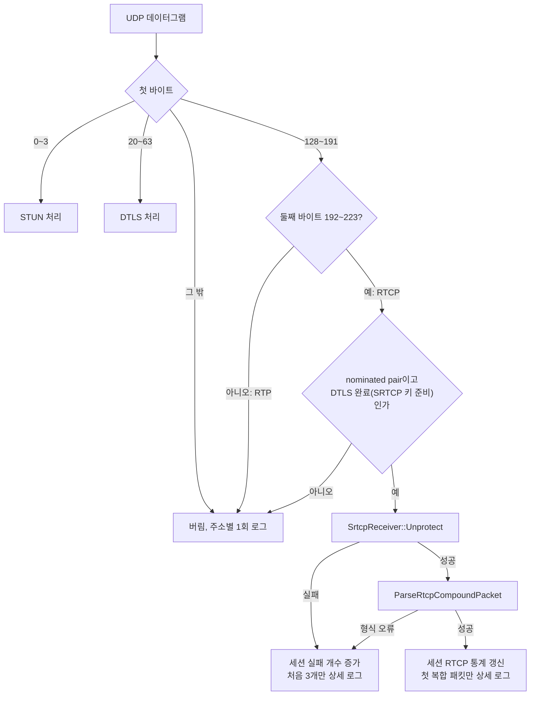
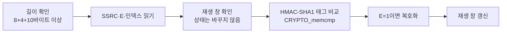

# Design

## Context

변경 이유는 proposal.md "Why"를 따른다. 요구 동작은 이 change의 `specs/`(`rtcp`, `srtp`, `ice-lite`)를 따른다.

현재 상태:

- `IceLiteAgent::HandlePacket`은 첫 바이트로 STUN(0~3)과 DTLS(20~63)만 처리한다. 128~191(RTP/RTCP)은 `LogDroppedPacket`으로 버리며, 원격 주소마다 한 번만 로그를 남긴다.
- `DtlsTransport::SrtpKeys()`는 DTLS가 완료되면 `local_key/local_salt`(서버 송신용)와 `remote_key/remote_salt`(브라우저 송신용)를 모두 가진다. 지금은 `local_*`만 `VideoStreamSender`에 넘긴다.
- `src/crypto/srtp.cpp`의 키 유도(`DeriveSessionKey`), AES-CTR 컨텍스트 생성, 키스트림 XOR은 익명 네임스페이스 안에 있다. 공개 함수는 `DeriveSrtpSessionKeys`(레이블 0x00~0x02), `XorAesCmKeystream`, `SrtpSender`뿐이다.
- 서버의 answer는 `sendonly`라 브라우저는 RTP를 보내지 않는다. `a=rtcp-fb`가 없으므로 브라우저가 보내는 RTCP는 RR과 SDES 정도다.
- 테스트에는 브라우저 역할의 `DtlsTestClient`(키 재료 추출 가능)와 SRTP 수신 측 `SrtpTestReceiver`가 있다.

제약:

- C++23, `-fno-exceptions`. 오류는 `std::expected`로 전달한다.
- 서버는 단일 스레드 이벤트 루프이며, 패킷 처리 중 블로킹 I/O를 하지 않는다.

## Goals / Non-Goals

**Goals:**

- 수신 SRTCP 처리를 소켓과 세션을 모르는 순수 함수와 객체로 만들어 단위 테스트로 검증한다.
- RTCP 해석 결과를 세션에 모아 두어, 이후 PLI 응답이 같은 자리에 "PLI를 받으면 할 일"만 추가하면 되게 한다.
- 로그 양이 패킷 수에 비례해 늘지 않게 한다.

**Non-Goals:**

- RTCP 패킷 생성과 SRTCP 보호(서버 송신). SR 송신 change에서 다룬다.
- RTCP 피드백(205·206)의 FMT별 해석. PLI change에서 다룬다.
- 수신 RTP(SRTP) 복호화. 서버는 RTP를 받지 않는다.

## Decisions

### 1. 처리 흐름



- `PacketKind`에 `kRtcp`를 더하고, `ClassifyPacket`이 첫 바이트와 둘째 바이트를 함께 보게 바꾼다. 둘째 바이트 192~223은 RFC 5761 4절의 RTCP 구분 규칙이다.
- 세션을 찾는 방법은 DTLS와 같다. 도착 소켓과 출발 주소로 `nominated_pairs_`에서 찾는다. RTCP에는 STUN의 USERNAME 같은 세션 표시가 없기 때문이다.

### 2. SRTCP 수신 측은 `srtp.h/.cpp`에 둔다

- `DeriveSrtcpSessionKeys(master_key, master_salt)`를 추가한다. 내부의 `KeyDerivationLabel`에 0x03~0x05를 더하고, 기존 유도 코드를 "레이블 세 개를 받아 `SrtpSessionKeys`를 채우는" 내부 함수로 묶어 두 공개 함수가 함께 쓴다. 결과 구조체는 `SrtpSessionKeys`를 그대로 쓴다. 키 세 개의 크기와 쓰임이 같기 때문이다.
- `SrtcpReceiver`를 추가한다. 세션 키, AES 컨텍스트, SSRC별 재생 방지 창을 소유하고, `SrtpSender`처럼 `std::unique_ptr`로만 다루며 소멸할 때 키를 지운다.
- `Unprotect(packet)`의 반환형은 `std::expected<std::vector<std::uint8_t>, SrtcpUnprotectError>`이다. 오류는 원인(`kTooShort`, `kAuthenticationFailed`, `kReplayed`, `kTooManySsrcs`, `kCryptoFailure`)과, 읽을 수 있었다면 SSRC와 인덱스를 담는다. 원인을 열거형으로 두는 이유는 호출자가 원인별 개수를 세기 때문이다.
- 대안 1: `srtcp.h/.cpp`를 따로 만드는 방법. 내부 도우미(AES-CTR 컨텍스트, 키스트림 XOR, 키 유도)를 공유하려면 내부 헤더를 새로 만들어야 해서 택하지 않았다. SRTP와 SRTCP는 같은 RFC의 같은 암호 문맥이므로 한 모듈에 두어도 경계가 흐려지지 않는다.
- 대안 2: libsrtp를 쓰는 방법. 새 외부 의존성이 생기고, 송신 쪽을 이미 직접 구현했으므로 택하지 않았다.

### 3. `Unprotect` 단계 순서



- 재생 창 확인을 인증보다 먼저 하는 것은 비용을 줄이기 위해서다. 상태를 바꾸지 않으므로 위조 패킷이 창을 오염시킬 수 없다. 창 갱신은 인증과 복호화가 모두 성공한 뒤에만 한다(RFC 3711 3.3).
- 태그 비교는 상수 시간 비교(`CRYPTO_memcmp`)로 한다.
- IV는 `SrtpSender`와 같은 배치를 쓴다. 세션 솔트를 바이트 0~13에 두고, SSRC를 바이트 4~7에, 인덱스(31비트를 48비트 자리에 0으로 채워)를 바이트 8~13에 XOR한다.
- E=0 패킷은 복호화 없이 인증만 하고 받아들인다. RFC 3711이 허용하는 형식이고, 거부할 근거가 없다.

### 4. 재생 방지 창

- SSRC마다 `{가장 큰 인덱스, 64비트 비트맵}`을 둔다. 새 인덱스가 더 크면 그 차이만큼 비트맵을 밀고, 창 안이면 해당 비트를 확인한다.
- SSRC별 창은 최대 8개를 작은 배열에 두고 선형 탐색한다. 브라우저는 RTCP를 SSRC 한두 개로 보내므로 해시 표가 필요 없다. 다만 인증을 통과한 패킷만 창을 만들므로, 키가 없는 상대가 창을 채울 수는 없다.
- 31비트 인덱스가 넘치는 경우(초당 1개면 약 68년)는 다루지 않는다.

### 5. RTCP 해석은 `webrtc/rtcp_packet.h/.cpp`

- `ParseRtcpCompoundPacket(span) -> std::expected<std::vector<RtcpPacket>, std::string>`
- `RtcpPacket`에는 다음 값을 담는다.
  - 종류 번호, count 필드, 전체 길이
  - 보낸 쪽 SSRC
  - 보고 블록 목록(SR·RR일 때)
  - CNAME(SDES의 첫 청크에 있을 때)
- 보고 블록에는 대상 SSRC, 손실률(8비트), 누적 손실(부호 있는 24비트), 확장 최고 순번, jitter, LSR, DLSR을 담는다. SR도 보낸 쪽 정보 20바이트 뒤에 같은 보고 블록이 오므로 함께 해석한다. 지금은 브라우저가 SR을 보내지 않지만 비용이 거의 없다.
- RFC 3550의 "복합 패킷은 SR이나 RR로 시작한다"는 규칙은 검사하지 않는다. reduced-size RTCP(RFC 5506)를 나중에 협상하면 PLI만 단독으로 올 수 있기 때문이다.
- padding 비트가 있으면 패킷 마지막 바이트를 padding 길이로 보고 본문에서 뺀다. padding 길이가 0이거나 본문보다 길면 형식 오류다.
- CNAME은 로그에 남기기 전에 출력할 수 없는 바이트를 `?`로 바꾸고 길이를 제한한다. 신뢰할 수 없는 입력이 로그 줄을 깨뜨리지 않게 하기 위해서다.
- 위치를 `crypto`가 아닌 `webrtc`로 둔 것은 RTCP 형식이 암호와 무관한 미디어 전송 형식이기 때문이다. 기존 `rtp_packet`과 같은 자리다.

### 6. 세션 상태와 수명

`IceLiteAgent::Session`에 다음을 추가한다.

- `std::unique_ptr<crypto::SrtcpReceiver> srtcp_receiver`
  - DTLS가 kConnected가 될 때 `remote_key/remote_salt`로 만든다. 동영상 지정 여부와는 관계없다.
  - kFailed·kClosed가 되면 지운다. 따라서 "SRTCP 수신 상태가 있는 세션"이 곧 "DTLS가 완료되어 열려 있는 세션"이다.
  - 생성에 실패하면 로그를 남기고 비워 둔다. 그러면 그 세션의 RTCP는 nominated pair가 아닌 주소의 패킷처럼 버려진다.
  - `VideoStreamSender`가 아니라 세션이 소유한다.
    - 키의 수명이 DTLS 연결과 같다. `VideoStreamSender`는 동영상이 지정된 세션에만 있지만, 브라우저는 동영상 없이도 RTCP를 보낼 수 있다.
    - 방향이 다르다. `VideoStreamSender`는 서버 → 브라우저 송신(`local_*` 키)을 맡고, 이 객체는 브라우저 → 서버 수신(`remote_*` 키)을 맡는다.
    - 복합 패킷 하나에 여러 스트림에 대한 보고와 피드백이 함께 올 수 있다. 세션이 받아 해석한 뒤 대상 SSRC의 스트림에 나눠 주어야 하므로, 이후 PLI 응답도 세션이 대상 `VideoStreamSender`에 키프레임을 요청하는 구조가 된다.
- `RtcpReceiveStats rtcp_stats`
  - 복합 패킷 수, 종류 번호별 개수(`std::map<std::uint8_t, std::uint64_t>`), 마지막 보고 블록, 원인별 실패 개수, 상세 로그를 남긴 실패 수를 담는다.
  - 세션과 함께 사라진다.

로그는 기존처럼 `std::println(stderr, ...)`로 남긴다. 예시는 다음과 같다.

```text
RTCP 수신 시작: 세션 abcd1234, 브라우저 192.168.0.5:61234: RR(보낸 쪽 SSRC 1, 대상 SSRC 305419896, 손실률 0/256, 누적 손실 0, 최고 순번 70123, jitter 12), SDES(CNAME xYz...)
RTCP 버림: 세션 abcd1234, 원인 인증 실패, SSRC 1, 인덱스 42, 길이 82바이트 (상세 로그 1/3)
RTCP 수신 요약: 세션 abcd1234, 복합 패킷 31개, RR 31개, SDES 31개, 마지막 RR(손실률 0/256, 누적 손실 0, jitter 9), 버림: 인증 실패 0, 재생 0, 길이 부족 0, 형식 오류 0
```

요약은 `RemoveSession`에서 기존 "ICE 세션 제거" 로그 직전에 남긴다. 복합 패킷을 하나도 받지 않았고 실패도 없으면 남기지 않는다.

### 7. 테스트에서 상태를 보는 방법

- `IceLiteAgent::FindRtcpReceiveStats(local_ufrag) const -> std::optional<RtcpReceiveStats>`를 공개한다. 기존 `FindSessionState`와 같은 방식이다. 로그 문자열을 파싱하는 테스트보다 덜 깨진다.
- 브라우저 역할로 SRTCP를 만드는 `SrtcpTestSender`를 `tests/crypto`에 둔다(`SrtpTestReceiver`와 같은 정적 라이브러리). 키 유도는 서버 함수를 쓰고, IV, 인덱스 단어, 태그 입력의 조립은 따로 작성해 서버의 조립 실수를 잡는다.

## Risks / Trade-offs

- [테스트 송신 측과 서버가 같은 오해를 하면 단위 테스트가 통과해도 브라우저 패킷은 실패한다] → 공개된 SRTCP 테스트 벡터를 찾지 못했다. 키 유도는 기존 RFC 3711 벡터로 검증된 코드를 레이블만 바꿔 쓴다. 마지막 확인은 실제 Chrome 패킷의 인증 실패 개수가 0인지로 한다(`srtp` "브라우저가 보낸 패킷" 시나리오, README 확인 절차).
- [RTCP를 받아도 세션 만료가 늦춰지지 않는다] → 의도한 동작이다. 연결 유지 판단은 지금처럼 ICE 동의 확인만 따른다. 브라우저는 동의 확인을 몇 초마다 보내므로 동작이 바뀌지 않는다.
- [첫 복합 패킷만 상세 로그를 남겨 연결 중 손실 변화가 보이지 않는다] → 이번 change의 목적은 수신 경로 확인이다. 실시간 손실 관찰은 이후 RTCP 통계 노출이나 PLI change에서 다룬다. 마지막 RR 값은 요약 로그에 남는다.
- [DTLS 완료 직후 브라우저가 보낸 RTCP가 SRTCP 수신 상태보다 먼저 도착할 수 있다] → 상태를 kConnected 전이 직후 같은 이벤트 처리 안에서 만들므로 순서가 바뀌지 않는다. 그 전에 온 패킷은 버려도 다음 RR이 1초 안에 다시 온다.

## Migration Plan

명령행 인자, SDP, HTTP API가 바뀌지 않으므로 이전 단계가 없다. 되돌릴 때는 이 change를 되돌리면 이전처럼 RTCP를 버린다.
