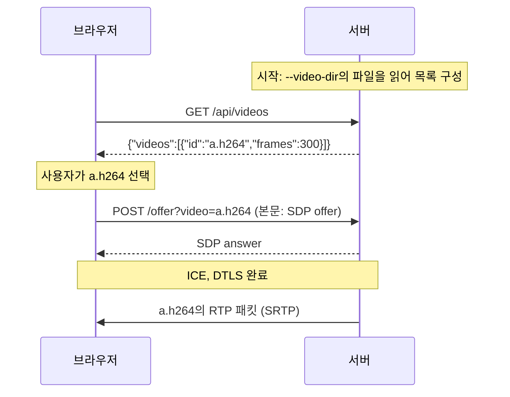

# Background

## 읽는 순서

1. 이 문서의 "전체 흐름"과 "HTTP 요청 대상과 쿼리 문자열"을 먼저 읽는다.
2. `proposal.md`에서 무엇이 바뀌는지 확인한다(특히 `--video-file` 제거).
3. `specs/`는 `video-file-source`(디렉터리 읽기) → `video-catalog`(목록 API) → `webrtc-signaling`(선택한 ID로 연결) → `rtp-video-streaming`(세션별 송신) → `http-server`(메서드 규칙) 순서로 읽는다.
4. 용어가 막히면 이 문서의 해당 절로 돌아온다. 그다음 `design.md`, `tasks.md`를 읽는다.

동영상 선택 기능의 흐름은 다음과 같다. 서버는 시작할 때 동영상 디렉터리의 파일들을 읽어 목록을 만든다. 웹 페이지는 그 목록을 JSON으로 받아 `select` 요소의 `option` 요소로 보여 준다. 사용자가 하나를 골라 연결하면, 페이지는 고른 ID를 offer 요청 주소의 쿼리 문자열에 실어 보낸다. 서버는 그 ID로 찾은 파일을 그 세션에만 보낸다.

## 개념

### 전체 흐름



### HTTP 요청 대상과 쿼리 문자열

**요청 대상(request target)**
- 정의: HTTP 요청 줄의 두 번째 칸. 예: `POST /offer?video=a.h264 HTTP/1.1`의 `/offer?video=a.h264`.
- 왜 필요한가: 서버는 이 값으로 어떤 처리를 할지(라우팅) 정한다.
- 동작: `?` 앞은 **경로**(path), 뒤는 **쿼리 문자열**(query string)이다. 지금 서버는 경로만 보고 정적 파일 또는 `/offer`를 고르며, 쿼리는 무시한다.
- 쓰이는 곳: 경로로 엔드포인트를 고르는 방식은 그대로 두고, `/offer`만 쿼리의 `video` 값을 추가로 읽는다(`webrtc-signaling` "Offer의 동영상 선택").

**쿼리 매개변수**
- 정의: 쿼리 문자열을 `&`로 나눈 `이름=값` 쌍 하나하나.
- 왜 필요한가: 요청 본문을 바꾸지 않고 짧은 선택 값을 덧붙일 수 있다. `/offer`의 본문은 이미 SDP(`application/sdp`)이므로, 동영상 ID를 본문에 섞으면 형식을 새로 정해야 한다.
- 예시: `video=a.h264&debug=1` → `video`는 `a.h264`, `debug`는 `1`. 서버는 `video` 외의 이름을 무시한다.
- 쓰이는 곳: `design.md` 결정 4.

**퍼센트 인코딩(percent-encoding)**
- 정의: URL에 그대로 쓸 수 없는 바이트를 `%`와 16진수 두 자리로 쓰는 방법.
- 왜 필요한가: `&`, `=`, `?`, 공백, 한글은 URL에서 구분자와 섞이거나 쓸 수 없다. 예를 들어 ID에 `&`가 들어 있으면 그대로 쓸 경우 매개변수 경계로 잘못 읽힌다.
- 동작: 문자를 UTF-8 바이트로 바꾼 뒤 바이트마다 `%XX`로 쓴다.

  | 원래 문자 | UTF-8 바이트 | 인코딩 결과 |
  |---|---|---|
  | `시` | `EC 8B 9C` | `%EC%8B%9C` |
  | 공백 | `20` | `%20` (폼 형식에서는 `+`) |
  | `/` | `2F` | `%2F` |
  | `&` | `26` | `%26` |

  디코딩은 반대로 한다. `%` 뒤에 16진수 두 자리가 없으면(`%zz`, 끝의 `%4`) 잘못된 인코딩이다.
- `+`와 공백: HTML 폼 형식(`application/x-www-form-urlencoded`)은 공백을 `+`로 쓴다. 브라우저의 `URLSearchParams`가 이 규칙으로 읽으므로 서버도 `+`를 공백으로 해석해 맞춘다.
- `encodeURIComponent`: 브라우저 JavaScript 함수. 영문자·숫자와 `-_.!~*'()`를 뺀 모든 문자를 퍼센트 인코딩한다. 그래서 ID 안의 `&`, `=`, `+`도 `%26`, `%3D`, `%2B`가 되어 경계와 섞이지 않는다.
- 쓰이는 곳: 페이지가 `encodeURIComponent`로 인코딩하고, 서버가 디코딩해 목록 ID와 비교한다(`webrtc-signaling` "Offer의 동영상 선택", "동영상 선택 오류").

**경로 순회(path traversal)**
- 정의: `../`처럼 상위 디렉터리를 가리키는 값으로 의도한 디렉터리 밖의 파일에 접근하는 공격.
- 왜 필요한가: 사용자가 보낸 값을 파일 경로에 이어 붙이면 `video=../../etc/passwd`로 임의 파일을 읽힐 수 있다.
- 쓰이는 곳: 받은 ID를 경로로 쓰지 않고, 시작할 때 만든 목록의 ID와 **같은지만** 비교한다. 목록에 없는 값은 모두 404가 되므로 경로 순회가 성립하지 않는다(`design.md` 결정 4).

### HTTP 메서드와 상태 코드

**GET과 POST**
- GET은 자원을 읽는 요청이며 보통 본문이 없다. POST는 서버에 데이터를 보내 처리를 요청한다.
- 쓰이는 곳: 목록 조회는 읽기만 하므로 `GET /api/videos`, 연결 요청은 offer를 보내므로 지금처럼 `POST /offer`다.

**405 Method Not Allowed와 `Allow` 헤더**
- 경로는 있지만 그 메서드를 지원하지 않을 때 쓰는 응답이다. `Allow` 헤더로 지원하는 메서드를 알린다. 예: `POST /api/videos` → `405`, `Allow: GET`.
- 쓰이는 곳: `http-server` "요청 오류 응답".

**400과 404의 구분**
- `400 Bad Request`: 요청 형식 자체가 잘못됨(잘못된 퍼센트 인코딩, `video` 중복).
- `404 Not Found`: 형식은 맞지만 가리키는 대상이 없음(목록에 없는 ID).
- 쓰이는 곳: 페이지와 테스트가 "요청을 잘못 만든 것"과 "없는 영상을 고른 것"을 구분할 수 있게 둘을 나눈다(`webrtc-signaling` "동영상 선택 오류").

### 웹 페이지의 HTML 요소와 동영상 ID

**DOM(Document Object Model)**
- 정의: 브라우저가 HTML을 읽어 메모리에 만드는 요소 트리. 화면은 이 트리를 그린 결과다.
- 왜 필요한가: HTML 파일을 바꾸지 않고도 JavaScript가 DOM에 요소를 넣거나 바꾸면 화면이 바로 다시 그려진다. 서버는 HTML이 아니라 JSON 데이터만 주면 된다.
- 쓰이는 곳: 페이지가 목록을 받아 `option` 요소를 만들어 넣는다(`design.md` 결정 7).

**`select`, `option`, `button` 요소**
- 정의: HTML 표준의 폼 컨트롤(form control). 동영상을 고르는 컨트롤은 `select` 요소, 그 항목은 `option` 요소, 산출물의 "연결 버튼"은 `button` 요소다.
- 동작:

  | | `select` 요소 | `button` 요소 |
  |---|---|---|
  | 역할 | 자식 `option` 요소 중 하나를 고르는 컨트롤 | 눌러서 동작을 일으키는 컨트롤 |
  | 상태 | `value`가 있음. 선택된 `option` 요소의 `value`다 | 고른 값이 없음 |
  | 주요 이벤트 | 선택이 바뀌면 `change` | 누르면 `click` |

  `select` 요소는 "무엇을"을, `button` 요소는 "언제"를 정한다. 사용자가 `option` 요소를 골라도 요청은 가지 않는다. `button` 요소의 `click` 이벤트에서 그 시점의 `select` 요소 `value`를 읽어 offer를 보낸다.
- `index.html`에는 `select` 요소만 두고, `option` 요소는 `app.js`가 목록을 받은 뒤 동영상 수만큼 만든다. 목록이 도착하기 전에 빈 `select` 요소가 보이지 않도록 "목록을 불러오는 중" `option` 요소 하나를 처음에 넣어 두며, 목록을 받으면 이것을 지우고 새로 채운다.
- 쓰이는 곳: `webrtc-signaling` "연결 상태 확인 웹 페이지", `design.md` 결정 7.

**HTML `id` 속성과 동영상 ID**
- 둘은 이름만 비슷하고 다른 값이다.

  | | HTML `id` 속성 | 동영상 ID |
  |---|---|---|
  | 예 | `<select id="video-select">`의 `video-select` | `"id":"시험.h264"`의 `시험.h264` |
  | 정하는 곳 | 페이지 작성자가 HTML에 적음 | 서버가 파일 이름으로 정해 `/api/videos`로 보냄 |
  | 개수 | 요소마다 하나. `select` 요소에는 하나뿐 | 동영상 수만큼 |
  | 용도 | JavaScript가 `getElementById`로 요소를 찾음 | 서버에 어느 동영상인지 알림 |

- 페이지는 동영상 ID를 만들지 않고 받은 값을 그대로 쓴다. 동영상마다 `option` 요소 하나를 만들고, 그 `value`(서버로 보낼 값)와 `textContent`(화면에 보일 글자)에 동영상 ID를 넣는다.
- `textContent`를 쓰는 이유: `innerHTML`에 파일 이름을 넣으면 `.h264` 같은 이름이 HTML로 해석되어 스크립트가 실행될 수 있다(XSS). `textContent`는 항상 글자로만 넣는다.
- 동영상 ID를 URL에 넣을 때 인코딩하는 이유는 "퍼센트 인코딩" 항목을 따른다. 예를 들어 `a&b.h264`를 그대로 붙이면 `&`에서 잘리고, `a#1.h264`는 `#` 뒤가 서버로 전송되지 않는다.
- 쓰이는 곳: `video-catalog` "동영상 목록 조회", `webrtc-signaling` "Offer의 동영상 선택".

### 텍스트 인코딩과 JSON

**UTF-8**
- 정의: 유니코드 문자를 1~4바이트로 쓰는 인코딩. 리눅스 파일 이름과 웹은 보통 UTF-8을 쓴다.
- 동작: 첫 바이트의 상위 비트로 길이를 나타낸다.

  | 코드 포인트 범위 | 바이트 수 | 비트 배치 |
  |---|---|---|
  | U+0000~U+007F | 1 | `0xxxxxxx` |
  | U+0080~U+07FF | 2 | `110xxxxx 10xxxxxx` |
  | U+0800~U+FFFF | 3 | `1110xxxx 10xxxxxx 10xxxxxx` |
  | U+10000~U+10FFFF | 4 | `11110xxx 10xxxxxx 10xxxxxx 10xxxxxx` |

  예: `시`(U+C2DC) → `EC 8B 9C`.
- 유효하지 않은 UTF-8:
  - **잘린 시퀀스**: 첫 바이트가 약속한 바이트 수보다 실제 바이트가 모자람. 문자를 반만 보낸 상태라 어떤 문자인지 정할 수 없다.

    ```text
    '시' = EC 8B 9C
    EC = 1110 1100  → "1110"으로 시작 = 3바이트 문자의 첫 바이트
    8B = 10 001011  → 이어지는 바이트("10"으로 시작)
    9C = 10 011100  → 이어지는 바이트
    ```

    | 바이트열 | 판정 |
    |---|---|
    | `EC 8B 9C` | 3바이트 약속, 3바이트 있음 → `시` |
    | `EC 8B` | 3바이트 약속, 2바이트에서 끝남 → 잘린 시퀀스, 무효 |
    | `EC 41` | 두 번째 바이트가 `10`으로 시작하지 않음 → 무효 |

  - **과잉 표현(overlong)**: 더 짧게 쓸 수 있는 문자를 긴 틀에 억지로 넣은 바이트열. 정상적인 프로그램은 만들지 않고, 누군가 일부러 만든 값이다. 비트를 계산하면 같은 값이 나오지만, UTF-8 규격은 가장 짧은 형식만 유효하다고 정한다.

    ```text
    '/' = 0x2F
    1바이트(정상):  0 0101111            → 2F
    2바이트(과잉):  110 00000  10 101111 → C0 AF   (00000 + 101111 = 0x2F)
    ```

    금지하는 이유는 보안이다. "경로에 `/`가 있으면 막는다"는 검사가 `2F` 바이트만 찾으면, 공격자가 `C0 AF`를 보내 검사를 통과한 뒤 다른 단계에서 `/`로 해석되게 할 수 있다. 실제로 웹 서버의 경로 순회 공격에 쓰인 적이 있다.
  - **서로게이트(U+D800~U+DFFF)**: UTF-16 전용 범위라 UTF-8에 나오면 안 된다.
  - **U+10FFFF 초과**: 유니코드 범위 밖이다.
- 퍼센트 인코딩 오류와의 구분: 둘은 서로 다른 층의 오류다.
  - `%zz`는 `%` 뒤가 16진수가 아니어서 **바이트로 바꿀 수조차 없는** 퍼센트 인코딩 오류다.
  - `%C0%AF`, `%EC%8B`는 바이트로는 바뀌지만, 그 바이트열이 유효한 문자가 아닌 **UTF-8 오류**다.
- 검사하는 곳:
  - 파일 이름을 목록에 넣을 때: UTF-8 검사로 위의 무효 형태를 모두 거부한다. 그런 이름의 파일은 목록에 들어가지 않는다.
  - 쿼리 값 `video`: 퍼센트 인코딩 오류만 `400`으로 거부하고, UTF-8 검사는 하지 않는다. 디코딩한 바이트열을 문자나 경로로 해석하지 않고 목록 ID와 바이트 단위로 비교만 하므로, `%C0%AF`가 `/`로 받아들여지는 일은 없다. 목록 ID는 모두 유효한 UTF-8이라 무효한 바이트열은 어떤 ID와도 같지 않아 `404`가 된다.
- 왜 필요한가: 파일 이름 중에는 UTF-8이 아닌 것도 있을 수 있는데, JSON에는 그런 이름을 올바르게 담을 수 없다.
  - 리눅스 커널은 파일 이름을 문자가 아닌 바이트열로 저장하며, `/`(경로 구분자)와 NUL(문자열 끝)만 금지한다. 어떤 인코딩으로 읽을지는 환경의 약속일 뿐이다. 그래서 Windows에서 만든 zip을 풀 때처럼 옛 한글 인코딩(CP949) 이름이 들어올 수 있다. 예: "시험"은 UTF-8로 `EC 8B 9C ED 97 98`, CP949로 `BD C3 C7 E8`이고, 후자는 첫 바이트 `BD`가 이어지는 바이트(`10`으로 시작)라 UTF-8로는 무효다.
  - JSON 텍스트는 UTF-8이어야 한다(RFC 8259 8.1). 무효한 바이트를 그대로 보내면 브라우저가 `�`(U+FFFD)로 바꾸어 깨진 이름이 표시된다. 사용자가 그 항목을 고르면 바뀐 바이트(`EF BF BD`)가 서버로 가므로 원래 이름과 맞지 않아 `404`가 된다. 목록에는 보이지만 재생할 수 없는 항목이 생기는 것이다. `\uXXXX`는 문자 번호를 적는 표기라 임의의 바이트를 표현할 수 없다.
  - 그래서 UTF-8이 아닌 이름은 목록에 넣지 않고 경고를 남긴다. 파일 이름을 UTF-8로 바꾸면(예: `convmv -f cp949 -t utf-8 --notest <파일>`) 목록에 나온다.
- 쓰이는 곳: `video-file-source` "잘못된 파일 건너뛰기", `design.md` 결정 6.

**JSON 문자열 이스케이프**
- 정의: JSON 문자열 안에 그대로 쓸 수 없는 문자를 `\`로 시작하는 표기로 바꾸는 규칙.
- 동작: `"` → `\"`, `\` → `\\`, U+0020 미만 제어 문자 → `\u00XX`(예: U+0001 → `\u0001`). 나머지 유효한 UTF-8 문자는 그대로 써도 된다.
- 예시: 파일 이름 `시험 "1".h264` → `"시험 \"1\".h264"`.
- 쓰이는 곳: `video-catalog` "동영상 ID 표기".

**바이트 순서 정렬**
- 정의: 문자열을 UTF-8 바이트 값의 사전 순서로 정렬하는 것.
- 왜 필요한가: 디렉터리를 읽는 순서는 파일 시스템마다 다르다. 정렬해야 목록 순서와 합계 상한에서 어느 파일이 빠질지가 항상 같다.
- 예시: 대문자(`0x41~0x5A`)가 소문자(`0x61~0x7A`)보다 앞이므로 `A.264`가 `b.h264`보다 앞이다. 한글(`0xEA` 이상으로 시작)은 영문 뒤에 온다. 사람이 기대하는 "자연스러운" 순서(대소문자 무시, `2` < `10`)와는 다를 수 있다.
- 쓰이는 곳: `video-file-source` "동영상 목록 구성".

### 파일 시스템

**심볼릭 링크**
- 정의: 다른 경로를 가리키는 특수 파일.
- 동작: 대상이 일반 파일이면 그 파일처럼 읽을 수 있다. 대상이 없으면(끊어진 링크) 열 때 실패한다.
- 쓰이는 곳: 링크는 가리키는 대상으로 판단한다. 다른 곳에 있는 영상을 링크로 디렉터리에 넣어 쓸 수 있고, 끊어진 링크는 "열 수 없음" 경고 후 건너뛴다(`video-file-source` "동영상 목록 구성", "Annex-B 파일 읽기").

### 동영상 파일과 재생 속도 (복습)

**Annex-B H.264 파일**
- 정의: H.264 NAL 단위를 시작 코드(`00 00 01` 또는 `00 00 00 01`)로 이어 붙인 원시 스트림. 컨테이너(MP4 등)가 없다.
- 첫 프레임에 **SPS·PPS**(디코더 설정)와 **IDR**(앞 프레임 없이 디코딩할 수 있는 프레임)이 있어야 브라우저가 처음부터 화면을 그린다.
- 쓰이는 곳: 이 검증에 실패한 파일은 서버를 멈추지 않고 건너뛴다(`video-file-source` "재생 시작 조건 검증").

**fps와 컨테이너가 없는 파일**
- 원시 스트림에는 프레임마다의 재생 시각이 없다. SPS 안의 선택 항목(VUI `timing_info`)에 fps를 넣을 수는 있지만 없을 수도 있고, 읽으려면 비트 단위 해석이 필요하다.
- 쓰이는 곳: 그래서 `--video-fps` 하나를 모든 파일에 쓰고, 파일별 fps는 이후 마일스톤으로 미룬다(`design.md` Risks).

### 호환되지 않는 변경

**BREAKING CHANGE**
- 정의: 기존 사용 방식이 더 이상 동작하지 않는 변경. 이 프로젝트는 커밋 타입 뒤에 `!`를 붙여 표시한다.
- 쓰이는 곳: `--video-file`을 쓰는 실행 명령은 "알 수 없는 인자"로 시작하지 않는다. 그 파일이 든 디렉터리를 `--video-dir`로 지정한다(`proposal.md` What Changes).

## 참고 문서

| 용어 | 문서 | 절 |
| --- | --- | --- |
| 요청 대상, 경로, 쿼리 | RFC 9112 HTTP/1.1 | 3.2 Request Target |
| URI 구문, 퍼센트 인코딩 | RFC 3986 URI Generic Syntax | 2.1 Percent-Encoding, 3.4 Query |
| 폼 형식 쿼리(`+` = 공백) | WHATWG URL Standard | 5.1 application/x-www-form-urlencoded parsing |
| `encodeURIComponent` | ECMAScript Language Specification | 19.2.6.5 encodeURIComponent |
| DOM | WHATWG DOM Standard | 4 Nodes |
| `select`, `option`, `button` 요소 | WHATWG HTML Living Standard | 4.10.7, 4.10.10, 4.10.6 |
| `id` 속성 | WHATWG HTML Living Standard | 3.2.6 Global attributes |
| `textContent` | WHATWG DOM Standard | 4.4 Interface Node |
| GET, POST, 400, 404, 405, `Allow` | RFC 9110 HTTP Semantics | 9.3.1, 9.3.3, 10.2.1, 15.5.1, 15.5.5, 15.5.6 |
| UTF-8, 과잉 표현, 서로게이트 | RFC 3629 UTF-8 | 3 UTF-8 definition, 4 Syntax, 10 Security Considerations |
| JSON 문자열 이스케이프 | RFC 8259 JSON | 7 Strings, 8.1 Character Encoding |
| `std::filesystem` 오류 코드 오버로드 | cppreference `std::filesystem::directory_iterator` | 생성자·`increment` |
| Annex-B, SPS·PPS·IDR, VUI | ITU-T H.264 | 부록 B, 7.3.2.1, 부록 E |
