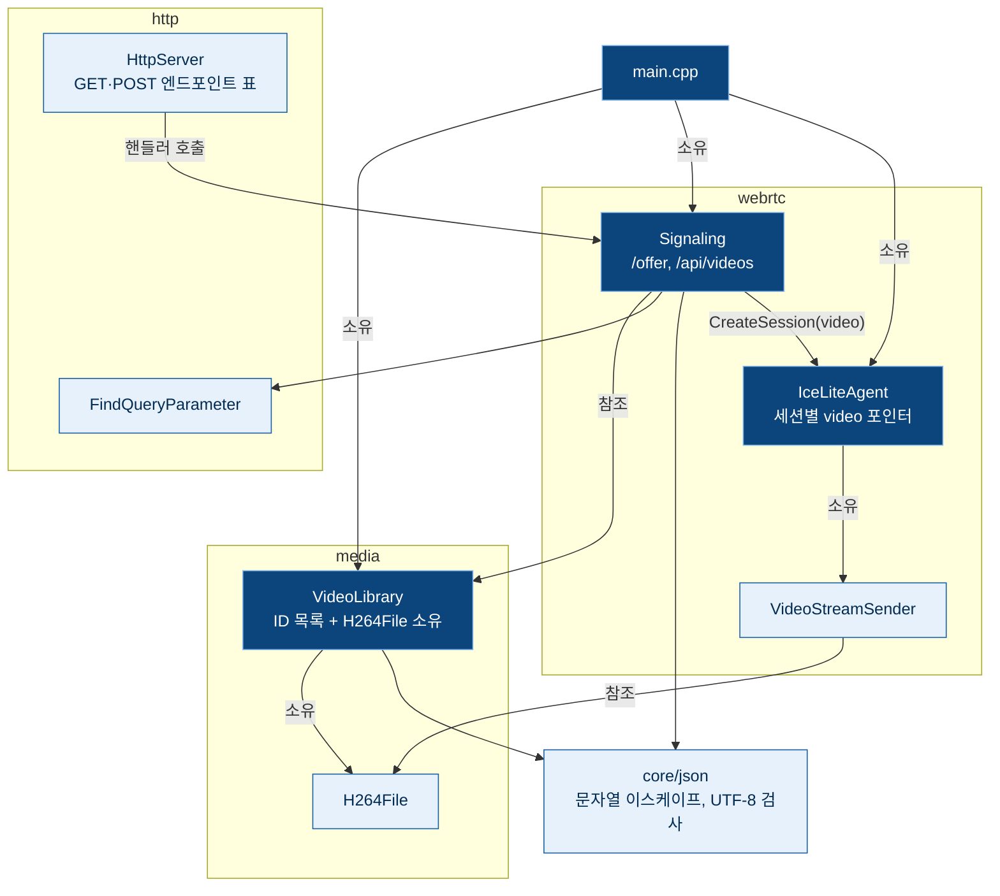

# Design

## Context

변경 이유는 proposal.md "Why"를 따른다. 요구 동작은 이 change의 `specs/`(`video-catalog`, `video-file-source`, `http-server`, `webrtc-signaling`, `rtp-video-streaming`)를 따른다.

현재 상태:

- `main.cpp`가 `--video-file`의 `H264File` 하나를 읽고, `IceLiteAgentConfig::video_file`(포인터)과 `video_fps`로 에이전트에 넘긴다.
  - 에이전트는 DTLS가 완료되면 `StartVideoStream`에서 `video_file_`이 있으면 모든 세션에 같은 파일을 보낸다.
- `VideoStreamSender`는 `const H264File&`을 참조만 한다. `H264File`은 이동해도 버퍼 주소가 유지되고, 복사는 금지되어 있다.
- `HttpServer`는 `HttpPostHandlers`(경로 → POST 핸들러)만 받는다. 표에 없는 경로는 모두 GET 정적 파일로 처리한다.
  - `Allow` 헤더도 "POST 표에 있으면 POST, 아니면 GET"으로 정한다.
- 라우팅은 `?` 앞의 경로만 쓰고, 원래 요청 대상은 `HttpRequest::target`에 남아 있다.
- JSON 처리 코드는 없다.

제약:

- C++23, `-fno-exceptions`. `std::filesystem`은 `std::error_code`를 받는 오버로드만 쓴다.
- 서버는 단일 스레드이며, HTTP 핸들러는 이벤트 루프에서 동기로 호출된다.

## Goals / Non-Goals

**Goals:**

- 동영상 목록을 시작할 때 한 번 만들고, 이후 모든 조회(목록 API, offer의 ID 찾기, 송신)가 같은 목록을 읽기 전용으로 공유한다.
- 디렉터리 읽기와 파일별 건너뛰기 판단을 `main.cpp`가 아닌 `media`에 두어 단위 테스트로 검증한다.
- 세션이 "자기 동영상"을 가지게 하여, 이후 카메라 같은 다른 소스도 세션에 지정할 수 있는 자리를 만든다.

**Non-Goals:**

- 범용 JSON 파서·생성기. 이 change는 문자열 이스케이프와 UTF-8 검사만 필요하다.
- 범용 URL 파서. 쿼리 매개변수 하나를 찾는 기능만 만든다. 경로의 퍼센트 인코딩은 지금처럼 해석하지 않는다.
- 동영상 소스의 추상 인터페이스. 소스 종류가 H.264 파일 하나뿐이므로, 카메라가 들어올 때 공통 인터페이스를 정한다.

## Decisions

### 1. 구성 요소와 소유 관계

| 위치 | 내용 | 의존 |
|---|---|---|
| `src/media/video_library.h/.cpp` | 디렉터리 읽기, 건너뛰기 판단, ID로 찾기 | `media/h264_file`, `core/json` |
| `src/http/query_string.h/.cpp` | 요청 대상에서 쿼리 매개변수 하나 찾기, 퍼센트 디코딩 | 없음 |
| `src/core/json.h/.cpp` | JSON 문자열 이스케이프, UTF-8 검사 | 없음 |

- `VideoLibrary`는 `std::vector<VideoEntry>`(ID 문자열 + `H264File`)를 소유한다. 시작할 때 만든 뒤 바꾸지 않으므로, 원소의 `H264File` 주소와 그 프레임 뷰는 `VideoLibrary`가 살아 있는 동안 유효하다.
- `main.cpp`는 `VideoLibrary`를 에이전트와 `Signaling`보다 먼저 만든다. 소멸이 선언 역순이므로 송신 상태가 파일보다 먼저 사라진다. 지금 `std::optional<H264File>`을 두는 자리를 그대로 쓴다.
- 대안: 세션이 `std::shared_ptr<const H264File>`을 가지게 하는 방법. 실행 중 목록 갱신이 범위 밖이어서 공유 소유가 필요 없고, 기존 `VideoStreamSender`의 참조 설계를 바꾸지 않는 쪽을 택했다.

### 2. 디렉터리 읽기와 건너뛰기

`VideoLibrary::LoadDirectory(directory, limits)`는 `std::expected<VideoLibraryLoadResult, std::string>`을 돌려준다.

- 성공 값은 목록과 함께 건너뛴 파일의 경고 문구 목록을 담는다. 로그 출력은 `main.cpp`가 한다. `H264File::Load`처럼 `media`가 표준 오류에 직접 쓰지 않아야 테스트에서 경고 내용을 확인할 수 있기 때문이다.
- 오류는 디렉터리를 열 수 없음, 디렉터리가 아님, 쓸 수 있는 파일이 없음 세 가지다.
- 처리 순서:
  1. `directory_iterator`로 항목 이름을 모으고 확장자(대소문자 무시)로 거른다. 순회 중 오류가 나면 전체 오류로 처리한다.
  2. 이름을 바이트 순서로 정렬한다. 순회 순서는 파일 시스템마다 달라서, 정렬해야 목록과 합계 상한의 결과가 일정하다.
  3. 이름마다 디렉터리 여부(심볼릭 링크는 대상 기준), UTF-8 여부, 파일 크기와 남은 합계, `H264File::Load` 순서로 검사한다. 크기를 먼저 보면 상한을 넘는 파일을 읽지 않고 건너뛸 수 있다.
- 한도는 `VideoLibraryLimits{max_total_bytes = 256MiB}`로 받는다. 테스트가 작은 값으로 합계 상한을 재현하기 위해서다. 파일당 상한은 기존 `kMaxH264FileSize`를 그대로 쓴다.
- 합계에는 실제로 목록에 넣은 파일의 크기만 더한다. 검증에 실패한 파일은 메모리에 남지 않기 때문이다.
- 목록 크기만큼의 선형 탐색으로 ID를 찾는다. 목록이 수십 개 규모이고 offer마다 한 번만 찾기 때문이다.

### 3. HTTP GET 엔드포인트

- `HttpGetHandler = std::move_only_function<HttpEndpointResponse(const HttpRequest&)>`와 `HttpGetHandlers` 표를 추가한다.
- `HttpServer::Start(loop, config, HttpEndpoints endpoints)`로 바꾸고, `HttpEndpoints{get, post}`가 두 표를 묶는다. 인자를 하나 더 늘리는 것보다 이후 엔드포인트가 늘어날 때 호출부가 덜 바뀐다.
- 라우팅 순서: POST 표 → GET 표 → 정적 파일. 경로가 어느 표에 있는지로 허용 메서드를 정하고, 어디에도 없으면 정적 파일(GET)이다.
  - 같은 경로가 두 표에 함께 있는 경우는 지원하지 않는다. `Start`에서 확인하지 않고 주석으로 전제를 밝힌다(등록은 `main.cpp` 한 곳뿐이다).
- 대안: `/api/videos.json` 같은 정적 파일을 시작할 때 웹 루트에 쓰는 방법. 웹 루트에 쓰기 권한이 필요하고, 이후 카메라 상태처럼 바뀌는 목록에 쓸 수 없어 택하지 않았다.

### 4. 쿼리 매개변수 해석

`http::FindQueryParameter(target, name)`은 `std::expected<std::optional<std::string>, QueryParameterError>`를 돌려준다.

- `?` 뒤를 `&`로 나누고, 각 쌍의 이름과 값을 퍼센트 디코딩(`+`는 공백)한 뒤 이름을 비교한다. 브라우저의 `URLSearchParams`와 같은 해석이다.
- `=`가 없는 쌍은 값이 빈 문자열인 것으로 본다.
- 이름이 같은 쌍이 두 번 이상이면 `kDuplicate`, `%` 뒤에 16진수 두 자리가 없으면 `kInvalidEncoding` 오류다.
  - 다른 이름의 쌍에 있는 잘못된 인코딩도 오류로 본다. 쿼리 전체를 한 번에 검사하는 쪽이 규칙이 단순하다.
- 디코딩 결과의 UTF-8 유효성은 보지 않는다. 목록 ID는 모두 유효한 UTF-8이므로, 잘못된 바이트열은 어떤 ID와도 같지 않아 404가 된다.
- 디코딩한 값은 목록 ID와 비교만 하고 파일 경로로 쓰지 않는다. 그래서 `../` 같은 값을 따로 거르지 않아도 디렉터리 밖에 접근할 수 없다.

### 5. 시그널링과 세션의 동영상

- `Signaling`이 `const media::VideoLibrary&`를 추가로 참조한다.
  - `HandleOffer`: `Content-Type` 검사 → `video` 해석(400/404) → SDP 검증(400) → 세션 생성. 동영상 검사를 SDP보다 먼저 하는 이유는 SDP 해석보다 비용이 작고, 실패 원인을 구분하기 쉬워서다.
  - `HandleVideoList`: `GET /api/videos` 핸들러. 목록을 JSON으로 만든다.
- `IceSessionRequest`에 `const media::H264File* video`와 로그용 `std::string_view video_id`를 추가한다. 세션 구조체가 둘을 보관한다(ID는 `std::string`으로 복사).
- `IceLiteAgentConfig::video_file`을 지우고 `video_fps`만 남긴다. `StartVideoStream`은 에이전트의 `video_file_` 대신 세션의 `video`를 보고, 없으면 지금처럼 송신하지 않는다.
- 목록 API 핸들러를 `Signaling`에 두는 이유: `/offer`와 `/api/videos`가 모두 같은 목록을 HTTP에 노출하는 웹 API이고, 지금 웹 API 핸들러가 모인 곳이 `Signaling`이다. 엔드포인트가 더 늘면 웹 API 계층을 따로 나눈다.

### 6. JSON 출력

- `core::IsValidUtf8(std::string_view)`: 과잉 표현(overlong), 서로게이트 범위(U+D800~DFFF), U+10FFFF 초과를 거부하는 엄격한 검사. 이 검사를 통과한 이름만 목록에 넣으므로 JSON 출력이 항상 유효하다.
- `core::AppendJsonString(std::string& out, std::string_view text)`: 앞뒤 `"`를 포함해 이스케이프한 문자열을 덧붙인다. `"`, `\`, U+0020 미만만 바꾸고 나머지 바이트는 그대로 둔다.
- 목록 응답은 공백 없이 한 줄로 만든다. `Content-Type`은 기존 `.json` 파일 응답과 같은 `application/json`이다.

### 7. 웹 페이지

- 연결 버튼 앞에 `<select id="video-select">`를 둔다. 페이지가 로드되면 `fetch("/api/videos")`로 목록을 채운다.
- 목록이 비었거나 요청이 실패하면 값이 빈 `<option>` 하나("동영상 없음" 또는 "목록을 불러오지 못함")를 두고 `select` 요소를 비활성화한다. 연결할 때 선택 값이 비었으면 쿼리를 붙이지 않는다.
- 연결 요청 주소는 `` `/offer?video=${encodeURIComponent(id)}` ``다.
- 연결 버튼은 비활성 상태로 시작하고, 목록 요청이 끝나면(성공·실패 모두) 활성화한다. 목록이 도착하기 전에 누르면 안내 `<option>`의 빈 값으로 동영상 없이 연결되어, 영상이 나오지 않는 이유를 알 수 없기 때문이다.

## Risks / Trade-offs

- [시작 시 모든 파일을 메모리에 읽음] 파일 수가 많으면 시작이 느리고 메모리를 많이 쓴다. → 합계 256MiB 상한과 파일별 로그로 원인을 드러낸다. 요청할 때 읽는 방식은 실행 중 목록 갱신과 함께 이후 마일스톤에서 다룬다.
- [모든 파일에 같은 fps] 30fps가 아닌 파일은 빠르거나 느리게 재생된다. → README에 "같은 fps로 만든 파일만 둔다"고 적는다.
- [파일 SPS와 answer 코덱 불일치] 파일마다 프로파일이 달라도 answer는 같은 규칙으로 코덱을 고른다. → 기존 change와 같은 제약이다. README의 ffmpeg 명령(baseline)으로 만든 파일을 쓴다.
- [`--video-file` 제거] 기존 실행 명령이 동작하지 않는다. → 오류 문구에 사용법이 함께 나오고, README와 통합 테스트를 같은 커밋에서 바꾼다.
- [`/api/videos`가 웹 루트의 같은 경로 파일을 가림] → `http-server` 명세에 우선순위를 적었다. 웹 루트에 `api/` 디렉터리를 두지 않는다.

## Migration Plan

- 실행 명령의 `--video-file <디렉터리>/<파일>`을 `--video-dir <디렉터리>`로 바꾸고, 페이지에서 그 파일을 고른다.
- 되돌리려면 이 change의 커밋을 되돌린다. 저장 데이터나 형식 변경은 없다.
